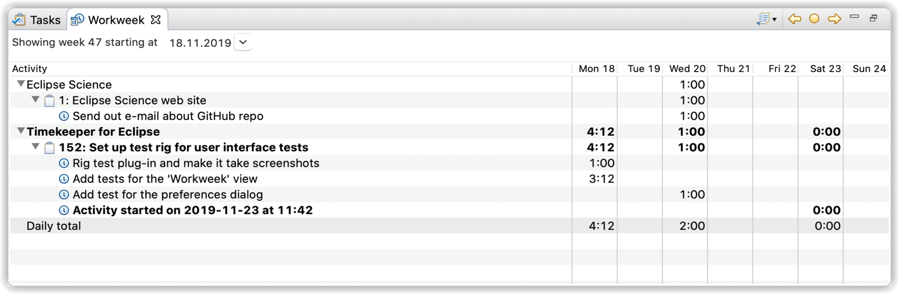
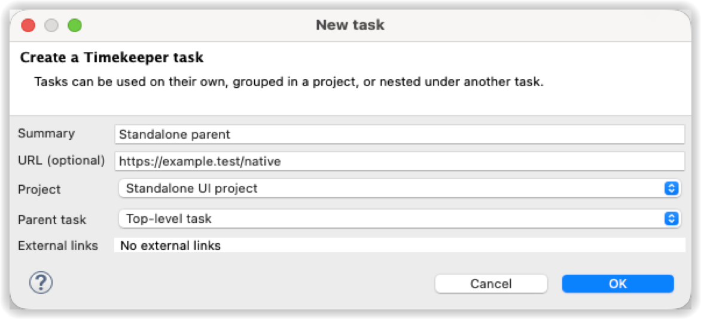
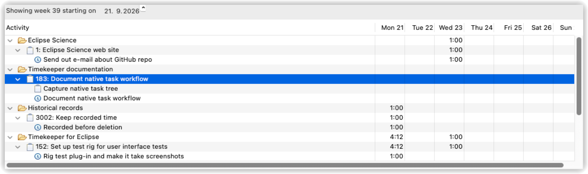
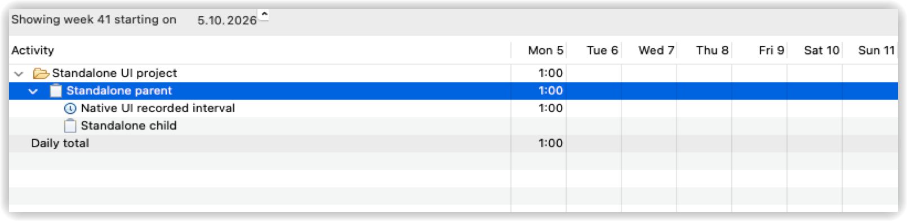
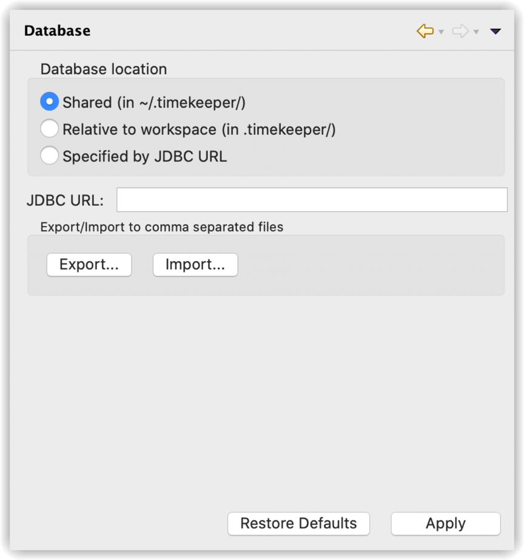

# Timekeeper for Eclipse 

Timekeeper tracks time on native Eclipse projects and tasks. Optional
[Eclipse Mylyn](https://eclipse.org/mylyn/) integration also tracks local and
connector-backed tasks.

With the optional integration installed, whenever a task is *activated* in Mylyn it will automatically show up in the **Workweek** view with a bold label, and the amount of time the task is active will be tracked. An *activity* will be added to the task, which is the entity keeping track of the time and a short note. Multiple activities can be added to each task.

When the task is *deactivated* the end time is registered on the activity and the active time is added to the total for the task on the particular day. It is also possible to manually edit the start and stop times by clicking into the cell.

The context menu and toolbar buttons can be used to browse back and forward by one week. The current locale is used to determine week numbers. Left of the navigation buttons there is a button for copying and exporting the displayed workweek in various formats. The export definitions can be modified or new ones can be added using [Freemarker](https://freemarker.apache.org) templates found in the preference settings. 

See the <a href="../../wiki">wiki</a>  for more about usage.

## Native Timekeeper tasks

Use the **Workweek** toolbar to create a **New project...** or **New task...**.
Right-click a project or task to edit or delete it. A task has a summary, an
optional URL and project, and an optional parent task in that project. Use
**New subtask...** on a task to extend its hierarchy. Editing a task lets you
move it between projects or choose **No project** for an independent task;
move or delete its subtasks first before moving their parent to another project.

These records belong to Timekeeper and are available before any time has been
recorded. Creating them does not create a Mylyn task or category. To also show
new native records in Mylyn, enable **Show new Timekeeper projects and tasks in
Mylyn Task List** in **Preferences > Timekeeper**. Existing Task List projections
continue to synchronize when that option is off.

With **Timekeeper Mylyn integration** installed, the standard Mylyn **Task List** is also supported: categories represent
projects, local tasks represent root tasks, and nested local tasks represent
subtasks. Creating, renaming, or moving those objects synchronizes their native
Timekeeper records without requiring a repository connector.

Activate a linked local task through Mylyn as usual, or start an activity
directly in Workweek. Native tasks participate in weekly totals,
reports, and CSV export alongside connector-backed tasks.

In Workweek, right-click a task and choose **New activity** to record time on
any date. Enter start and end as `yyyy-MM-dd HH:mm` in the Eclipse host time
zone, along with a summary and labels. Use **Start activity** for a new ongoing
interval, then **Stop activity** on that interval. **Edit activity...** changes
its dates, times, summary and labels; completed intervals can be deleted.
These operations also work when a linked Mylyn task is unavailable. Timekeeper
reports a conflict if another interval is already open or a record changed
while it was being edited.

Native projects and tasks can be renamed or deleted in Workweek or Task List. Delete
activities and subtasks before deleting their task, then remove its tasks
before deleting the project; recorded history is preserved if deletion is
refused. See the [native project/activity UI verification](baseline/STANDALONE-ACTIVITY-UI.md).

The data is stored in an H2 SQL database, mapped to POJOs using the Java Persistence API with EclipseLink. Reports are generated using Apache FreeMarker. The database has an explicit schema version and initialization state; historical data migration is not supported.

In the 2.0 data model, a Timekeeper task has its own UUID and can be created,
edited and persisted without Eclipse. The Eclipse projection stores that UUID
on its Mylyn local task; it is not an external connector identity. Jira, GitHub
and future providers are optional external references, and each
provider/repository/task tuple can be linked to only one Timekeeper task.
Recorded activities carry an explicit owner identity. The embedded Eclipse
client uses the stable owner `local`, while a future service can supply
authenticated user or service identities.

Activity and heartbeat timestamps are stored as UTC instants. Calendar operations
such as day and workweek totals require an explicit time zone; the Eclipse client
uses the host system zone. This keeps persisted data independent of the process
time zone while making daylight-saving and week-boundary behavior deterministic.

## Jira connector

Jira is available through **Timekeeper Mylyn integration** and the separate
[JiraConnector](https://github.com/gnl42/JiraConnector) plugin. Keep the Eclipse
2026-09 dependency site enabled, install the optional Timekeeper feature, then
add `https://gnl42.github.io/JiraConnector-update/` in **Help > Install New
Software...** and select **Mylyn Tasks Connector: Jira**. Restart Eclipse before
adding a Jira repository in **Task Repositories**. Timekeeper does not handle
Jira credentials; use the connector's repository settings.

The compatibility candidate is JiraConnector **6.0.0.202605160149** on Java 21,
Eclipse 4.41 and Mylyn 4.12. Installation and Timekeeper metadata/tracking
fixtures are verified; live Jira Cloud/Data Center queries and authentication
remain unverified. The known Mylyn theme-parser Error Log entry also remains
open. See the [Jira acceptance report](baseline/JIRA-COMPATIBILITY.md).

The Jira repository settings include a **Timekeeper** section. New issues are
grouped by **Jira project**, **Mylyn category**, or a **Custom field**. Enter a
custom field ID such as `customfield_10001`, or its full Mylyn attribute ID,
`attribute.jira.custom::customfield_10001`. Project and option display names
are used rather than numeric values; a missing, empty or unavailable field
groups the issue under **None**. Existing Timekeeper project assignments are
preserved when grouping settings change.

Workweek displays the Jira issue key, such as `TK-42`, while the numeric issue
ID preserves its Timekeeper identity when an issue is moved or renamed. If the
issue disappears from Task List, the optional adapter can still derive its key
from the stored Jira browse URL. Recorded time remains editable and available
to labels, reports and CSV export. Timekeeper activities are not sent to Jira
worklogs.

## Database configuration

The Database configuration page in preferences (**Timekeeper > Database**) allows you to configure where the database for the running Eclipse instance should be kept. The default is to place it in the shared location, under `.timekeeper` in your home folder. But you can also use a workspace relative path, or even a H2 server if you have one running.

Multiple instances of the Timekeeper can share the database as it utilizes a H2 feature called mixed mode. This will automatically start a server instance on port 9090 if more connections are needed.

The Eclipse 2026-09 upgrade uses **H2 2.5.250 with schema version 2** as its
supported database baseline. Start with new storage; historical H2 files,
unversioned databases and old Mylyn attribute records are not imported.
Schema versioning and guarded migration-target infrastructure are retained for
future migrations, but there are no active migration recipes or recovery buttons.
See the [complete data model and ER diagram](DATA-MODEL.md) and the
[database policy, backups and future migration contract](DATABASE-RECOVERY.md).

Keep unsupported databases intact and select a separate empty location. CSV
Export/Import now targets the current project, task, activity, external-reference
and relation tables, including native task hierarchy, but it remains a
convenience interchange format rather than a database backup, migration or
rollback mechanism.

## Installing

Published releases are hosted on GitHub Pages. In **Help > Install New
Software... > Add...**, use this stable update-site URL:

    https://turesheim.github.io/eclipse-timekeeper/updates/

The site becomes installable when the first release using the new publication
workflow is published. Prereleases use a separate opt-in channel:

    https://turesheim.github.io/eclipse-timekeeper/updates/preview/

For a specific release, use `updates/releases/<tag>/` under the same base URL,
for example `https://turesheim.github.io/eclipse-timekeeper/updates/releases/v2.0.0/`.
Each release also provides a `timekeeper-p2.zip` asset and SHA-256 checksum on
[GitHub Releases](https://github.com/turesheim/eclipse-timekeeper/releases).
Download the ZIP and select **Add... > Archive...**, or extract it and select
**Add... > Local...**. These assets do not require a GitHub login to download.

Before publication, candidate builds remain available as the `p2-repository`
artifact from [GitHub Actions](https://github.com/turesheim/eclipse-timekeeper/actions/workflows/build.yml).
Extract the artifact and select **Add... > Local...**. The older public release
is also listed on the [Eclipse Marketplace](https://marketplace.eclipse.org/content/timekeeper-eclipse).
See [release publication](RELEASING.md) for the workflow and retry procedure.

Timekeeper 2.0.0 requires Eclipse 2026-09 (4.41) and Java 21. Select
**Timekeeper for Eclipse** for native project, task and activity management.
Mylyn is optional. Select **Timekeeper Mylyn integration** as well to track
Mylyn task activation and use Task List projections. The integration requires
Mylyn Tasks 4.12; keep the Eclipse 2026-09 software site enabled so p2 can
resolve its complete feature. Repository connectors such as Bugzilla are optional.

The base UI, domain, client API and database contain no Mylyn API dependencies.
Idle-time corrections use the client API for native and linked tasks. Returning
from an extended absence stops tracking when **Automatically stop tracking when
away** is enabled; otherwise it starts a new interval after excluding idle time.
Open activities are owned by Timekeeper and remain open across restart, even if
a linked provider task is absent or inactive. Stop or edit those intervals in
Workweek when needed.

Earlier release candidate builds were installed and updated in a clean Eclipse
4.41 runtime on macOS Apple Silicon. The optional-adapter split is additionally
verified in separate Eclipse test runtimes with and without Mylyn. See the [installed-IDE acceptance
report](baseline/INSTALLED-IDE.md) for the verified behavior and the remaining
upstream Mylyn Error Log blocker. This is not yet a release certification.

## Supported environments

Timekeeper 2.0.0 targets Eclipse 2026-09 (4.41) on Java 21. The following
environments have direct acceptance evidence:

- macOS on Apple Silicon: clean build, installation, update, restart, data,
  manual-editing and native idle-detection checks;
- Linux x86_64 with X11: the complete automated build and UI suite under Xvfb;
- Windows x86_64: clean build, persistence tests and a native idle-detection
  smoke test.

macOS x86_64 and Linux aarch64 are build targets but have not received installed
runtime acceptance. Native idle detection is unavailable in a pure Wayland
session; it requires X11 or a usable XWayland `DISPLAY` with XScreenSaver. See
the [platform acceptance report](baseline/PLATFORM-ACCEPTANCE.md) for the full
support boundaries.

## Upgrade and rollback

Version 2.0.0 does not migrate databases from earlier releases. Before changing
an installation, stop every Eclipse instance and H2 server that uses Timekeeper,
preserve the old database and workspace, and configure 2.0.0 with a separate,
empty storage location. Do not point 2.0.0 at an old H2 file or unversioned
database.

To roll back the application, stop Eclipse, uninstall 2.0.0, reinstall the prior
Timekeeper release, and restore that release's original workspace, database and
database-location setting. Do not open a 2.0.0 schema with an older Timekeeper
or H2 version. Current-schema backup and restore instructions are in the
[database policy](DATABASE-RECOVERY.md).

## Building

Use JDK 21. Clone the project and from the root execute:

    ./mvnw -B -ntp clean verify -Dtycho.localArtifacts=ignore

The Linux CI and release builds also enable `-Pjira-connector-tests`. This
installs the pinned JiraConnector 6 feature into a dedicated p2 test runtime,
uses a loopback REST fixture for Basic/Bearer authentication, queries, the issue
editor and activity tracking, then starts a second Eclipse process to verify
file-backed history and reconnection. Run it locally with:

    ./mvnw -B -ntp clean verify -Pjira-connector-tests -Dtycho.localArtifacts=ignore

On Linux, run under Xvfb as in CI. Jira is a test-only dependency and is not
added to either Timekeeper release feature. The fixture requires no account or
secrets. Passing these tests does not certify live Jira Cloud/Data Center
configuration or clear the upstream Mylyn Error Log gate. See the
[automated Jira acceptance report](baseline/JIRA-AUTOMATED-ACCEPTANCE.md).

On Windows, use `mvnw.cmd`. The Apache Maven wrapper downloads and uses Maven
3.9.16, the same version used by CI. Maven 3.10 rejects nested-JAR classifiers
generated by Tycho 5.0.4; direct `mvn` builds therefore require Maven 3.9.9–3.9.x.

When the build completes successfully there will be an Eclipse p2 repository at *net.resheim.eclipse.timekeeper-site/target/repository* which you can install from.

For Eclipse PDE development, open `default.target` and choose **Set as Active
Target Platform**. This is the authoritative target for both PDE and Maven,
using the dated Eclipse 2026-09 repository with pinned root dependencies.
Configure a JavaSE-21 execution environment in Eclipse. The development and
integration-test launch configurations use this environment and standard PDE
launchers; Java Mission Control is not required.

On Linux, run the UI tests under a graphical session or Xvfb, as in the GitHub
Actions workflow. Upgrade progress, known failures and migration requirements
are tracked in [UPGRADE-PLAN.md](UPGRADE-PLAN.md) and [baseline/README.md](baseline/README.md).

This project is using [JProfiler](https://www.ej-technologies.com/products/jprofiler/overview.html) for debugging performance issues.

## License

Copyright © 2014-2020 Torkild Ulvøy Resheim. All rights reserved. This program and the accompanying materials are made available under the terms of the Eclipse Public License v1.0 which accompanies this distribution, and is available at http://www.eclipse.org/legal/epl-v10.html
