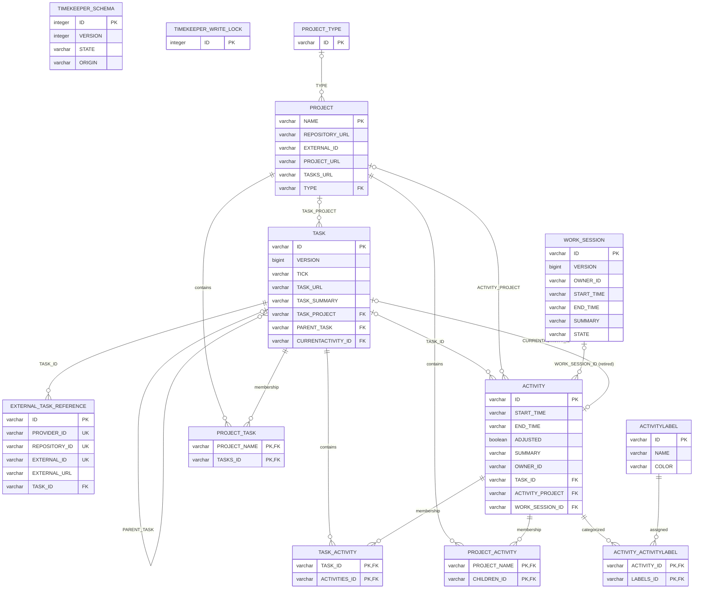
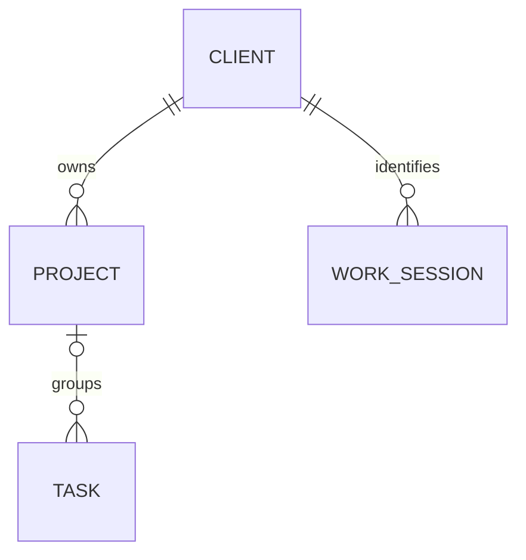

# Timekeeper data model

This document describes the complete persisted data model for Timekeeper schema
version 3 for embedded Eclipse storage. The server extension is described below.
It covers both the domain rules exposed by the application service and
the physical H2 schema generated by EclipseLink. The JPA mappings are the source
of truth for table and foreign-key definitions; `DatabaseSchema.CURRENT` is the
startup allow-list for tables and columns.

## Model overview

A `PROJECT` groups zero or more `TASK` records. A task may point to another task
in the same project through `PARENT_TASK`, forming the project > task > subtask
tree. `ACTIVITY` records are time intervals with an optional task and direct
project assignment. Activities may have reusable labels, and tasks may have
identities in one or more external task providers. An activity may also have no
task or project; no placeholder task is created.

`WORK_SESSION` records independent work periods. Reports derive activity context
from time overlap within the same owner scope, without a stored session
assignment. An activity can overlap more than one session. The legacy
`ACTIVITY.WORK_SESSION_ID` column is retained for native-file compatibility and
does not define the current logical relationship. See the
[component overview](README.md) for the client and storage boundaries.

The schema also contains three association tables created by the older
unidirectional JPA collections. They duplicate the child-side foreign keys used
by the current model:

- `PROJECT_TASK` accompanies `TASK.TASK_PROJECT`;
- `TASK_ACTIVITY` accompanies `ACTIVITY.TASK_ID`;
- `PROJECT_ACTIVITY` accompanies `ACTIVITY.ACTIVITY_PROJECT`.

The persistence adapter keeps both sides synchronized. They must be treated as
one relationship when inspecting, exporting, or importing data.

## Entity-relationship diagram

The diagram shows the physical tables. A circle indicates an optional end of a
relationship. Application rules that are stricter than the SQL cardinality are
listed under [Domain and service invariants](#domain-and-service-invariants).
The `WORK_SESSION_ID` relationship is a retired physical foreign key, ignored
by the service; it does not represent session membership.

`UK` on the three external-reference columns denotes one composite unique key,
not three independent unique constraints.

## Eclipse and Mylyn projection

The optional Mylyn representation is a projection of this model and does not
add tables to the schema. Native projects and tasks can be managed directly in
Workweek without Mylyn. With Timekeeper Mylyn integration installed, the
synchronizer applies the following mapping:

| Timekeeper model | Mylyn Task List | Stable mapping |
| --- | --- | --- |
| `PROJECT` | User-managed task category | Project UUID to category-handle mapping in Eclipse instance preferences |
| Root `TASK` | Local task below the project category | Timekeeper task UUID stored as a Mylyn task attribute |
| Child `TASK` | Local task below its parent local task | The same task UUID attribute plus the Mylyn parent container |

A Mylyn local task is the Eclipse form of a native Timekeeper task, not an
external task reference. It therefore needs no task-repository connector and no
row in `EXTERNAL_TASK_REFERENCE`. Changes made with the normal Mylyn category
and local-task commands are written through `TimekeeperService`. New native
projects and tasks are projected into Task List when the corresponding
preference is enabled; existing projections continue to synchronize when it is
disabled. Workweek provides native project, task and activity editing directly.

Connector-backed Mylyn tasks continue to use `EXTERNAL_TASK_REFERENCE`, keyed
by connector kind, repository and provider task ID. The stable native task UUID
remains unchanged if such references are later added or removed.

## Table reference

### `TIMEKEEPER_SCHEMA`

This single-row table is the durable schema identity and initialization marker.
It is created before the JPA tables and is managed by `DatabaseVersion`, not by
JPA.

| Column | SQL type | Required | Meaning |
| --- | --- | --- | --- |
| `ID` | `INTEGER` | yes | Primary key constrained to the single value `1`. |
| `VERSION` | `INTEGER` | yes | Physical schema version. The current value is `3`. |
| `STATE` | `VARCHAR(16)` | yes | Initialization state: `CREATING`, `MIGRATING`, or `READY`. Normal startup requires `READY`. |
| `ORIGIN` | `VARCHAR(16)` | yes | How the schema was created: `NEW` or `MIGRATION`. Known version-2 storage is upgraded additively after a verified backup; historical formats remain unsupported. |

### `PROJECT_TYPE`

Optional classification for connector-created projects, normally derived from
the Mylyn connector kind.

| Column | SQL type | Required | Meaning |
| --- | --- | --- | --- |
| `ID` | `VARCHAR` | yes | Project-type primary key, for example a connector kind. |

### `PROJECT`

The repository/project aggregate that owns a native task tree.

| Column | SQL type | Required | Meaning |
| --- | --- | --- | --- |
| `NAME` | `VARCHAR` | yes | Physical primary key. For a native service-owned project it contains the visible name, a record-separator character (`U+001E`), and the stable project UUID. Other projects use the name directly. |
| `REPOSITORY_URL` | `VARCHAR` | no | Source-code or task-repository URL. |
| `EXTERNAL_ID` | `VARCHAR` | no | Identifier for accounting or another external system. |
| `PROJECT_URL` | `VARCHAR` | no | General project URL. |
| `TASKS_URL` | `VARCHAR` | no | Issue-tracker or task-list URL. |
| `TYPE` | `VARCHAR` | no | Foreign key to `PROJECT_TYPE.ID`. |

The service exposes the embedded UUID as a native `ProjectId`. For a project
without an embedded service UUID, the adapter derives a stable name-based UUID.
Projects do not have a physical version column; their service version is a
stable content token calculated from the persisted name.

### `TASK`

A provider-independent unit of work. Its UUID remains stable when external links
are added or removed.

| Column | SQL type | Required | Meaning |
| --- | --- | --- | --- |
| `ID` | `VARCHAR` | yes | UUID primary key assigned by Timekeeper. |
| `VERSION` | `BIGINT` | yes | JPA optimistic-lock version, incremented when the task changes. |
| `TICK` | `VARCHAR(30)` | no | UTC instant of the latest non-idle activity heartbeat. |
| `TASK_URL` | `VARCHAR` | no | Optional task URL independent of any external reference. |
| `TASK_SUMMARY` | `VARCHAR` | no in SQL; yes in service | Display summary. The service rejects null or blank values. |
| `TASK_PROJECT` | `VARCHAR` | no | Foreign key to `PROJECT.NAME`. Subtasks require a project at service level. |
| `PARENT_TASK` | `VARCHAR` | no | Self-referencing foreign key to `TASK.ID`; null identifies a root task. |
| `CURRENTACTIVITY_ID` | `VARCHAR` | no | Foreign key to the task's currently open `ACTIVITY`, if any. |

`TICK`, `START_TIME`, and `END_TIME` use the same UTC instant conversion and are
stored as ISO-8601 text in `VARCHAR(30)` columns.

### `EXTERNAL_TASK_REFERENCE`

An optional provider identity attached to a Timekeeper task. A task can have
several references, but a provider/repository/external-ID tuple can identify
only one task.

| Column | SQL type | Required | Meaning |
| --- | --- | --- | --- |
| `ID` | `VARCHAR` | yes | UUID primary key for the reference itself. |
| `PROVIDER_ID` | `VARCHAR` | yes | Provider or connector kind, such as GitHub, Jira, or Bugzilla. |
| `REPOSITORY_ID` | `VARCHAR` | yes | Repository/account namespace within the provider. |
| `EXTERNAL_ID` | `VARCHAR` | yes | Provider's task identifier. |
| `EXTERNAL_URL` | `VARCHAR` | no | Direct URL supplied by the provider. |
| `TASK_ID` | `VARCHAR` | yes | Foreign key to `TASK.ID`. |

`(PROVIDER_ID, REPOSITORY_ID, EXTERNAL_ID)` has the composite unique constraint
`UK_EXTERNAL_TASK_REFERENCE`. References are cascade-persisted with their task
and removed as orphans when unlinked.

### `ACTIVITY`

A recorded work interval with optional task and direct project assignments. If
both are supplied, their projects must agree. Work-session context is derived
from time overlap within the same account; activities require no session link.

| Column | SQL type | Required | Meaning |
| --- | --- | --- | --- |
| `ID` | `VARCHAR` | yes | UUID primary key assigned by Timekeeper. |
| `START_TIME` | `VARCHAR(30)` | no in SQL; yes in service | Inclusive UTC start instant, stored as ISO-8601 text. |
| `END_TIME` | `VARCHAR(30)` | no | Exclusive UTC end instant. Null means the activity is open. |
| `ADJUSTED` | `BOOLEAN` | no | True when the interval was manually created or edited. |
| `SUMMARY` | `VARCHAR` | no | Free-form activity note; normalized to an empty string by the service. |
| `OWNER_ID` | `VARCHAR` | yes | Stable user or service identity. The embedded client uses `local`; this is a value, not a foreign key. |
| `TASK_ID` | `VARCHAR` | no | Optional foreign key to `TASK.ID`. |
| `ACTIVITY_PROJECT` | `VARCHAR` | no | Optional foreign key to `PROJECT.NAME` for an activity recorded directly against a project. |
| `WORK_SESSION_ID` | `VARCHAR(36)` | no | Retired nullable foreign key to `WORK_SESSION.ID`, retained for native-file compatibility; ignored by the service and cleared on save/session deletion. |

Activities do not have a physical version column. The adapter calculates their
service version from the persisted interval, summary, owner, adjusted flag, and
sorted label identifiers, project and work-session associations.

### `ACTIVITYLABEL`

A reusable category that may be assigned to any number of activities.

| Column | SQL type | Required | Meaning |
| --- | --- | --- | --- |
| `ID` | `VARCHAR` | yes | UUID primary key assigned by Timekeeper. |
| `NAME` | `VARCHAR` | no in SQL; yes in service | Display name; the service rejects null or blank values. |
| `COLOR` | `VARCHAR` | no | Optional display color, currently encoded as comma-separated RGB values. |

Labels do not have a physical version column. Their service version is a stable
content token calculated from name and color. Labels are shared and are never
cascade-deleted with an activity.

### Association tables

| Table | Composite primary key | Foreign keys | Purpose |
| --- | --- | --- | --- |
| `PROJECT_TASK` | `PROJECT_NAME`, `TASKS_ID` | `PROJECT_NAME` -> `PROJECT.NAME`; `TASKS_ID` -> `TASK.ID` | Backs `Project.tasks`; mirrors `TASK.TASK_PROJECT`. |
| `TASK_ACTIVITY` | `TASK_ID`, `ACTIVITIES_ID` | `TASK_ID` -> `TASK.ID`; `ACTIVITIES_ID` -> `ACTIVITY.ID` | Backs `Task.activities`; mirrors `ACTIVITY.TASK_ID`. |
| `PROJECT_ACTIVITY` | `PROJECT_NAME`, `CHILDREN_ID` | `PROJECT_NAME` -> `PROJECT.NAME`; `CHILDREN_ID` -> `ACTIVITY.ID` | Backs project-level activities; mirrors `ACTIVITY.ACTIVITY_PROJECT`. |
| `ACTIVITY_ACTIVITYLABEL` | `ACTIVITY_ID`, `LABELS_ID` | `ACTIVITY_ID` -> `ACTIVITY.ID`; `LABELS_ID` -> `ACTIVITYLABEL.ID` | Implements the activity-to-label many-to-many relationship. |

Every association-table column is a required `VARCHAR`. EclipseLink/H2 may
create implementation indexes for primary, unique, and foreign-key constraints;
index names are generated and are not part of the supported schema contract.

## Domain and service invariants

These rules are enforced transactionally by the domain/service layer unless a
database constraint is explicitly mentioned:

- Every native identifier is a UUID. Project, task, activity, and label IDs are
  stable across edits.
- Project names, task summaries, label names, owner IDs, and every component of
  an external reference key must be non-blank.
- A subtask and all its ancestors belong to the same project. A task cannot be
  its own parent, and following `PARENT_TASK` must never form a cycle.
- A task with subtasks cannot move to another project. It cannot be deleted
  while it has subtasks or activities, and a project cannot be deleted while it
  has tasks or directly associated activities.
- An activity end cannot precede its start. At most one activity may be open for
  an owner, and `CURRENTACTIVITY_ID` identifies the open interval for a task.
- An activity may use only existing labels. A label cannot be deleted while an
  activity uses it.
- Each owner may have one running work session, independently of their open
  activity. Sessions can span midnight independently of daily activity parts.
  Moving, stopping or deleting a session leaves activities and timers unchanged.
- Session tracked time sums clipped activity intervals. Allocated time is their
  union, and unallocated time is session duration minus that union. Overlapping
  activities therefore do not count twice toward covered time. Intervals outside
  the session are allowed with a warning.
- The composite external-reference key is unique in both the service and the
  database, so the same external issue cannot be linked to two Timekeeper tasks.
- A replaced provider identity becomes an alias of the task. Active references
  and aliases share the owner-scoped uniqueness index; either key resolves the
  task. Deleting the task removes both keys. Ordinary unlink removes the current
  key without making a new alias.
- Task updates use the physical optimistic-lock `VERSION`. Projects, activities,
  and labels use deterministic content versions because those legacy tables do
  not have version columns.
- Calendar totals are derived from UTC instants using an explicit `ZoneId`.
  Queries use an inclusive start and exclusive end, and open activities are
  measured through the report's generation instant.

## Lifecycle and ownership

The service is the supported write boundary. It validates references and
deletion preconditions before the JPA adapter mutates the schema. In particular:

- deleting a task removes its external references through cascade/orphan
  removal, but deletion is rejected until its activities and subtasks are gone;
- deleting an activity removes its task association but not shared labels;
- deleting a label is rejected while the many-to-many table still references
  it; and
- renaming a native project replaces the physical `PROJECT` row because `NAME`
  is the primary key, then reconnects tasks and project-level activities while
  preserving the embedded service UUID.

Direct SQL writers and import tools must preserve both the child-side foreign
keys and their corresponding association tables. Native CSV export/import
includes project types, projects, tasks, activities, external references,
collection relation tables, labels, activity-label assignments and work sessions.
Older exports remain supported; native files carrying legacy session references
require the corresponding work-session file.

The server's portable domain-v3 JSON and CSV formats include clients, projects,
tasks, labels, activities and independent work sessions. They preserve mandatory
project/session client links and session summaries, and remap identifiers on import.
Server task payloads now include a provider-neutral status, optional date-only
`scheduledDate`, and optional UTC `completedAt`. Older task payloads read with
`NOT_STARTED` and null date defaults. These fields live in the existing
owner-scoped `tk_resource` JSON payload in both H2 and PostgreSQL, so they need
no new table or schema-version change. Legacy task updates and reference changes
carry planning forward; account export/import retains it.
The same task payload also contains ordered `checklistItems`, each with its own
UUID, text, completion state and time, and position. These are embedded task
values and are never independent tasks or activity targets. Older payloads read
with an empty checklist; legacy task and planning updates retain existing items.
Portable exports and account archives preserve checklist contents and item IDs.
Tasks also carry independent optional `start` and `due` values. Each value is
either a date-only civil day or a local wall time plus its original IANA or
Windows time-zone identifier. These values are not inferred from the Google
Tasks scheduled day, and no instant is invented at DST gaps or overlaps.
Older task payloads read with null start/due; legacy edits preserve them, and
portable exports and account archives retain their exact date/time kind.
`priority` (`UNSPECIFIED`, `LOW`, `NORMAL`, `HIGH`), `flagged`, and `urgent`
are independent task values. Missing values on older payloads read as
`UNSPECIFIED`/false/false. Ordinary task edits preserve them, and both portable
exports and account archives retain them. Provider capabilities determine
which of these fields a connector may write remotely.
Task notes are an embedded `body` value with an explicit `TEXT` or `HTML`
format. Missing values on older payloads read as empty plain text. The
conditional body endpoint can clear notes with empty text; ordinary task edits
preserve notes, and portable exports and account archives retain them. HTML is
stored as source content and must be sanitized by a renderer before display.
Each external task reference may carry provider-supplied creation/modification
instants plus opaque remote ETag and revision values. These values belong to the
provider identity, since one task can have several links with different source
times and revisions. Older references read with empty source state. Legacy link
updates keep existing source state, while a conditional source update can
replace or clear it. Remote ETags are never Timekeeper task versions.
Provider account mappings are separate `TASK_CONNECTION` records with an owned
UUID, provider ID, remote account ID, display name, read/write permissions, and
enabled state. `TASK_LIST` records have their own UUID, connection ID, remote
list ID, name, kind, permissions, sharing/ownership flags, presence, and order.
A list is independent of a Timekeeper project. Both record types use the
owner-scoped `tk_resource` payload in H2 and PostgreSQL, and a relation links
each list to its connection. Marking a connection disabled or a list absent
retains the records and associated tasks. Explicit deletion is conditional and
rejects a connection with lists or a list with linked tasks. Account archives
and portable transfers include these records; older archives import without
them.
`TaskList.sharing` optionally records a provider owner principal and disclosed
participant IDs, display names, and roles. This data is separate from
Timekeeper account access and from the list's current permission flags. Older
list writes preserve it, and portable transfers retain it.
`TASK_SECTION` records are optional children of one provider list. They
store a provider section identity, name, standard or grocery-category kind,
position, presence, and section write permission. A relation prevents
deleting a list while sections remain. The section catalog does not change
Timekeeper projects or infer sections for providers that lack them. Archive and
portable transfer include sections and remap their list IDs; older snapshots
without sections remain valid.
An external task reference may include the stable Timekeeper `taskListId`.
Task-to-list relations protect referenced lists from deletion, while portable
imports remap the list ID. The reference's provider must match the list's
connection provider. `repositoryId` remains the remote identity namespace;
connectors must include the account/list scope when remote task IDs can repeat.
The optional `sectionId` is valid only with a `taskListId` and must identify a
section in that list. Task-to-section relations guard deletion, and portable
imports remap section IDs. A conditional location update can explicitly clear
both IDs without changing the provider identity or other task fields.
`ExternalTaskReference.assignment` holds provider assignee/assigner identity
and read-only source context independently of the task's primary URL. It is
retained through legacy writes, identity replacement, and transfer. A
conditional assignment update can clear it explicitly.
`TASK_ATTACHMENT` is an owner-scoped resource attached to one task by a
relation. It stores file name, media type, byte count, SHA-256, bounded Base64
content, and optional provider/remote identity. Content is verified before
storage, and deleting the task cascades attachment deletion. Portable transfer
and account archives retain the verified bytes and remap the parent task ID.

`TASK_SYNC_CURSOR` is owner-scoped durable connector state linked to one
connection and optionally one list. Its mode is `INITIAL`, `INCREMENTAL`, or
`RESCAN_REQUIRED`; only incremental mode carries an opaque cursor. A cursor
is not a task version and is intentionally excluded from account archives and
portable domain transfers, which require a fresh provider scan after restore.

`TASK_CONNECTION.capabilities` is a versioned, owner-scoped declaration of
effective field read/write/delete support. Unlisted fields are unknown.
Older records decode to an empty declaration; legacy connection updates keep
the existing map. Credentials never belong in it.

Each external reference may also contain a versioned last-common `baseline`:
capture time plus a sparse JSON map of normalized task fields that the local
task and that provider last agreed on. It belongs to one provider identity and
is updated atomically with source revision metadata after an accepted exchange.
Older records decode without one; legacy task and link writes preserve it.
The field map excludes credentials, provider transport state, and unsupported
fields. It supplies the base for later field-level three-way conflict handling.

`TASK_TOMBSTONE` is an owner-scoped, append-only record created when a locally
deleted task has provider identities. Its initial ID is the deleted task ID;
portable transfer remaps the record ID and retains historical `taskId`. It stores deletion
time, previous task version, and every former active or alias provider key.
The task row is removed while this record and both change-feed entries remain.
It distinguishes an intentional local deletion from a never-imported remote
identity. It survives account archive and portable transfer. It says nothing
about whether the provider deleted its own item.

Each external reference may contain one namespaced, versioned provider-data
envelope. Its JSON object preserves exposed provider fields that are not yet
normalized. The envelope belongs to that reference, so links to other
providers cannot overwrite it. Conditional replacement and explicit clearing
are separate from the source timestamp/revision update; older task and link
writes retain the envelope. Connector credentials never belong in task data.
`TASK.siblingOrder` is a nonnegative local position among tasks under the same
parent. It defaults to zero for older rows, is independent of a provider list's
position, and survives updates from clients that do not know this field.
`TASK.recurrence` stores a series rule with an explicit end condition and a
bounded set of occurrence exceptions keyed by original date or wall-time slot.
Moved, completed, and skipped occurrences remain distinct from the series
status. Legacy task updates preserve recurrence; older rows decode as a task
without a series or occurrence exceptions. Account archives and portable
transfers include it.
`TASK.reminders` holds owner-scoped typed alert triggers with stable UUIDs.
Absolute and relative time alerts, geofences, car events, and message contacts
remain distinct from task scheduling and due dates. Older task writes preserve
them, and archives and portable transfers include them.
`TASK.metadata` stores Apple-style tags, Outlook categories, and typed links as
separate collections. A provider source link is not the task's editable primary
URL. Each link has a stable Timekeeper UUID; provider-origin links also record
their provider and, where available, remote link ID. Legacy task writes retain
the collections and transfers preserve them.
The account ZIP archive also includes active day labels and Markdown bodies;
deletion tombstones are not portable account records.
Imports also accept v1/v2 snapshots, assign their projects and sessions to the
General client, and ignore retired activity/session links. Native table CSV and
portable server CSV are distinct formats; see the
[API interchange contract](API-V1.md#resources-and-client-workflows) and
[HTTP client CSV guide](../development/HTTP-CLIENT.md#server-csv-transfer).

## Schema compatibility

Version 3 requires a correctly stamped schema. Known version-2 storage is upgraded after a verified backup. Historical H2 databases,
unversioned layouts, extra application tables, missing columns, and incomplete
initialization states are rejected without mutation. See
[Database recovery and migration policy](../operations/DATABASE-RECOVERY.md) for startup,
backup, and recovery behavior.

## Work Session storage

`WORK_SESSION` records independent work periods with UUID `ID`, optimistic
`VERSION`, `OWNER_ID`, exact UTC `START_TIME`/nullable `END_TIME`, `SUMMARY` and
`STATE` (`RUNNING` or `COMPLETED`). Its time fields use the same nanosecond-preserving
text converter as activities. Sessions have no task or project dependency.
`ACTIVITY.WORK_SESSION_ID` is a retired nullable foreign key retained for native-file compatibility. The service ignores its value; session deletion clears legacy foreign keys before removing the session. Activities may also omit
`TASK_ID` and optionally use the existing `ACTIVITY_PROJECT` relation directly.

`TIMEKEEPER_WRITE_LOCK` contains the database row used to serialize local service
transactions across H2 clients. A single running session is enforced per owner
inside this lock. Session edits use optimistic versions. Reports derive activity
context from owner-scoped time overlap without manual association. Native CSV exports include `work_session.csv`,
and import accepts legacy link metadata, validates owner/open-session invariants and
advances changed existing session versions instead of reusing stale versions.

## Server client hierarchy

The server/web model adds `CLIENT` (owned UUID, version, name, required color).
Every server `PROJECT` and `WORK_SESSION` refers to exactly one owned client.
Clients may have many projects and work sessions; sessions have a single
optional summary, with no separate title. Client deletion is restricted while either
kind of record references it. These fields live in the server’s generic resource
payloads and foreign-key relations, without extending Eclipse’s physical schema.
See [API-V1.md](API-V1.md#clients-in-the-server-and-web-client) for migration and
legacy-client behavior.

This diagram shows client ownership links. Activities are not children of work
sessions; session reports find overlapping activities within the same account.
The time-overlap calculation does not create a persistent association.

## Server day notes and WebDAV

The server has a separate physical schema from embedded Eclipse storage
(`ServerSchema.CURRENT` is 7). Day notes and their deletion markers reuse
`tk_resource(owner_id, entity_type, id, version, payload)` in both H2 and
PostgreSQL. Its primary key is `(owner_id, entity_type, id)`; `payload` is JSON.
These are logical row types, not extra SQL tables or Eclipse JPA entities.
`owner_id` references `tk_owner`; links between the row types below are IDs in
their JSON payloads and are validated within owner-scoped server transactions.

| `entity_type` | Identity and purpose |
| --- | --- |
| `DAY_LABEL` | Independent date-keyed label with its own `text`, `version` and modification time. Clearing retains a versioned empty value. It neither requires a note nor shares its version, Markdown bytes or deletion lifecycle. |
| `DAY_NOTE` | Date-keyed Markdown document with canonical UTF-8 `markdown`, projected `body`, internal `modifiedAt`, and its own optimistic `version`. An untouched date has no row and reads as version zero. Legacy `text` is retained only as private compatibility metadata; public labels come from `DAY_LABEL`. `labelIndependent` marks newly written note content; legacy fields may remain privately in migrated records. An existing `DAY_LABEL` row prevents legacy label resurrection. |
| `JOURNAL_DELETE` | Date-keyed deletion marker with the `DAY_NOTE` version it applies to. Deleting keeps an empty, versioned note row so stale editors cannot recreate it with an old ETag. |
| `WEEK_NOTE` | One deterministic UUID per ISO week Monday and owner. Stores the ISO week key (`YYYY-Www`), exact Markdown `body`, an internal modification time and optimistic `version`. The ISO week-based year may differ from the calendar year at New Year. |
| `WEEK_NOTE_DELETE` | Week-keyed deletion marker tied to the `WEEK_NOTE` version. A deleted weekly file remains versioned so stale writes fail. |
| `JOURNAL_ASSET` | One deterministic UUID per account and safe filename under `assets/`. The JSON payload contains the filename, base64 binary data, byte length, derived safe media type, modification time, deletion flag and optimistic version. Deleted rows retain their version so old ETags cannot be reused. |

`DAY_NOTE` and `DAY_LABEL` writes use independent conditional versions and publish a content-free profile
invalidation through `tk_change`. Calendar range reads return only the label
and `hasBody`, not the Markdown body. Active notes are included in account
archives, including canonical Markdown even for empty but present notes.
Version 3 account archives store labels separately and daily and weekly notes as separate
`YYYY-MM-DD.md` and `YYYY-Www.md` files, with a checksummed `journalFiles` index.
Journal assets use `assets/`; task attachment bytes use `assets/task attachments/` and
retain their metadata in the task graph. `archive.json.dayLabels` backs up labels separately, including explicit clears and labels on deleted-note dates. Legacy version 2 file archives and version 1 archives with inline
`dayNotes`, `weekNotes` and `journalAssets` remain readable. Daily and weekly notes are independent.
Active journal assets are also included; empty deletion markers are not.
Historical rows from the retired SSH synchronization
implementation are ignored; no data migration is required.

Calendar and REST responses omit internal `markdown`, `modifiedAt` and migration
markers. Legacy combined reads expose `text` and `labelVersion` alongside the
note version; independent content reads omit both label fields. The editor
command checks each changed resource's version and commits atomically. Deleting
a note preserves its label, and clearing a label preserves the document.

Schema 7 fences out older binaries. Startup migrates old label projections in
owner-scoped transactions before serving requests, copying cleared values too.
Existing canonical bytes and note versions stay unchanged. A virtual old document
is materialized once, so later label changes cannot alter it. Existing
`timekeeper-label` YAML is preserved as opaque metadata; new labels are never
projected into new note documents. Older archives use an explicit legacy import
adapter; current archives restore labels independently from Markdown files.

The note bodies and complete Markdown documents are readable to the server.
Protect their database, temporary files, backups and exports as described in
[journal storage protection](../operations/JOURNAL-STORAGE.md). See the
[day-note API](API-V1.md#private-day-labels-and-markdown-bodies) and
[WebDAV guide](../operations/JOURNAL-WEBDAV.md) for write,
conflict and authorization behavior.
