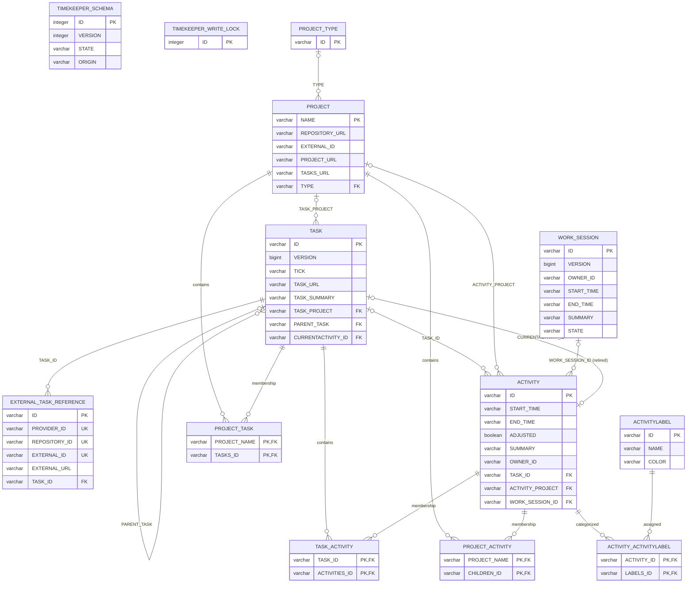
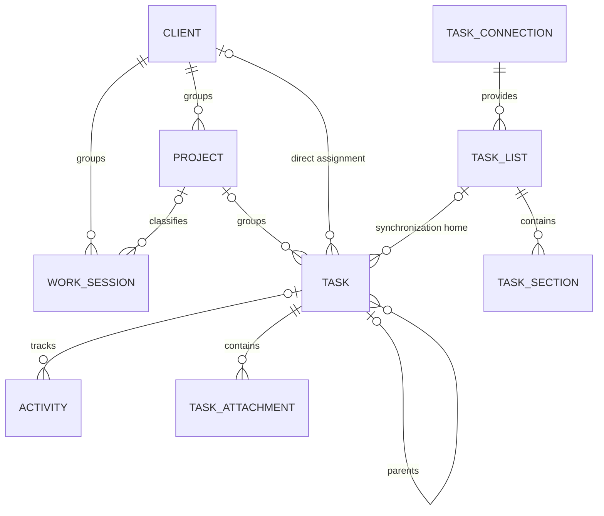

# Dagsverk data model

Dagsverk has two persistence models. Eclipse local mode uses an embedded H2
schema managed by EclipseLink. The server uses its own H2 or PostgreSQL
schema for the browser and Eclipse remote mode. Both use the shared Java
domain and service. See [server storage](#server-storage) for the server's
logical records, including [tasks and provider synchronization](#server-tasks).

## Embedded Eclipse storage

The embedded schema is version 3. The JPA mappings define tables and foreign
keys, and `DatabaseSchema.CURRENT` lists the accepted tables and columns.

A `PROJECT` groups zero or more `TASK` records. A task may have an optional
`PARENT_TASK`. A parent and child share a project assignment, which may be empty
for both. `ACTIVITY` records are time intervals with optional task and direct
project assignments and reusable labels. Tasks can have external identities,
for example for connector-backed Mylyn tasks. Activities without a task or
project are recorded directly.

`WORK_SESSION` records independent work periods. Reports derive activity context
from time overlap within the same owner scope, without a stored session
assignment. An activity can overlap more than one session. The legacy
`ACTIVITY.WORK_SESSION_ID` column is retained for native-file compatibility and
does not define the current logical relationship. See the
[component overview](README.md) for the client and storage boundaries.

The schema also contains three association tables created by the older
unidirectional JPA collections. They duplicate the child-side foreign keys used
by the current model:

- `PROJECT_TASK` accompanies `TASK.TASK_PROJECT`;
- `TASK_ACTIVITY` accompanies `ACTIVITY.TASK_ID`;
- `PROJECT_ACTIVITY` accompanies `ACTIVITY.ACTIVITY_PROJECT`.

The persistence adapter keeps both sides synchronized. They must be treated as
one relationship when inspecting, exporting, or importing data.

### Entity-relationship diagram

The diagram shows the physical tables. A circle indicates an optional end of a
relationship. Application rules that are stricter than the SQL cardinality are
listed under [Domain and service invariants](#domain-and-service-invariants).
The `WORK_SESSION_ID` relationship is a retired physical foreign key, ignored
by the service; it does not represent session membership.

`UK` on the three external-reference columns denotes one composite unique key,
not three independent unique constraints.

### Eclipse and Mylyn projection

The optional Mylyn representation is a projection of this model and does not
add tables to the schema. Native projects and tasks can be managed directly in
Workweek without Mylyn. With Dagsverk Mylyn integration installed, the
synchronizer applies the following mapping:

| Dagsverk model | Mylyn Task List | Stable mapping |
| --- | --- | --- |
| `PROJECT` | User-managed task category | Project UUID to category-handle mapping in Eclipse instance preferences |
| Root `TASK` | Local task below the project category | Dagsverk task UUID stored as a Mylyn task attribute |
| Child `TASK` | Local task below its parent local task | The same task UUID attribute plus the Mylyn parent container |

A Mylyn local task projects a native Dagsverk task using the stored UUID.
Changes made with the normal Mylyn category and local-task commands are written
through `TimekeeperService`. New native projects and tasks are projected into
Task List when the corresponding preference is enabled. Existing projections
continue to synchronize when it is disabled.

Connector-backed Mylyn tasks use `EXTERNAL_TASK_REFERENCE`, keyed
by connector kind, repository and provider task ID. The stable native task UUID
remains unchanged if such references are later added or removed.

### Table reference

#### `TIMEKEEPER_SCHEMA`

This single-row table is the durable schema identity and initialization marker.
It is created before the JPA tables and is managed by `DatabaseVersion`, not by
JPA.

| Column | SQL type | Required | Meaning |
| --- | --- | --- | --- |
| `ID` | `INTEGER` | yes | Primary key constrained to the single value `1`. |
| `VERSION` | `INTEGER` | yes | Physical schema version. The current value is `3`. |
| `STATE` | `VARCHAR(16)` | yes | Initialization state: `CREATING`, `MIGRATING`, or `READY`. Normal startup requires `READY`. |
| `ORIGIN` | `VARCHAR(16)` | yes | How the schema was created: `NEW` or `MIGRATION`. Known version-2 storage is upgraded additively after a verified backup; historical formats remain unsupported. |

#### `PROJECT_TYPE`

Optional classification for connector-created projects, normally derived from
the Mylyn connector kind.

| Column | SQL type | Required | Meaning |
| --- | --- | --- | --- |
| `ID` | `VARCHAR` | yes | Project-type primary key, for example a connector kind. |

#### `PROJECT`

The repository/project aggregate that owns a native task tree.

| Column | SQL type | Required | Meaning |
| --- | --- | --- | --- |
| `NAME` | `VARCHAR` | yes | Physical primary key. For a native service-owned project it contains the visible name, a record-separator character (`U+001E`), and the stable project UUID. Other projects use the name directly. |
| `REPOSITORY_URL` | `VARCHAR` | no | Source-code or task-repository URL. |
| `EXTERNAL_ID` | `VARCHAR` | no | Identifier for accounting or another external system. |
| `PROJECT_URL` | `VARCHAR` | no | General project URL. |
| `TASKS_URL` | `VARCHAR` | no | Issue-tracker or task-list URL. |
| `TYPE` | `VARCHAR` | no | Foreign key to `PROJECT_TYPE.ID`. |

The service exposes the embedded UUID as a native `ProjectId`. For a project
without an embedded service UUID, the adapter derives a stable name-based UUID.
Projects do not have a physical version column; their service version is a
stable content token calculated from the persisted name.

#### `TASK`

A provider-independent unit of work. Its UUID remains stable when external links
are added or removed.

| Column | SQL type | Required | Meaning |
| --- | --- | --- | --- |
| `ID` | `VARCHAR` | yes | UUID primary key assigned by Dagsverk. |
| `VERSION` | `BIGINT` | yes | JPA optimistic-lock version, incremented when the task changes. |
| `TICK` | `VARCHAR(30)` | no | UTC instant of the latest non-idle activity heartbeat. |
| `TASK_URL` | `VARCHAR` | no | Optional task URL independent of any external reference. |
| `TASK_SUMMARY` | `VARCHAR` | no in SQL; yes in service | Display summary. The service rejects null or blank values. |
| `TASK_PROJECT` | `VARCHAR` | no | Optional foreign key to `PROJECT.NAME`. A child and its parent have the same assignment, including when both have none. |
| `PARENT_TASK` | `VARCHAR` | no | Self-referencing foreign key to `TASK.ID`; null identifies a root task. |
| `CURRENTACTIVITY_ID` | `VARCHAR` | no | Foreign key to the task's currently open `ACTIVITY`, if any. |

`TICK`, `START_TIME`, and `END_TIME` use the same UTC instant conversion and are
stored as ISO-8601 text in `VARCHAR(30)` columns.

#### `EXTERNAL_TASK_REFERENCE`

An optional provider identity attached to a Dagsverk task. A task can have
several references, but a provider/repository/external-ID tuple can identify
only one task.

| Column | SQL type | Required | Meaning |
| --- | --- | --- | --- |
| `ID` | `VARCHAR` | yes | UUID primary key for the reference itself. |
| `PROVIDER_ID` | `VARCHAR` | yes | Provider or connector kind, such as GitHub, Jira, or Bugzilla. |
| `REPOSITORY_ID` | `VARCHAR` | yes | Repository/account namespace within the provider. |
| `EXTERNAL_ID` | `VARCHAR` | yes | Provider's task identifier. |
| `EXTERNAL_URL` | `VARCHAR` | no | Direct URL supplied by the provider. |
| `TASK_ID` | `VARCHAR` | yes | Foreign key to `TASK.ID`. |

`(PROVIDER_ID, REPOSITORY_ID, EXTERNAL_ID)` has the composite unique constraint
`UK_EXTERNAL_TASK_REFERENCE`. References are cascade-persisted with their task
and removed as orphans when unlinked.

#### `ACTIVITY`

A recorded work interval with optional task and direct project assignments. If
both are supplied, their projects must agree. Work-session context is derived
from time overlap within the same account; activities require no session link.

| Column | SQL type | Required | Meaning |
| --- | --- | --- | --- |
| `ID` | `VARCHAR` | yes | UUID primary key assigned by Dagsverk. |
| `START_TIME` | `VARCHAR(30)` | no in SQL; yes in service | Inclusive UTC start instant, stored as ISO-8601 text. |
| `END_TIME` | `VARCHAR(30)` | no | Exclusive UTC end instant. Null means the activity is open. |
| `ADJUSTED` | `BOOLEAN` | no | True when the interval was manually created or edited. |
| `SUMMARY` | `VARCHAR` | no | Free-form activity note; normalized to an empty string by the service. |
| `OWNER_ID` | `VARCHAR` | yes | Stable user or service identity. The embedded client uses `local`; this is a value, not a foreign key. |
| `TASK_ID` | `VARCHAR` | no | Optional foreign key to `TASK.ID`. |
| `ACTIVITY_PROJECT` | `VARCHAR` | no | Optional foreign key to `PROJECT.NAME` for an activity recorded directly against a project. |
| `WORK_SESSION_ID` | `VARCHAR(36)` | no | Retired nullable foreign key to `WORK_SESSION.ID`, retained for native-file compatibility; ignored by the service and cleared on save/session deletion. |

Activities do not have a physical version column. The adapter calculates their
service version from the persisted interval, summary, owner, adjusted flag, and
sorted label identifiers, project and work-session associations.

#### `ACTIVITYLABEL`

A reusable category that may be assigned to any number of activities.

| Column | SQL type | Required | Meaning |
| --- | --- | --- | --- |
| `ID` | `VARCHAR` | yes | UUID primary key assigned by Dagsverk. |
| `NAME` | `VARCHAR` | no in SQL; yes in service | Display name; the service rejects null or blank values. |
| `COLOR` | `VARCHAR` | no | Optional display color, currently encoded as comma-separated RGB values. |

Labels do not have a physical version column. Their service version is a stable
content token calculated from name and color. Labels are shared and are never
cascade-deleted with an activity.

#### Association tables

| Table | Composite primary key | Foreign keys | Purpose |
| --- | --- | --- | --- |
| `PROJECT_TASK` | `PROJECT_NAME`, `TASKS_ID` | `PROJECT_NAME` -> `PROJECT.NAME`; `TASKS_ID` -> `TASK.ID` | Backs `Project.tasks`; mirrors `TASK.TASK_PROJECT`. |
| `TASK_ACTIVITY` | `TASK_ID`, `ACTIVITIES_ID` | `TASK_ID` -> `TASK.ID`; `ACTIVITIES_ID` -> `ACTIVITY.ID` | Backs `Task.activities`; mirrors `ACTIVITY.TASK_ID`. |
| `PROJECT_ACTIVITY` | `PROJECT_NAME`, `CHILDREN_ID` | `PROJECT_NAME` -> `PROJECT.NAME`; `CHILDREN_ID` -> `ACTIVITY.ID` | Backs project-level activities; mirrors `ACTIVITY.ACTIVITY_PROJECT`. |
| `ACTIVITY_ACTIVITYLABEL` | `ACTIVITY_ID`, `LABELS_ID` | `ACTIVITY_ID` -> `ACTIVITY.ID`; `LABELS_ID` -> `ACTIVITYLABEL.ID` | Implements the activity-to-label many-to-many relationship. |

Every association-table column is a required `VARCHAR`. EclipseLink/H2 may
create implementation indexes for primary, unique, and foreign-key constraints;
index names are generated and are not part of the supported schema contract.

### Domain and service invariants

These rules are enforced transactionally by the domain/service layer unless a
database constraint is explicitly mentioned:

- Every native identifier is a UUID. Project, task, activity, and label IDs are
  stable across edits.
- Project names, task summaries, label names, owner IDs, and every component of
  an external reference key must be non-blank.
- A task and its ancestors share the same project assignment, including an
  empty assignment. Following `PARENT_TASK` must never form a cycle.
- A task with subtasks cannot move to another project. It cannot be deleted
  while it has subtasks or activities, and a project cannot be deleted while it
  has tasks or directly associated activities.
- An activity end cannot precede its start. At most one activity may be open for
  an owner, and `CURRENTACTIVITY_ID` identifies the open interval for a task.
- An activity may use only existing labels. A label cannot be deleted while an
  activity uses it.
- Each owner may have one running work session, independently of their open
  activity. Sessions can span midnight independently of daily activity parts.
  Moving, stopping or deleting a session leaves activities and timers unchanged.
- Session tracked time sums clipped activity intervals. Allocated time is their
  union, and unallocated time is session duration minus that union. Overlapping
  activities therefore do not count twice toward covered time. Intervals outside
  the session are allowed with a warning.
- The service and database enforce uniqueness of the composite external
  reference key in the local store.
- Task updates use the physical optimistic-lock `VERSION`. Projects, activities,
  and labels use deterministic content versions because those legacy tables do
  not have version columns.
- Calendar totals are derived from UTC instants using an explicit `ZoneId`.
  Queries use an inclusive start and exclusive end, and open activities are
  measured through the report's generation instant.

### Lifecycle and native CSV

The service is the supported write boundary. It validates references and
deletion preconditions before the JPA adapter mutates the schema. In particular:

- deleting a task removes its external references through cascade/orphan
  removal, but deletion is rejected until its activities and subtasks are gone;
- deleting an activity removes its task association but not shared labels;
- deleting a label is rejected while the many-to-many table still references
  it; and
- renaming a native project replaces the physical `PROJECT` row because `NAME`
  is the primary key, then reconnects tasks and project-level activities while
  preserving the embedded service UUID.

Direct SQL writers and import tools must preserve both the child-side foreign
keys and their corresponding association tables. Native CSV export/import
includes project types, projects, tasks, activities, external references,
collection relation tables, labels, activity-label assignments and work sessions.
Older exports remain supported; native files carrying legacy session references
require the corresponding work-session file.

### Schema compatibility

Version 3 requires a correctly stamped schema. Known version-2 storage is upgraded after a verified backup. Historical H2 databases,
unversioned layouts, extra application tables, missing columns, and incomplete
initialization states are rejected without mutation. See
[Database recovery and migration policy](../operations/DATABASE-RECOVERY.md) for startup,
backup, and recovery behavior.

### Work session storage

`WORK_SESSION` records independent work periods with UUID `ID`, optimistic
`VERSION`, `OWNER_ID`, exact UTC `START_TIME`/nullable `END_TIME`, `SUMMARY` and
`STATE` (`RUNNING` or `COMPLETED`). Its time fields use the same nanosecond-preserving
text converter as activities. Sessions have no task or project dependency.
`ACTIVITY.WORK_SESSION_ID` is a retired nullable foreign key retained for native-file compatibility. The service ignores its value; session deletion clears legacy foreign keys before removing the session. Activities may also omit
`TASK_ID` and optionally use the existing `ACTIVITY_PROJECT` relation directly.

`TIMEKEEPER_WRITE_LOCK` contains the database row used to serialize local service
transactions across H2 clients. A single running session is enforced per owner
inside this lock. Session edits use optimistic versions. Reports derive activity
context from owner-scoped time overlap without manual association. Native CSV exports include `work_session.csv`,
and import accepts legacy link metadata, validates owner/open-session invariants and
advances changed existing session versions instead of reusing stale versions.

## Server storage

The server uses schema version 10 (`ServerSchema.CURRENT`). On both H2 and
PostgreSQL, domain records are rows in
`tk_resource(owner_id, entity_type, id, version, payload)`. The primary key
is `(owner_id, entity_type, id)`, `owner_id` references `tk_owner`, and
`payload` contains JSON. `tk_relation` stores owner-scoped foreign keys
between resources. Task and note record types share these tables. Task
optimistic versions come from the resource row and are exposed through API
ETags. Provider revisions and ETags belong to individual external references.

### Clients, projects and work sessions

A `CLIENT` has an owned UUID, version, name, required color and retirement
flag. Each `PROJECT` and `WORK_SESSION` belongs to one owned client. A session
can also reference a project, in which case the project's client determines
the session's client. A session has an optional summary and can use owned
labels. References restrict client deletion. A project with sessions must have
those sessions reassigned before the project can be deleted or moved to another
client. See [client API and legacy behavior](API-V1.md#clients-in-the-server-and-web-client).

The relationships below are logical server records. Reports associate
activities with sessions by account and time overlap.

### Server tasks

The `TASK` resource has a stable UUID, a summary, and optional URL, project and
parent task. Parent and child share the same project assignment, including
when both are unassigned, and the hierarchy is acyclic. A task with children
cannot move to a different project. A project task inherits its project's
client. A task without a project may have a direct `clientId`, backed by an
owned client relation.

The embedded Eclipse adapter persists the basic task fields and provider
identity shown in the [embedded tables](#table-reference). The following
task fields are persisted in the server JSON payload.

| Fields | Meaning and defaults for older rows |
| --- | --- |
| `status`, `scheduledDate`, `completedAt` | Status defaults to `NOT_STARTED` and also supports `IN_PROGRESS`, `COMPLETED`, `WAITING` and `DEFERRED`. The optional scheduled date is a civil day. The optional completion time is a UTC instant. |
| `start`, `due` | Independent optional civil dates or local wall times with their original IANA or Windows time-zone identifiers. Google Tasks' scheduled day is stored in `scheduledDate`. |
| `priority`, `flagged`, `urgent` | The independent values default to `UNSPECIFIED`, false and false. Priority also supports `LOW`, `NORMAL` and `HIGH`. |
| `body` | Task notes in `TEXT` or `HTML` format. Defaults to empty plain text. Renderers sanitize HTML for display. |
| `checklistItems` | Ordered embedded values with their own UUID, text, completion state and time, and position. Older rows default to an empty list. These values have no separate task identity or time tracking. |
| `siblingOrder` | Nonnegative local position among siblings. Defaults to zero. Provider list position is separate. |
| `recurrence` | Optional series rule with an end condition and bounded occurrence exceptions, keyed by original civil date or wall-time slot. Occurrence moves, completions and skips are tracked separately from series status. |
| `reminders` | Typed triggers with stable UUIDs, including absolute and relative time, geofence, car event and message contact triggers. |
| `metadata` | Separate collections of tags, categories and typed links. Links have stable UUIDs, with provider origin and remote link ID where available. The primary task URL is a separate field. |
| `externalReferences`, `externalAliases` | Current provider identities, their per-reference data, and former identity keys. |
| `syncListId`, `deleted` | Optional synchronization home and retained-deletion flag, which defaults to false. See [automatic synchronization and deletion](#automatic-synchronization-and-deletion). |

Older payloads default to no recurrence, reminders or task metadata. Edits
that omit optional fields preserve their existing values where the API
supports partial updates.

`TASK_ATTACHMENT` stores a file name, media type, verified byte count and
SHA-256, bounded Base64 bytes and optional provider identity. An owner-scoped
relation attaches it to a task. Physical task deletion cascades to attachments.

#### External identities and provider catalogs

A task can carry multiple external references. Each identity key combines
provider, repository namespace and external task ID. The repository namespace
includes the relevant account or list scope when remote task IDs can repeat.
The server indexes both active identities and aliases in
`tk_external_reference` for unique lookup per owner. Replacing an identity
retains the old key as an alias. Ordinary unlink removes the current key.

Each active reference may store its external URL, provider creation and
modification timestamps, remote ETag and revision, and assignee or assigner
context. Optional `taskListId` and `sectionId` identify its provider location.
The list's connection must match the reference's provider, and the section
must belong to that list. The task's list and section relations protect
referenced catalogs from deletion.

A reference may also carry namespaced, versioned `providerData` and a
last-common `baseline`. The baseline is a sparse map of normalized fields
with a capture time. It is updated with the remote source revision after
an accepted exchange and supports three-way comparison. Each reference has
its own provider data, baseline and source metadata. Legacy writes preserve
these values. See the [synchronization protocol](TASK-SYNC-PROTOCOL.md) for
field support and exchange semantics.

| Record type | Meaning |
| --- | --- |
| `TASK_CONNECTION` | Owned provider account mapping with remote account ID, display name, permissions, enabled state and effective field capabilities. Capabilities absent from the map are unknown. |
| `TASK_LIST` | Provider list with a stable Dagsverk UUID, a connection relation, remote list ID, name, kind, permissions, presence, order and sharing information. Its optional `sharing` data describes provider principals independently of Dagsverk account access. |
| `TASK_SECTION` | Optional section within one list, with a remote identity, name, kind, position, presence and write permission. |

Lists and sections can also carry the namespaced `providerData` envelope.
The owning connection determines the provider namespace. Disabling a
connection or marking a list absent preserves the catalog and its tasks.
Explicit deletes are conditional and respect dependent records.

#### Automatic synchronization and deletion

`syncListId` selects a task's single automatic synchronization home. For a
user-selected home, the list must be writable and explicitly subscribed
through a supported Google or Microsoft Internet account. An external
reference's list records the observed provider location, which may differ from
the home while a move is pending. Project mappings supply a default project for
imports. Omitting the home in an update preserves it. Explicitly clearing it
detaches synchronization while keeping both task copies. When the parent has a
home, the service requires child edits to use that same home and defaults new
children to it. A move to another home must stay within the same provider
account. Legacy connector links keep their manual behavior.

The server stores Internet account authorization and selected lists in
`TASK_AUTH`, separately from portable connection metadata. Runtime records
include `TASK_SYNC_INTENT` for desired task changes, `TASK_SYNC_ISSUE` for
exceptions, `TASK_WRITE` for provider operations and their outcomes, and
`TASK_PULL_SCAN` / `TASK_PULL_PAGE` for staged observations. The connector
also supports `TASK_SYNC_CURSOR` for per-connection or per-list progress
(`INITIAL`, `INCREMENTAL`, `RESCAN_REQUIRED`), with an opaque cursor only in
incremental mode. See [automatic task-list synchronization](AUTOMATIC-TASK-SYNC.md).

- A task without a home is physically deleted only after its activities and active
  subtasks are gone. When it had provider identities, `TASK_TOMBSTONE` keeps
  its deleted task ID, time, prior version and former active and alias keys.
- Deleting a task with a home still requires its active subtasks to be gone. The
  server marks the task `deleted`, hides it from active task reads, retains
  its work and provider identity, and records provider deletion intent. Its
  tombstone can begin with no provider keys if the provider has yet to
  acknowledge creation. A tombstone records local deletion separately from
  the result of any provider operation.

#### Portable task data

The server's domain-v3 JSON/CSV transfers and account ZIP archives include
task fields, provider catalogs, attachments, retained tasks, and task
tombstones. Imports remap owned clients, projects, parents, list and section
IDs, and attachment parents. A retained task and its tombstone share a
remapped UUID, with transfer mappings qualified by entity type. Baseline
fields that refer to missing historical records lose only their affected
comparison group. Other fields and opaque provider IDs survive transfer.

Portable exports exclude authorization, subscriptions and pending connector
state. Reconnecting and scanning the provider reestablishes live
synchronization. Full instance backups include the stored runtime records.
The portable domain formats also include clients, projects, labels, activities
and independent work sessions. Imports accept legacy v1/v2 snapshots, assign
missing project and session clients to General, and ignore retired
activity/session links. See the [API interchange contract](API-V1.md#resources-and-client-workflows)
and [HTTP client CSV guide](../development/HTTP-CLIENT.md#server-csv-transfer).

## Server day notes and WebDAV

The canonical HTTP collection `/dav/notes/` addresses the same owner-scoped
resources through the configured journal, event and assets folders. It shares
token authorization, data, ETags and guarded mutations with the REST interfaces.

Day notes and their deletion markers use the same owner-scoped `tk_resource`
table as tasks. Links between the row types below are IDs in their JSON
payloads and are validated within owner-scoped server transactions.

| `entity_type` | Identity and purpose |
| --- | --- |
| `FOCUS_SETTINGS` | Owner-private singleton `00000000-0000-0000-0000-000000000002`, with an independent optimistic version and an `areas` array of `{id,name,clientIds}`. Only owned clients can be assigned. Membership is a presentation preference; client deletion makes a membership inert. Changes publish `PROFILE/UPDATED`. Stored independently from holiday/profile preferences; no domain or SQL schema migration is required. Account archives preserve definitions and remap imported client IDs. |
| `DAY_LABEL` | Independent date-keyed label with its own `text`, `version` and modification time. Clearing retains a versioned empty value. It neither requires a note nor shares its version, Markdown bytes or deletion lifecycle. |
| `DAY_NOTE` | Date-keyed Markdown document with canonical UTF-8 `markdown`, projected `body`, internal `modifiedAt`, and its own optimistic `version`. An untouched date has no row and reads as version zero. Legacy `text` is retained only as private compatibility metadata; public labels come from `DAY_LABEL`. `labelIndependent` marks newly written note content; legacy fields may remain privately in migrated records. An existing `DAY_LABEL` row prevents legacy label resurrection. |
| `JOURNAL_DELETE` | Date-keyed deletion marker with the `DAY_NOTE` version it applies to. Deleting keeps an empty, versioned note row so stale editors cannot recreate it with an old ETag. |
| `WEEK_NOTE` | One deterministic UUID per ISO week Monday and owner. Stores the ISO week key (`YYYY-Www`), exact Markdown `body`, an internal modification time and optimistic `version`. The ISO week-based year may differ from the calendar year at New Year. |
| `WEEK_NOTE_DELETE` | Week-keyed deletion marker tied to the `WEEK_NOTE` version. A deleted weekly file remains versioned so stale writes fail. |
| `EVENT_NOTE` | Deterministic UUID derived from subscription UUID and stable occurrence key, within the owner. Stores those identities, a bounded original UID/recurrence/title snapshot, exact Markdown body, internal modification time, deletion flag and optimistic version. Rescheduling or renaming an event does not change its note; recurring occurrences have distinct notes. The row survives removal of its calendar subscription. |
| `JOURNAL_ASSET` | One deterministic UUID per account and safe filename under `assets/`. The JSON payload contains the filename, base64 binary data, byte length, derived safe media type, modification time, deletion flag and optimistic version. Deleted rows retain their version so old ETags cannot be reused. |

`DAY_NOTE` and `DAY_LABEL` writes use independent conditional versions and publish a content-free profile
invalidation through `tk_change`. Calendar range reads return only the label
and `hasBody`, not the Markdown body. Active notes are included in account
archives, including canonical Markdown even for empty but present notes.
Account archives from version 3 onward store labels separately and daily and weekly notes as separate
`YYYY-MM-DD.md` and `YYYY-Www.md` files, with a checksummed `journalFiles` index.
Calendar-event notes use `event-<subscription UUID>-<64-character occurrence key>.md`. A bounded `timekeeper-event` JSON frontmatter line preserves the identity and event snapshot; the Markdown body follows byte-for-byte. Names contain ASCII letters, digits and hyphens, independent of event titles and feed URLs. Active event notes round-trip through the same checksummed journal-file index. Imported notes retain the source identity, even when that subscription is absent; they are available through the event-note API and WebDAV, and are never guessed onto a different subscription.

Journal assets use `assets/`; task attachment bytes use `assets/task attachments/` and
retain their metadata in the task graph. `archive.json.dayLabels` backs up labels separately, including explicit clears and labels on deleted-note dates. Legacy version 2 file archives and version 1 archives with inline
`dayNotes`, `weekNotes` and `journalAssets` remain readable. Daily and weekly notes are independent.
Active journal assets are also included; empty deletion markers are not.
Historical rows from the retired SSH synchronization
implementation are ignored; no data migration is required.

Calendar and REST responses omit internal `markdown`, `modifiedAt` and migration
markers. Legacy combined reads expose `text` and `labelVersion` alongside the
note version; independent content reads omit both label fields. The editor
command checks each changed resource's version and commits atomically. Deleting
a note preserves its label, and clearing a label preserves the document.

Schema 7 fences out older binaries. Startup migrates old label projections in
owner-scoped transactions before serving requests, copying cleared values too.
Existing canonical bytes and note versions stay unchanged. A virtual old document
is materialized once, so later label changes cannot alter it. Existing
`timekeeper-label` YAML is preserved as opaque metadata; new labels are never
projected into new note documents. Older archives use an explicit legacy import
adapter; current archives restore labels independently from Markdown files.

The note bodies and complete Markdown documents are readable to the server.
Protect their database, temporary files, backups and exports as described in
[journal storage protection](../operations/JOURNAL-STORAGE.md). See the
[day-note API](API-V1.md#private-day-labels-and-markdown-bodies) and
[WebDAV guide](../operations/NOTES-WEBDAV.md) for write,
conflict and authorization behavior.

### Prospective day-label/note history

`DAY_NOTE_HISTORY` is owner-private metadata in `tk_resource`, keyed by the same
civil-date UUID as the independent `DAY_LABEL` and `DAY_NOTE`, under its distinct
entity type. Its version is a monotonically increasing diagnostic sequence,
never a shared optimistic write version for labels and notes. The bounded JSON
record retains the latest 1,000 events plus its recording start and legacy-gap
flag. Deleting/recreating a note does not remove this record or its label.

Events are persisted in the same owner transaction as actual label/note changes.
They store independent before/after versions, field names, previous/new label,
body-presence booleans, deletion state, available previous modification time,
operation/source and whitelisted client/build identity. Markdown bodies, binary
attachments, credentials and authentication digests are excluded. Old records
are not converted into fictional changes. A read exposes their actual current
metadata and available modification time; failed/no-op mutations produce no
history. Retention truncation remains explicit.

Account archives carry this evidence in `importHistory`; imported evidence is
kept as inert, provenance-tagged `ARCHIVE_AUDIT` copies. New local restore events
record the actual importer, independently of any source claims. Full database
backups retain local history unchanged. Schema 8 gates older binaries to prevent
writes that bypass prospective recording; the physical table shape is unchanged.

### Installation operation state (schema 9)

`tk_instance` is separate from owner-scoped resources. Its `CONTROL` row
serializes instance operations; `OPERATION` rows hold type, state and worker
leases; `AUDIT` rows retain safe lifecycle events. Every row has an ID, version,
UTC timestamp and JSON payload. Operation/audit rows also retain their operation
ID and actor owner ID. Actor references have no owner foreign key so replacing a
bootstrap account during an instance restore can preserve its audit evidence.
These records are included in full-instance images and excluded from personal
portability. See the [full-instance backup and restore architecture](INSTANCE-BACKUP.md).

### Notes collection (schema 10)

The account-private hierarchical namespace uses existing `tk_resource` and
`tk_relation` tables. `VAULT_ENTRY` holds stable entry ID, kind, parent, portable
NFC path and canonical source reference. `VAULT_PATH` and `VAULT_REF` are derived
owner-scoped point indexes; `vault_child` relations provide indexed directory
membership. Moves update paths and memberships under the same owner transaction
used by all canonical note writers. Metadata queries never fetch attachment data.

New entries also record a `createdAt` timestamp, using an original source creation
time supplied during create-only import, or otherwise their creation in the
collection. `createdAtSource` distinguishes `ORIGINAL` source creation from
`ADDED` collection addition; absent provenance or `UNKNOWN` stays unknown.
Clients must not infer it from the ordering of creation and modification times.
It survives content edits, moves, deletion/recovery and logical
account archives. Entries predating this metadata may omit it; reads and moves do
not invent a creation date. File `modifiedAt` remains the canonical content's
modification time. A create-only import can supply this original modification
time atomically with the new bytes; its canonical validator and derived index are
refreshed together. Subsequent edits use the normal server modification time.
Logical account archives and portable Notes ZIP metadata preserve available
creation and modification dates. Clients can sort complete metadata listings
without reading document bodies.

`NOTES_SEARCH` stores an owner-scoped search epoch, committed generation and
retained-history floor. `NOTES_SEARCH_LOG` stores at most 8,192 content-free
changed-entry/deletion/scope records, written in the same SQL transaction as
canonical mutations. Each replica independently replays those records into its
private Lucene cache. Cache commits retain identity and the applied watermark;
backfill copies canonical data in short repeatable-read snapshots and parses it
after releasing SQL connections. Final API publication rechecks current SQL
identity, generation, authorization and canonical source versions. Logical account
restore resets the search epoch, while instance restore also fences caches by
its restore generation. Search rows are derived synchronization data, excluded
from portable account exports; SQL backups include the state needed for recovery.

`VAULT_CONTENT` holds exact general-file bytes, checksum, size and content version.
DAY_NOTE, WEEK_NOTE, EVENT_NOTE and JOURNAL_ASSET remain the sole live sources for
typed entries. `VAULT_RECYCLE` retains deleted legacy bytes, associated with the
canonical deletion version. Entry tombstones retain their identity and deletion
batch; recursive recovery refuses conflicting destinations. `VAULT_SETTINGS`
holds configured journal/event/assets roots and explicit `.obsidian` opt-in.
`VAULT_SETTINGS.hideJournalFolder` is an optional account presentation preference
(default false) for Notes navigation and search; it never changes resource
authorization or synchronization.
`VAULT_STATE` holds quota counters, a monotonic namespace version and a random
collection identity. Deleted retained bytes count toward quota.

File content validators are canonical ETags; structural API operations use the
separate entry validator (`entryEtag`) so a stale rename/delete cannot act on a
new path while a body save can still address the stable ID. Directory validators
include namespace generation. DAV resource IDs derive from collection and entry
identity, survive MOVE, and distinguish a replaced collection. This
uses the resource-id property described by [RFC 5842, section 3.1](https://www.rfc-editor.org/rfc/rfc5842#section-3.1); it does not add BIND/UNBIND.

Schema 10 is a logical compatibility fence: older writers lack namespace hooks
and must remain stopped after upgrade. No database table or engine changes.
Account archive v4 exports logical entry IDs/paths/settings and checksummed byte
files; imports rebuild indexes and remap owner-dependent assets while preserving
journal/event associations. Encrypted instance backups retain raw records and
history across accounts. See [Notes design](NOTES-VAULT.md) and the
[manual synchronization guide](../operations/NOTES-WEBDAV.md).

`DAY_CLIENT`, `WEEK_CLIENT`, `EVENT_CLIENT` and `VAULT_CLIENT` store optional
owned client and project associations by stable canonical note source ID.
A project assignment supplies the client. These records have versions and
ETags independent of content and bookmark metadata, with owner-scoped
`client` and `project` relations for the assigned records. Explicit changes
also reassign the note's linked checklist tasks. Associations survive note
moves, title edits and recoverable deletion. Empty day/week associations do
not create Markdown files. Logical account archives remap client and project
IDs with imported work records. Encrypted instance backups retain the raw
records and relations.

### Prospective note revisions

`NOTE_REVISION` owner-scoped `tk_resource` records retain prior canonical UTF-8
Markdown for `DAY_NOTE`, `WEEK_NOTE`, `EVENT_NOTE` and ordinary Markdown
`VAULT_CONTENT` bindings. Fields include source type/ID, content version,
monotonic retained sequence, capture/content modification timestamps, raw byte
length, SHA-256 and base64 bytes. They are written in the same owner transaction
as the content mutation; stale/no-op writes create no snapshot. A snapshot ID
is separate from the note version so archive restores cannot alias unrelated
bytes under a reused content version.

Retention is bounded to 20 snapshots per note, 1,000 per owner and 8 MB of raw bytes per owner,
with oldest snapshots removed atomically. Binary assets and independent day
labels are excluded. This adds a record type, not a SQL table/schema migration.
Existing day-note audit events remain metadata evidence and are not replaced.
Portable account/Markdown archives retain their existing allowlist; full instance
backups include the revision records. History begins prospectively and is never
presented as a record of changes before installation.

`VAULT_SETTINGS.recentNotesDays` controls the Today sidebar's Recent notes list.
It defaults to 7 and accepts integers from 1 through 3650, counting the current
calendar day in the account time zone. Existing stored settings and account
archives without the field use 7. The preference is included in full account
archives, but not notes-only ZIP exports.

`GET /api/v1/notes/recent` returns owner-private index metadata rather than
document or attachment bodies. It includes active ordinary, event and daily/weekly
journal notes edited from the first local midnight through the end of today,
excluding assets, folders, trash and the daily journal note for the current
account-local date. Other journal dates use the edit instant for eligibility.
The exclusion uses the canonical source identity, so a custom journal folder or
an ordinary document with the same filename does not change it. Results sort by edit
instant descending, then normalized path and identity. The pagination snapshot
binds the collection generation, day range, time zone and preference; subsequent
pages require it in `If-Match`. The selection policy is versioned in the opaque
snapshot, so an upgrade of the selection policy invalidates pages.
Midnight and time-zone changes invalidate pages
even when no note has changed.

An empty Recent notes read does not initialize the collection or create business
records. This preserves the strict empty-target restore check after a user opens
Today on a fresh installation. Existing canonical event and journal notes are indexed on the
first recent-list read when the collection has not yet been initialized.

`VAULT_SETTINGS.editorCursor` is an optional account preference: `default`, `line`,
`underscore` or `solid`. Existing rows and older account archives default to
`default`; full account archives retain the preference. It applies to every
shared formatted and Markdown source editor. No cursor or draft state is stored
in browser storage.

Reading `/api/v1/notes/settings` does not initialize the collection. A guarded
settings update validates the caller's representation before initializing any
derived default folders, inside the same owner transaction. The first edit can
therefore use the ETag of an uninitialized settings read. The Notes account page
initializes its explicit collection information before loading its settings
representation; a default folder migration cannot make that form immediately
stale.

`GET /api/v1/notes/revisions/{revisionId}` returns an ETag bound to the immutable
owner/source-specific snapshot. `DELETE` at the same path requires write access,
the same source identity and that ETag in `If-Match`. It removes only the retained
revision, freeing its history budget. Current document bytes, content version,
independent day label and live save guard remain intact. Revision deletion never
applies or saves the editor's draft.

Notes quota overrides are an installation-wide `notesLimits` object in the
`saved` and `effective` JSON of `tk_service_settings`. Its independent version
and four byte/count values are updated atomically without changing the outer
service settings version, active version or authentication epoch. No table or
schema-version change is needed. Encrypted instance backups retain the object;
account archives do not carry authority to alter it.

### Markdown checklist tasks

Canonical Markdown checkboxes in journal, event and ordinary Notes documents
can create ordinary server `TASK` resources. These tasks have their own IDs
and can record work. `NOTE_TASK_DOC` is keyed by a deterministic UUID derived
from the canonical source type and ID. Its ordered entries store task IDs,
parsed summaries, checkbox state and source offsets. Each `NOTE_TASK_LINK`
is keyed by task ID and points back to its source document. Completing a linked
task updates the note's checkbox in the same owner transaction.

Removing a checkbox deletes its task if it has no recorded work or subtasks.
Otherwise the task is retained and unlinked. Deliberately deleting a task
leaves the checkbox in place. An explicit resolution of that checkbox can
recreate a task. Account archives carry the links as logical `noteTasks`
records and remap task IDs on restore. Full instance backups include both
resource types. See the [note checklist task API](API-V1.md#note-checklist-tasks).
