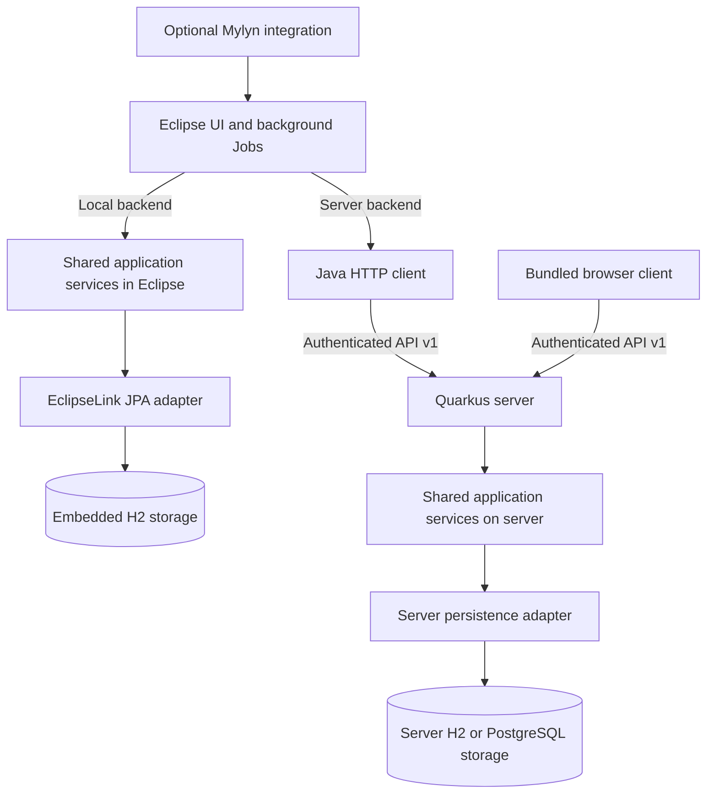

# Timekeeper architecture

Timekeeper has two storage paths. Eclipse can use an embedded H2 database through
the JPA adapter, or connect to the Timekeeper server through the Java HTTP client.
The browser uses the same server API. Optional Mylyn integration adapts Eclipse
task activation and Task List projections to Timekeeper services.

The shared domain and application-service sources live in `common/`. They
define immutable records, commands, repository ports and validation rules without
Eclipse, HTTP or persistence dependencies. The root Tycho reactor packages these
sources for Eclipse; the separate `server/pom.xml` reactor compiles the same
sources for Quarkus. The Java HTTP client implements the service boundary for
remote Eclipse operation; Eclipse runs network work in background Jobs.

In local mode, the JPA adapter owns the embedded schema and serializes writes
across H2 clients. A local database may be workspace-relative, shared on the
computer, or selected by a JDBC URL. This last option can connect to an H2 TCP
server and still uses the JPA path. It is separate from API v1 server operation.

In server mode, Quarkus authenticates requests, establishes the account scope and
owns server persistence. All Eclipse instances and browsers signed into the same
account share its records and receive committed change notifications. Server
storage uses its own schema; selecting another backend never copies or merges
the embedded database. The bundled browser assets are served at `/web/` and
require no separate Node service.

Activities record task/project time. Independent work sessions record work
periods; reports derive activity context from time overlap within the same
account. Clients group projects and sessions in the server/web model. These
business clients are distinct from the Eclipse and browser applications.

- [Data model](DATA-MODEL.md): embedded physical schema, legacy compatibility
  fields and the server client hierarchy.
- [API v1](API-V1.md): authentication, ownership, concurrency, synchronization
  and portable interchange.
- [Repository development](../development/REPOSITORY.md): prerequisites, reactors
  and test commands.
- [Eclipse connection guide](../operations/ECLIPSE-CLIENT.md): backend selection.
- [Server operations](../operations/SERVER.md): server configuration and storage.
