# Timekeeper web client

The **About** item at the bottom of the account menu opens a dialog that reads
`/api/v1/server` to identify the running server version and commit. Its details distinguish immutable build time, explicitly
recorded deployment time and process-start time. Information refreshes after
long polls and manual refreshes, including during rolling updates. Missing
deployment metadata is shown as **Not recorded**. The Docker/Synology deployment
guide records `TIMEKEEPER_DEPLOYED_AT`; direct JVM deployments may supply the
same UTC timestamp as an environment variable. Maven embeds Git identity and
build time in the server, and Docker builds receive Git identity as build args.

The standalone server serves its bundled client at `/web/`. Production uses
native browser modules; no Node process, CDN or separate database is needed.
Maven includes `server/web/src` in the server JAR. Users sign in with username and
password; the [account guide](../operations/ACCOUNTS.md) describes first setup,
legacy owner migration and recovery. The browser restores an HttpOnly Secure
cookie after reload. **Remember me** controls persistence across browser restarts.
API tokens for Eclipse are created under **My Account → API tokens**, shown once, and stored only
as hashes on the server. New credentials never enter browser storage. Existing
saved tokens are exchanged for a parent-bound cookie and then removed. Sign out
revokes the cookie session and clears records, drafts, requests and clipboard.

## Synchronization

Refresh binds the account first, then loads independent collections and reports
in parallel. Profile and revision checks still reject mixed snapshots and retry
up to three times. A 30-second overall deadline covers all pages and attempts;
failed or superseded attempts abort their outstanding reads. Browser console
warnings report refreshes lasting at least five seconds without exposing records.
See [Synology synchronization diagnostics](../operations/SYNOLOGY-PACKAGE.md#synchronization-diagnostics)
for request and database timings in the container logs.

## Language and region

The client uses locally bundled **i18next 26.5.2** with complete English and
Norwegian Bokmål catalogs in `server/web/src/locales/{en,nb}.json`. No CDN or
translation service is used. `npm run vendor:i18n` validates matching keys and
interpolation variables, then generates the native-module resources and copies
the pinned upstream ESM distribution and license. `npm test` verifies these
assets as well as pluralization, formatting, literal user text and stable import
fingerprints.

`i18n.js` selects the first supported browser language (Norwegian `nb`, `no` and
`nn` use Bokmål; English keeps its browser region), with `en-GB` as fallback.
**My Account → Profile → Language and region** can override this with `en-GB`,
`en-US`, or `nb-NO`, or restore the browser default. The optional nullable
`locale` field on `/me` persists account-wide; omission preserves it, while
`null` removes the override. Existing timezone-only clients remain compatible.
Schema 6 adds `tk_locale`; older owners have no override. `/auth/session` returns
the same owner-scoped preference so `bootstrap.js` loads it before evaluating
UI modules. Signing into an account with another language or saving a language
reloads the page after confirmation. Other account drafts require explicit
confirmation before a language change discards them.

Only marked UI text and attributes are translated. User records, identifiers,
CSV headers, timestamps and import fingerprints remain literal. `Intl` applies
the region to display dates, numbers and sorting; account time zones remain
independent. Worker requests carry the UI locale for consistent diagnostics.
New messages belong in both catalogs, use interpolation for values and i18next
plural forms for counts, and render through text nodes or attributes.

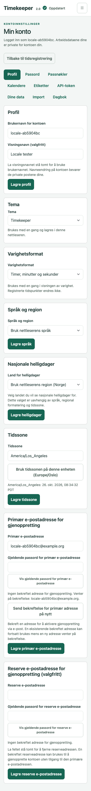

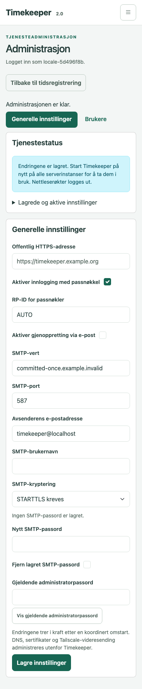

## Passkey sign-in and account management

The sign-in page offers an explicit **Sign in with a passkey** button when the
server has a configured HTTPS hostname. Password sign-in remains available;
canceling a native credential prompt leaves the form usable. **Remember me**
applies to either method. No credential is requested automatically on page load.

**My Account → Passkeys** lists user-named keys and creation/last-used times in
the account time zone. Adding or removing a key requires fresh password or
passkey proof. Removing the key used for the current session signs the user out.
Keys enrolled for an earlier hostname are marked unavailable at the current RP;
they remain visible until their owner removes them after testing a replacement.
Token-derived sessions direct the user to account sign-in before enrollment.
See [account operations](../operations/ACCOUNTS.md#passkeys) for configuration,
recovery, hostname changes and protected backup behavior.

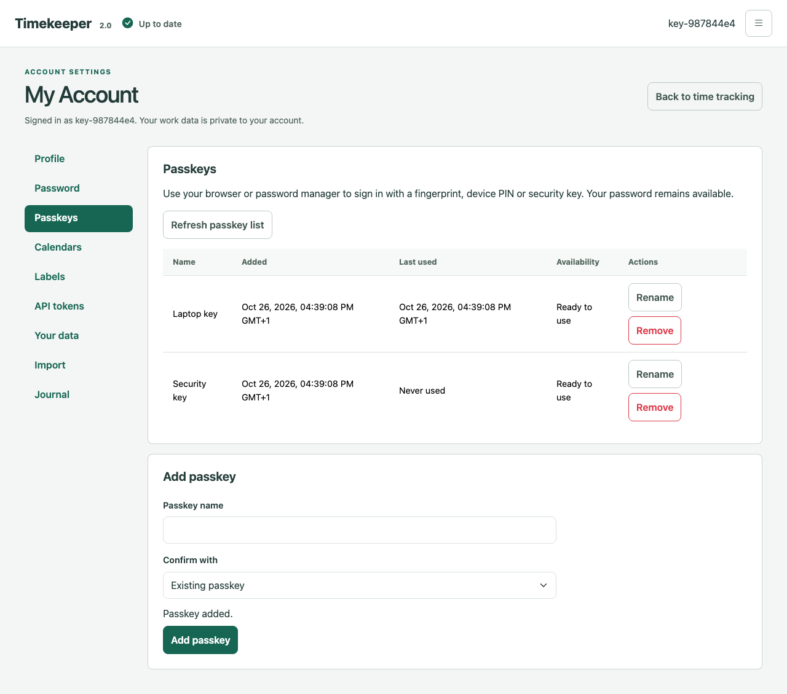

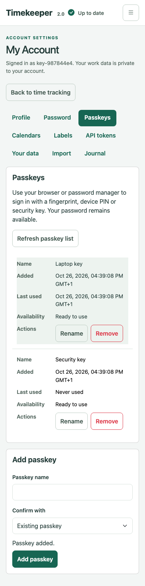

Bootstrap Icons 1.13.2 supplies locally bundled icons for navigation, tree
controls, action buttons and projects. Buttons retain accessible names and hover
titles; CSS, fonts and the MIT license are included in the server distribution.
Run `npm run vendor:icons` in `server/web` to regenerate the pinned assets,
project catalog and API allow-list. `npm run check:assets` verifies them.

Workspace views use a Bootstrap `navbar fixed-bottom` with `navbar-nav` and
`nav-link` controls. The six views appear in this order: Calendar, Week, Workweek, Activities,
Clients and Projects. Labels are configured under **My Account → Labels**.
The active view has `aria-current="page"`; compact screens show icons with
accessible names, and wide screens also show labels. Safe-area padding keeps the
bar and page content clear of each other. Standard action buttons use Bootstrap
`btn` variants, including the manual status refresh and calendar actions. The
clickable sync indicator sits immediately beside the Timekeeper title in the
header, remains available in My Account and is hidden when signed out.

## Daily-note Markdown prototype

About links to a local, lazy-loaded Milkdown editor prototype with formatted and
source modes, separate day labels, protected YAML frontmatter and source-only
editing for unsupported Obsidian syntax. It does not save calendar notes. See
the [evaluation and preservation contract](MARKDOWN-EDITOR.md) for the editor
choice, dependency licenses, bundle measurements, tests and integration limits.

## Calendar month view

**Calendar** is the default workspace tab. Its Monday-to-Sunday month grid shows
one client-coloured summary per client and day, with recorded session hours per
client above it. Only clients with logged time in the selected month are shown.
Multiple sessions for the same client are combined. Use the controls on the left
to move between months or return to the current month. The calendar button inside
the Month selector opens a month/year picker; a month can also be entered as `YYYY-MM`.
On mobile, swipe left across the month to go forward or right to go back.
Workweek, Activities and Week also support swiping between weeks on their
headings or other non-scrolling areas. Wide tables and the calendar grid keep
their normal scrolling and editing gestures. Date controls remain available.
Right-click a day or **press and hold** it on a touch screen, then choose
**Add day note** / **Edit day note**. A short label such as “Ferie” or “Avspasering”
appears beside the date in blue, distinct from red national holidays. Select the
label to edit it, or use the small note icon shown on hover or keyboard focus beside
an empty date. Empty-day icons are hidden by default on touch screens;
press and hold a day to create its note. Keyboard users can
focus that button and press **Shift+F10** for the same menu. Movement cancels a
long press, preserving scrolling and month swipes.

Labels accept up to 80 characters. The API independently stores a Markdown body
(up to 200,000 UTF-8 bytes), with a lightweight body-presence marker in calendar
summaries. Label-only edits preserve that body, and clearing a label leaves a
body-only note discoverable. The expanded day-note dialog edits the short label
and Markdown body independently. **Formatted** provides paragraphs, headings,
bold, italic, strikethrough, inline/fenced code, bulleted/numbered/task lists,
links, quotations, tables and undo/redo. Link addresses are validated; activating
a rendered link does not navigate. **Markdown source**
retains unsupported syntax, including Obsidian extensions. Opaque YAML
frontmatter is shown separately and preserved in saves. The Formatted and Markdown
source mode buttons share the editor toolbar with formatting actions, separated
by a vertical divider. Mode buttons use icons with localized tooltips. Editing
help and the separate clear/download actions are omitted. Safe angle-bracket
autolinks remain renderable, rich edits retain resource-link syntax, and
horizontal rules are saved as `---`.
The [layout evaluation](JOURNAL-EDITOR.md) records why this keeps the existing
Calendar navigation rather than introducing a separate Journal tab.
Clear the text and save to remove a label;
Cancel leaves the saved note unchanged. Each note belongs to its calendar date
and account, including days without work. It follows the account across web
sessions and devices, and remains on the same date after time-zone changes.
Narrow screens wrap the label when needed. Day notes never affect timed work,
reports or the Eclipse UI. A separate `journal-text` icon is always visible for
populated bodies, including body-only notes; `journal-plus` offers creation when
there is no body. Clearing only the label retains the body indicator; clearing
the body retains an existing badge. Empty-day add actions keep the existing
hover/keyboard/long-press behavior. Read-only sessions can open saved bodies,
switch modes; editing and task toggles remain disabled.

Dirty dismissal asks before discarding either field. Failed saves keep the
draft. A stale version disables Save and offers **Reload saved note**, with confirmation before replacing the draft. An
unconfirmed write offers **Check saved result**: it reads the server and accepts
a matching saved value without issuing another write. A differing saved value
requires explicit reload/review. No source or draft is stored in browser storage,
and logout clears both editor modes and their private content.

Week has a right-aligned daily-note button in each day heading, including
weekends. It edits the same dated note as the month view and retains the same
conflict, read-only, source-preservation and logout protections. Empty note
buttons stay visible in Week and are disabled for read-only sessions. Failed
note reads expose retry controls without blocking timed work.

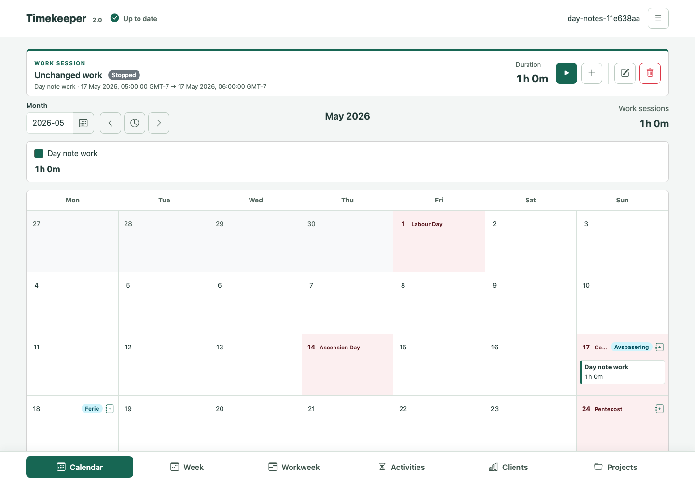

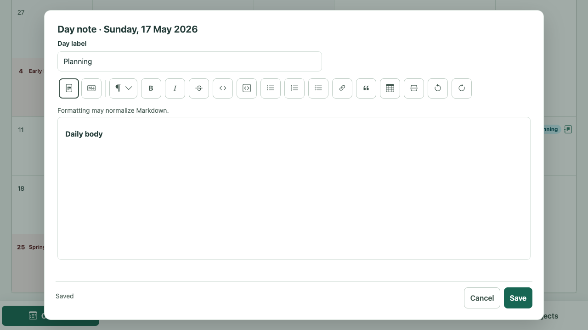

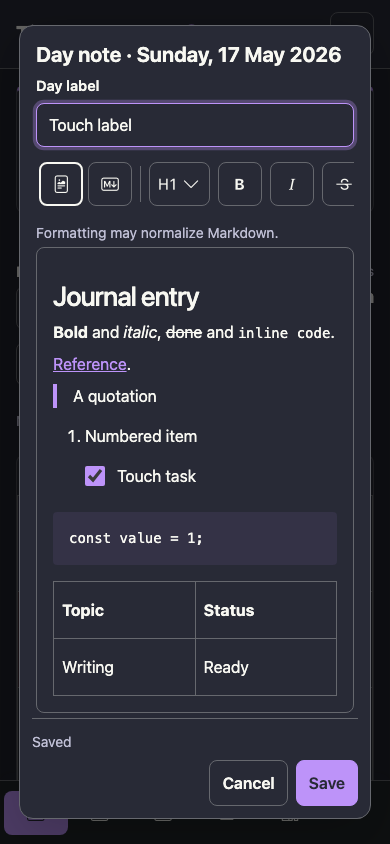

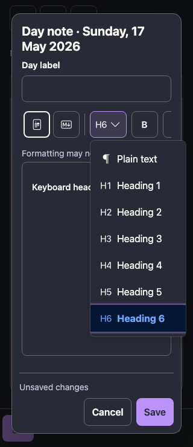

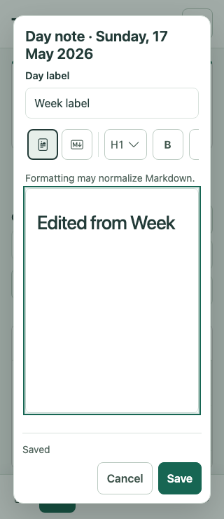

Hover over a daily client total to see its sessions, summaries, projects,
local start/end times and durations in a tooltip. These details are also available
when viewing the account with read-only access.
Month boundaries and daily slices follow the account's time zone, including DST;
running sessions use the server's report time. Activity/task time is independent
of these totals. Month navigation does not alter recorded sessions. Click a daily client total to edit its work session. When several sessions
contribute to the total, choose one by its summary, project and local times.
Optional project icons appear to the right of each daily duration. The same icon
is shown once when several contributing projects use it; hover details retain
all project names. Sessions without an icon add no placeholder.
The same editor is available in Week and Workweek. Daily summaries remain
readable in read-only sessions, where editing is unavailable.

These views use synthetic records from `tests/track.spec.js`; the browser uses
Los Angeles time while the account uses Oslo time.

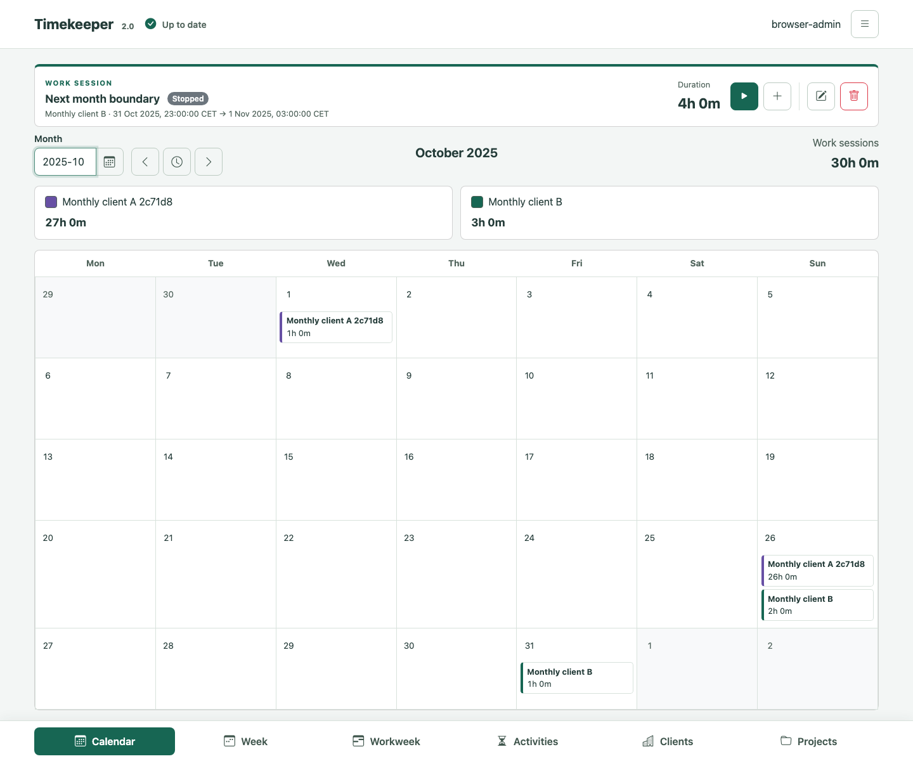

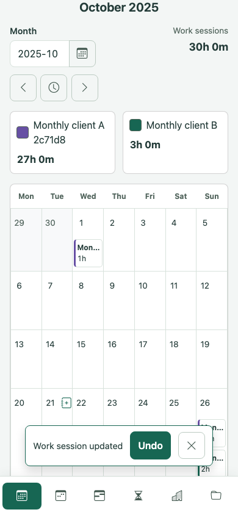

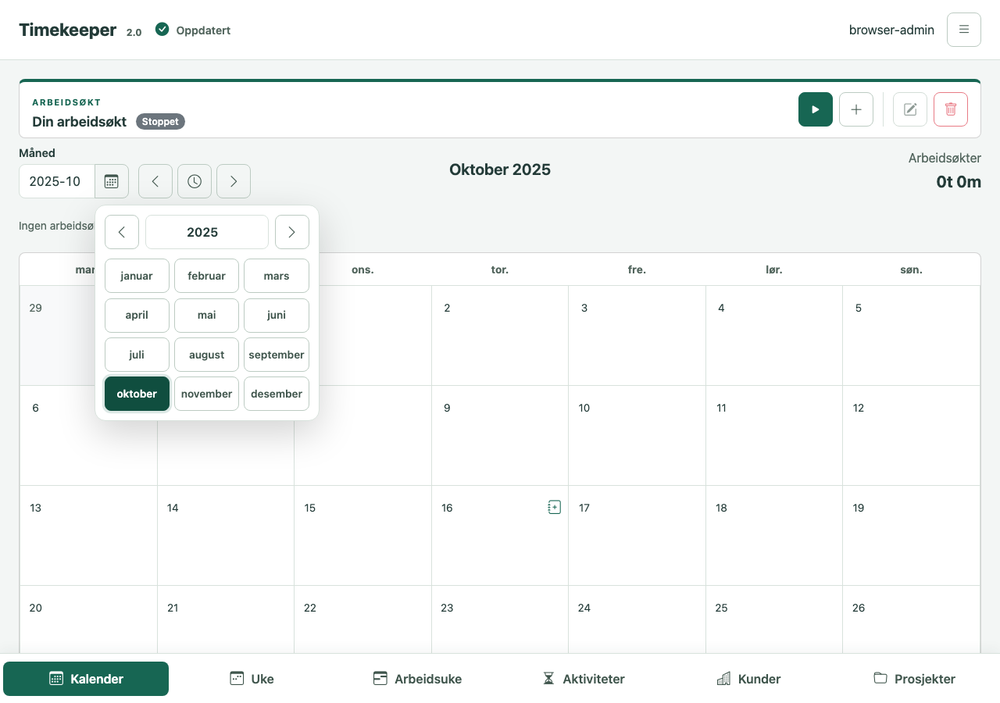

## Public holidays

Calendar marks national public holidays for the country selected under
**My Account → Profile → National holidays**. This choice is independent of
**Language and region**: Norwegian holidays can use an English interface.
The default uses the browser region; choose a country explicitly to share it
across devices, or **Do not show national holidays** to hide the calendar.
Changing the interface language preserves an explicit holiday country. The
account time zone still controls recorded work; it never moves a holiday to a
different civil date.

The optional `holidayCountry` field on `/me` stores the owner-scoped choice.
A supported country code selects its national calendar, `none` hides holidays,
and `null` uses the browser region. Omission preserves the current choice.
Preference writes use the profile ETag and change feed. Internal `PROFILE_PREF`
rows share the existing owner-scoped JSON storage; no schema upgrade is needed.

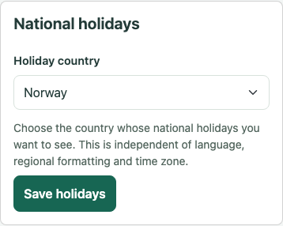

Holiday names appear directly beside the date, with both highlighted in red and
no icon or underline. Select the date or holiday name to read the full date and all names
for that day. This also works with read-only access. On narrow screens the names
are shortened visually; the dialog, hover title and accessible name retain them.
Holiday information does not change sessions, totals or editing permissions.
Holiday dates have a faint red background in Calendar and Week in every theme,
including weekend holidays. Week headers show the holiday name and preserve
today’s marker.

The locally bundled [date-holidays](https://github.com/commenthol/date-holidays)
3.37.0 dataset (2026-09-20) supplies national defaults. Regional and municipal
holidays can differ; subdivision calendars, optional holidays and observances are
not included. Unsupported regions and years before 0100 show an explicit message.
The engine loads when either view needs it, without requesting an external calendar.
A failed load offers Retry and preserves open session drafts. Data attribution
and the complete upstream license are available in **About**.
Run `npm run vendor:holidays` in `server/web` to regenerate the pinned engine,
country list and licenses; `npm run check:assets` verifies every generated file.

These previews use a Norwegian account with a browser in Pacific/Kiritimati:

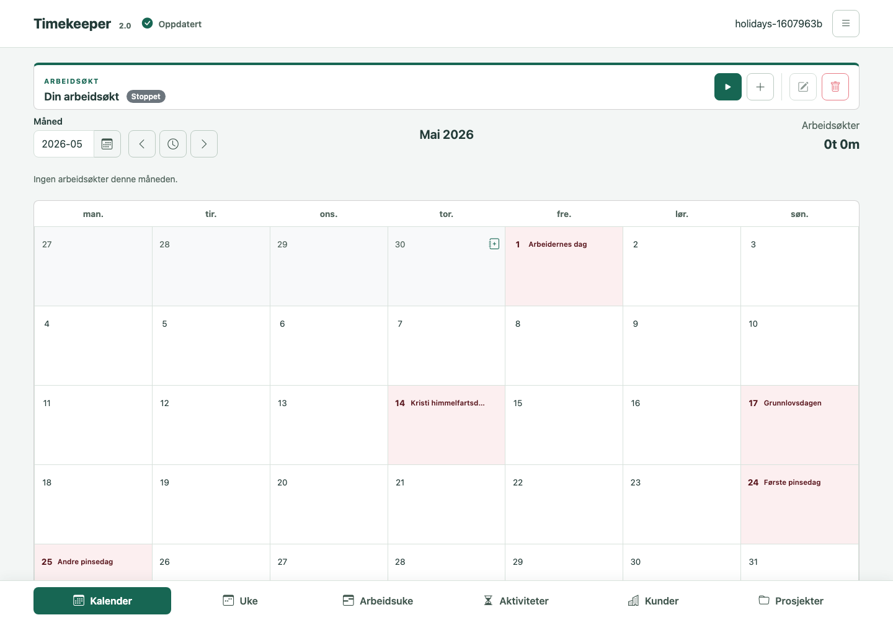

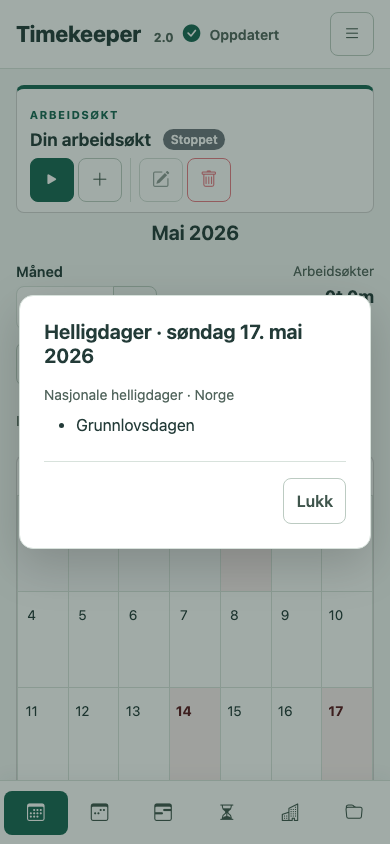

The monthly view omits its time-zone caption and normal holiday attribution
footer. **About** shows the selected holiday country and the local date-holidays
data license; loading failures and Retry remain available in the monthly view.

## Themes

Choose **Theme** under **My Account → Profile** to switch between Timekeeper (the default),
Timekeeper Dark, Solarized Light, Solarized Dark, Nord and Dracula. The selection
is saved on this browser and shared with other open Timekeeper tabs, including
Administration. A saved theme also applies to sign-in and loads before the
stylesheets to avoid flashing a light page. If browser storage is unavailable,
theme selection still works for the current page.

Theme tokens cover forms, tables, calendar surfaces, dialogs and account pages.
Client colors remain the colors chosen for those clients. The palettes use
[Solarized](https://ethanschoonover.com/solarized/),
[Nord](https://www.nordtheme.com/docs/colors-and-palettes/) and
[Dracula](https://draculatheme.com/spec), with text/accent contrast adjusted for
web controls. All styles and checkbox/radio assets are bundled locally.
`tests/themes.spec.js` checks WCAG A/AA contrast in every view, editors and account
settings, persistence, cross-tab updates and unavailable storage. It captures
desktop and mobile previews for every theme under `server/web/test-results/`.

## Design baseline

The main views share a fixed bottom navigation bar, with an icon for each view.
Labels remain visible on wide screens and hide when space is limited; every
button retains its accessible name and hover title. The bar stays within the
device's safe area, and content and Undo notifications leave room above it.
Account settings and sign-in use their own navigation.
Open **About** in the account menu for Timekeeper copyright, the Eclipse Public
License, project website, source and issue tracker. Server version, SPK version,
commit and build, deployment and start times remain available. Expand **Web
components and licenses** for the exact bundled Bootstrap, Bootstrap Icons,
i18next and date-holidays versions, upstream copyright and complete local license
texts, including date-holidays data and dependency notices. External project
links open separately; viewing About and its license texts needs no third-party
requests. Close the dialog with its button or Escape.

`npm run vendor:notices` regenerates the About metadata and local license copies
from pinned dependencies and bundled upstream notices. Asset checks reject stale
metadata or missing license texts. After updating a dependency, regenerate its
assets first and then the notices.

Existing browser sessions show a loading status during restoration rather than
flashing the sign-in form. My Account and Tracking use the same session; leaving
the page clears private data and returning rechecks the session. Expired sessions
and explicit sign-out still show sign-in.

**Edit work session** includes **Delete**. A separate confirmation defaults to
Cancel and leaves the draft intact when canceled or dismissed with Escape.
Confirmed deletion uses the version originally opened in the editor, rejects
concurrent changes, and offers Undo for ten minutes. An uncertain reply disables
further writes until the records have been reviewed.

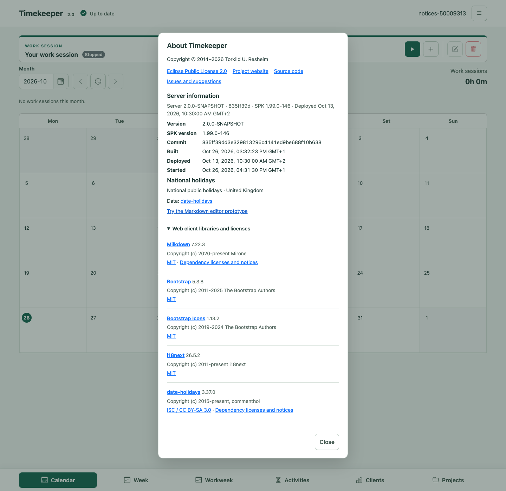

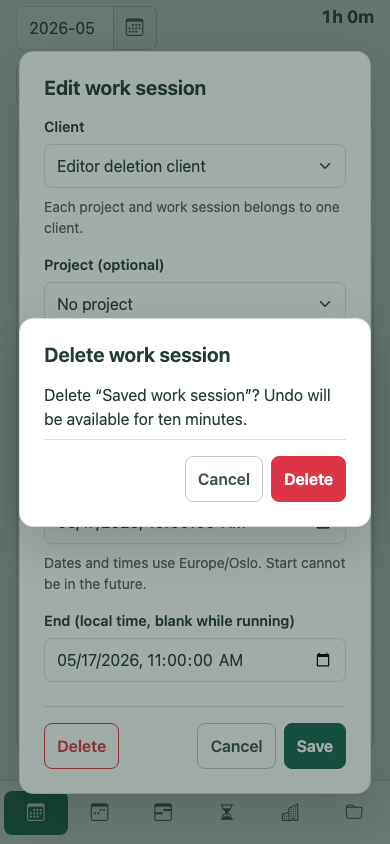

Bootstrap 5.3.8 supplies the shared buttons, forms, navigation, cards and tables.
The small application theme in `style.css` defines the green palette, typography,
spacing and visible keyboard focus. The work-session card establishes the baseline:
a client-color accent, summary, explicit running/stopped status, local times,
duration and consistently sized icon actions. Historical records and detailed
totals are available in Workweek, Activities and Week. Client color is always accompanied
by text.
The same controls apply to sign-in/setup/recovery, account management, activities,
clients, projects, tasks and labels. Record tables become labelled cards on narrow
screens so actions stay in view; Workweek, Activities and Week retain their specialized
scrollable layouts. Week geometry is isolated in `calendar.css`.

These screenshots use synthetic records from `tests/design.spec.js` at 1440 and
390 pixels wide. The design tests also capture all workspace views and account,
sign-in and validation states under `server/web/test-results/design-*.png`.
Review those images after layout changes; automated accessibility checks cannot
replace visual review or keyboard testing.

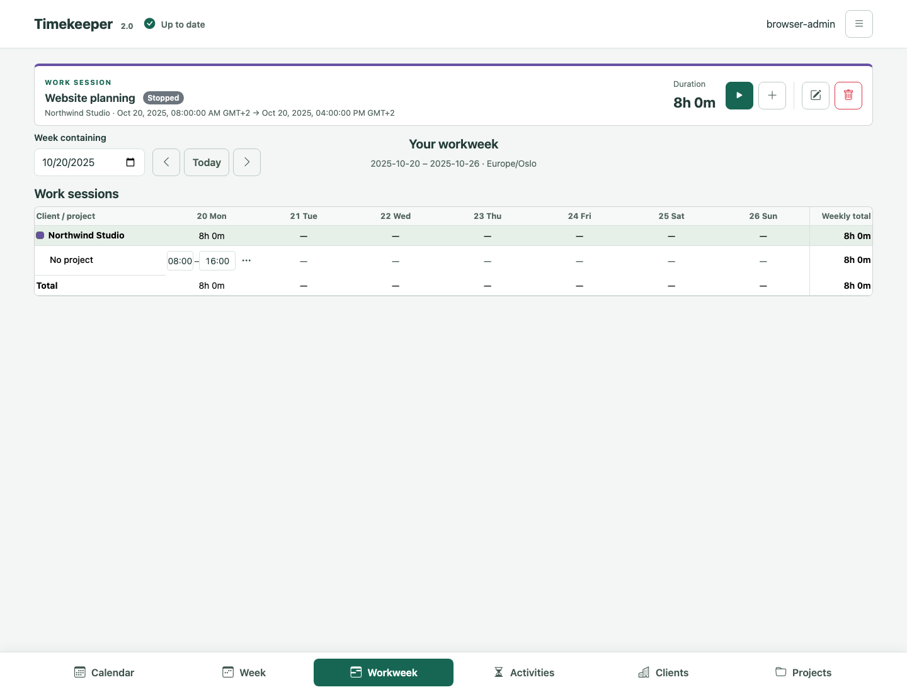

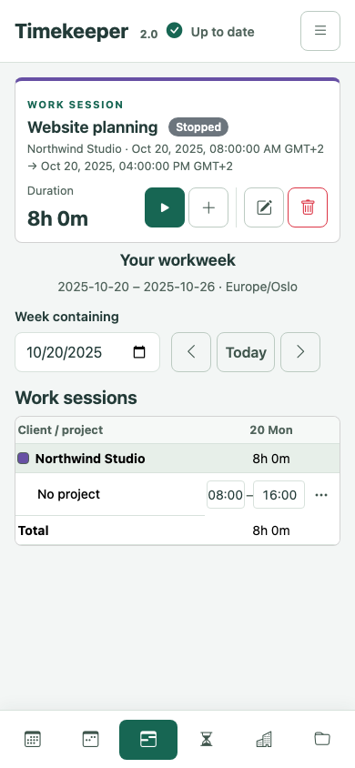

Bootstrap's exact npm version and integrity are pinned in `package-lock.json`.
Its compiled CSS and MIT license are committed under `src/assets/bootstrap`,
alongside the SVGs extracted from its data URLs. No Bootstrap JavaScript is needed:
native modal dialogs and the existing application navigation handle interactions.
The deployed client uses only same-origin files, including icon fonts, and retains
its `img-src 'self'` security policy. Maven packages these assets directly; it does
not require npm or an external CDN at runtime or when building the server.

After deliberately updating the pinned dependency, run:

```sh
cd server/web
npm ci --ignore-scripts
npm run vendor:bootstrap
npm run check:assets
```

Commit the regenerated CSS, SVGs and license together. CI checks that the bundled
assets match the pinned dependency, then runs real-server browser tests with axe
WCAG A/AA checks for all views at desktop and narrow widths. Those tests verify
that no design asset triggers a third-party request or is blocked by CSP, and exercise
keyboard focus, required fields and error recovery. Native browser validation and
the API's existing concurrency and authorization rules remain in use.

macOS WebKit reports inline-style CSP diagnostics for native select controls even
on a plain page without application styles/scripts; Playwright screenshots also
add inline-style diagnostics. The WebKit asset check excludes those inline reports
while continuing to reject blocked design assets. Chromium checks every CSP event.
The production security policy is unchanged. The macOS WebKit keyboard check uses
Option-Shift-Tab to include buttons, matching
[Safari's native keyboard navigation](https://support.apple.com/guide/safari/cpsh003/mac).

Projects, tasks, labels, activities and work sessions use API v1. Start/stop uses durable
idempotency keys. Editors/deletion retain the original opaque ETag, including
across full resynchronization, rather than upgrading a stale draft. Validation,
permission, network and concurrency failures preserve drafts. Loss of authorization
or a changed owner clears the account view and its drafts. An uncertain
ordinary write requires cancel, refresh and review; uncertain start/stop offers
explicit retry of the same frozen payload/key. Acknowledged saves remain
successful when a subsequent refresh fails.

## Workweek and Activities

Both views share Week's toolbar layout: date and previous/Today/next navigation
on the left, the view title and week details centered, and Activities' Add time,
Hide activities and Show activities icon actions on the right. On narrow screens,
the centered title sits above the controls.

Reports use the account's IANA time zone and the server's exact daily/weekly
totals. At sign-in, an untouched UTC profile (version zero) adopts the browser's
local IANA time zone. This is saved to the account so work sessions, activities,
calendar boundaries and other clients use the same zone. An explicitly selected
zone, including UTC, is retained when signing in from another device. Read-only
tokens retain the existing account zone. Use **Account menu → My Account → Profile → Time zone** to change it explicitly.
Workweek shows overlapping sessions in a compact **Work sessions** grid grouped
by client and project. Each daily cell contains a start/end pair for every
session; edit a time and press Enter or leave the pair to save, or Escape to
cancel. The details menu shows summaries and provides the full editor
and delete action. Running sessions remain marked. Edits preserve unchanged
endpoint precision and metadata; stale or uncertain saves keep the proposal for
review instead of repeating the write.

Times use the account time zone. Sessions crossing midnight appear on each day;
edit each endpoint on its actual day. An end of **24:00** means the next midnight.
For repeated daylight-saving times, include an explicit offset such as
**02:30+01:00**. Daily/client/project totals are clipped at local-day and week
boundaries and follow the selected clock/decimal format. The grid hides when no sessions overlap the
selected week. Session time is separate from activity report totals.

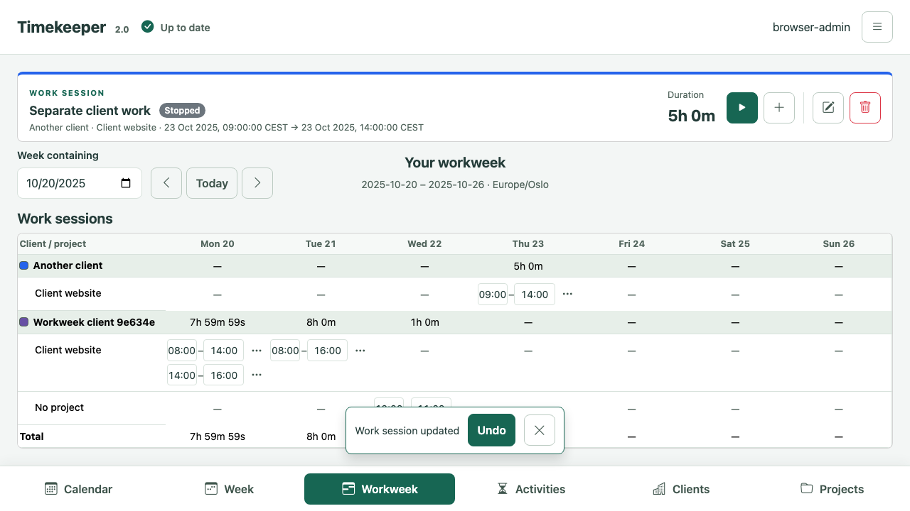

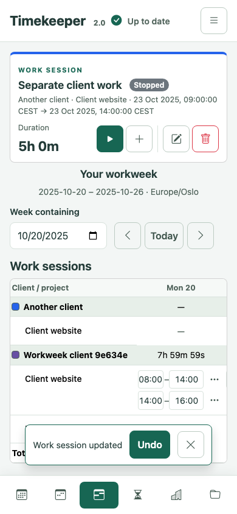

The **Activities** tab groups projects, tasks, subtasks and activities,
with seven daily duration columns, a weekly total column and expandable rows
like the Eclipse view. Its daily and weekly summaries report activity time.
Workweek and Activities share the selected week and duration format. Selecting
a day filters Activities without hiding work sessions in Workweek. Task totals include their subtasks. **Hide activities**
keeps the project/task outline visible; **Show activities** restores its rows.
**Duration format** in **My Account → Profile** chooses conventional time or decimal hours for this browser
session. Decimal hours use two places, rounded from each exact aggregate rather
than adding rounded daily cells. Display options do not change recorded times.
Daily and weekly summaries show whole seconds; stored times and calculations
retain nanoseconds. Linked task titles include their external ID (the Jira browse
key or GitHub issue number when available) and open the recorded HTTP/HTTPS issue
URL in a separate tab. Native task UUIDs are not display IDs.
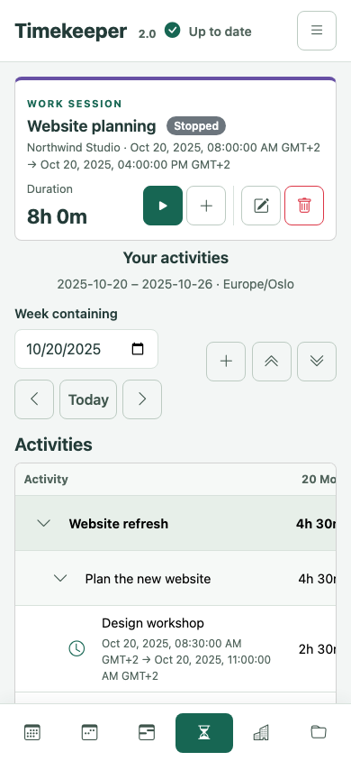

Activity fields show and accept local dates and times in the account’s configured
time zone, retaining up to nine fractional digits. Intervals across
midnight are stored as separate activities in the account's time zone, including
manual entries. Live tracking continues into the next day with the same active
identity and labels. Each day's activity is edited or deleted separately; a
rollover invalidates the earlier editor version. Day boundaries preserve exact
time through daylight-saving changes.
Start cannot be in the future, for either an ongoing or completed interval.
The server rejects invalid creates, edits and imports without changing records.
First click
selects an activity; another click or Enter while selected opens its editor.
Long polling loads consistent owner-scoped snapshots without replacing drafts.
Label choices in open activity and tracking dialogs receive additions and
renames from other clients while retaining their checked IDs and draft fields.
A selected label deleted by another client stays visible as deleted until the
user reviews it; saving cannot silently drop that reference.
Offline reads reconnect with backoff and never replay writes. Sessions bind to
the authenticated owner and reject live token owner reassignment.

## Personal settings and independent user accounts

**My Account** is a dedicated page with Profile, Password, API tokens, Labels and Import sections.
Open it from the header’s **Account menu**, which also contains **Sign out** and,
for administrators with write access, **Users**. Time-zone settings are in Profile.
The menu keeps the header on one row at phone widths and supports normal Tab
navigation, Enter/Space, Escape and outside-click dismissal.

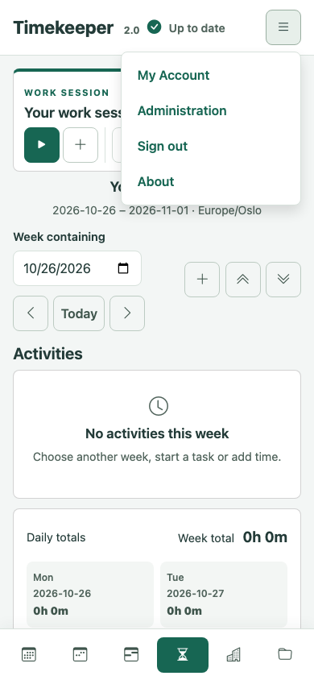

Safari’s **Add to Home Screen** uses the bundled Timekeeper clock icon through
[`apple-touch-icon` metadata](https://developer.apple.com/library/archive/documentation/AppleApplications/Reference/SafariWebContent/ConfiguringWebApplications/ConfiguringWebApplications.html).
The icon is served before sign-in and matches the web favicon and Synology icon.
Adding the shortcut does not add offline access or change session behavior.

Navigation validation uses the checksum-verified server archive. On `f119288`,
70 Chromium tests passed (the SMTP-only case runs separately), and 69 HTTPS WebKit
tests passed with a loopback SMTP fixture. The two native touch-injection tests
require Chromium CDP and are skipped in WebKit; pointer/keyboard calendar checks
still run there. Coverage includes menu keyboard focus, 320px layouts, role-based
Users visibility, sign-out and opening an editor while a saved-zone report refresh
is deliberately held pending. Web unit tests: 50 passed.
It uses a side navigation on desktop and wrapping navigation on narrow screens.
Profile includes an optional display name and an explicit time-zone preference;
the device-zone shortcut never overwrites a saved choice without a save action.
New passwords require confirmation. Token lists show access, expiry, last use
and revocation state, with one-time secret copy and named revocation confirmation.

Administrators use the separate **Users** page to list, create and edit account
identities. Editing opens a full page, with Back to users; the last enabled
administrator is protected in the UI and by the server. This does not grant
access to another account's work data or introduce workspaces, members or
invitations. Personal settings remain separate from other-user administration.

**Import** supports Toggl Track Detailed Report and Legacy CSV as work sessions (default)
or activities, with explicit source-user and
time-zone selection, explicit catalog mappings, duplicate review, durable
bounded commits and whole-job Undo. A cancellable module worker handles parsing
and batch planning. Navigation/sign-out disposes the worker and source preview;
resuming uses server history and reselecting the unchanged file. No raw CSV or
credentials are persisted in browser storage. See the
[import and Undo guide](../operations/TOGGL-IMPORT.md) for limits and conflict handling.

Routes are bookmarkable fragments (`#account/profile`, `#account/password`,
`#account/tokens`, `#account/import`, `#users`, `#users/new` and `#users/<encoded-owner>`). Direct
access still requires the authenticated account and server-side permissions.
Browser Back and explicit return links share the draft guard. Writes reserve
the page until their result is known; uncertain writes require record review,
and stale edits keep their captured ETag and draft until explicitly reloaded.
Changing pages never stops timers. Sign-out invalidates pending account-page
loads and clears forms and token secrets. Passwords and bearer credentials are
never placed in routes or browser storage.

## Work sessions

The compact **Work Session** card stays visible on every tracking tab. It shows
the running session, or the most recent completed session, with its summary, client,
local times and duration. Its timing/recording buttons sit beside the session
tools, separated by a divider; on narrow screens the tools wrap below a horizontal
divider. Tools target the session shown in the card and are disabled when no
session exists or access is read-only. Workweek provides historical edit/delete
actions, and Week provides historical editing. Opening a historical editor
does not change the shared panel's target. Start/stop controls remain independent
of activity timers. Counters use server timestamps and elapsed browser time;
when offline they freeze. The card contains no history selector, duplicate totals
or activity list; historical records and detailed reports remain in Workweek,
Activities and Week.

A work session is an independent interval for one client. Its tools are **Edit**
and **Delete**. Create or edit activities in Activities; task timers
run independently. There are no session selectors or manual activity links.

Work-session forms, cards, tooltips and details do not offer or display labels.
Client and optional project classify a work session. Labels belong to Activities
and are managed under **My Account → Labels**, rather than a tracking tab. The
account page reuses the existing label editor, deletion safeguards, read-only
permissions and live catalog updates.

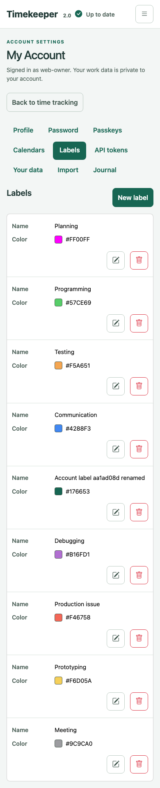

Legacy session labels remain in stored records and portable transfers. Session
edits omit `labelIds`, preserving existing metadata. Moving, resizing, stopping,
copying and Undo preserve it without changing Activity labels. New work-session
imports retain source tags in the import audit without creating session labels;
older resumable import plans keep their original mapping behavior.

Reports derive context from that account's activities overlapping the session,
including running timers. Tracked time sums clipped intervals; covered time is
their union. Unallocated time subtracts that union from session duration.
Moving, resizing, stopping or deleting a session leaves activities unchanged.
Sessions and activities can span midnight independently; activity day parts
remain independent records. Work-session editors use native date/time pickers in
the account's time zone. Unchanged endpoints retain their exact stored precision;
choosing a different time uses whole-second precision. Repeated clock times offer a
first/second occurrence choice. Activity editor fields preserve nanoseconds and reject
nonexistent or ambiguous local input. Open drafts retain their original time zone;
stale saves preserve drafts and uncertain commands retry the same durable key.

Portable domain-v3 JSON/CSV includes clients and independent sessions. Imports
still accept v1/v2/v3 snapshots, ignoring retired activity `workSessionId` fields,
including references to sessions absent from an older export. Exports omit those
links. Native Eclipse CSV and portable server CSV remain distinct formats.

## Automated verification

```sh
npm ci --ignore-scripts --prefix server/web
npm test --prefix server/web
cd server/web && npx playwright install --with-deps chromium && cd ../..
./mvnw -B -ntp -f server/pom.xml clean verify
python3 server/scripts/package_server.py --output server/target/distribution --commit "$(git rev-parse HEAD)"
python3 server/web/tests/acceptance.py --distribution server/target/distribution/timekeeper-server.zip
```

For WebKit, install its browser and use the existing HTTPS fixture so Secure
session cookies work. Run from the repository root after packaging the server:

```sh
cd server/web && npx playwright install --with-deps webkit && cd ../..
python3 server/web/tests/acceptance.py --distribution server/target/distribution/timekeeper-server.zip --browser webkit --https
```

Calendar boundary searches and timer displays reuse native date/number formatters
through caches bounded to 32 entries each, keyed by locale and formatting options.
The running-calendar regression advances a minute of timer updates without
repeated formatter allocation, checks that My Account stops hidden timer paints,
and verifies that returning to the workspace catches up the displayed elapsed time.
Timer paints also stop while the browser document is hidden.

The HTTPS fixture requires `openssl` on `PATH` to create a temporary test
certificate. It uses a loopback reverse proxy and accepts that certificate only
in the test browser. To reproduce CI's actual email-delivery checks with
Chromium, run:

```sh
python3 server/web/tests/acceptance.py --distribution server/target/distribution/timekeeper-server.zip --https --mail --grep 'first administrator|email recovery'
```

`--mail` requires `--https` and captures messages through a temporary loopback
SMTP fixture. Safari's native macOS Password AutoFill UI still needs a manual
check.

For virtual WebAuthn registration, sign-in and fresh-proof tests, use Chromium
with the isolated HTTPS `localhost` RP:

```sh
python3 server/web/tests/acceptance.py --distribution server/target/distribution/timekeeper-server.zip --https --mail --passkeys
```

Signed protocol tests also run across two independent server containers sharing
PostgreSQL. They cover cross-replica completion, one-use races, removal/recovery,
protected restore and changes to backend addresses, public ports and RP hostnames:

```sh
python3 server/scripts/passkey_replica_acceptance.py --server-image timekeeper-server:test
python3 server/scripts/passkey_replica_acceptance.py --server-image timekeeper-server:test --postgres-image postgres:17.11-bookworm --output server/target/passkey-pg17-acceptance.json
```

These fixtures use synthetic keys; they do not establish Safari/Touch ID,
security-key or cross-device interoperability. Record those checks separately
over HTTPS, including a hostname/port cutover. Fixture receipts contain only
scenario results; private keys and database dumps are temporary and never uploaded.

Packaging requires a clean committed tree. Browser acceptance launches the
checksum-verified distribution with temporary file storage and synthetic tokens,
then stops the JVM and removes private fixtures. Reports, screenshots and source
provenance go under `server/web/test-results`. Traces/videos are off because they could
retain authorization headers. CI's Web job uses the same Server artifact as
Remote-Eclipse.

Use `captureScreenshot` from `server/web/tests/screenshots.js` for browser
screenshots. When the bottom navigation is visible, it captures the viewport so
the bar stays at the bottom of the image. A full-page capture includes content
below the viewport but leaves fixed navigation at its original viewport position,
which makes the resulting image misleading. Pages without the workspace bar can
still use full-page captures.

Browser tests cover core tracking, authorization/validation, peer synchronization,
stale drafts, lost committed replies, exact nanoseconds, autumn DST, mobile
layout, expandable project/task hierarchy, external issue links and remembered
credentials. The `remote-client-tests` Eclipse profile
also launches a real browser peer against its installed runtime's server;
[WEB-ECLIPSE.md](../verification/WEB-ECLIPSE.md) records that bidirectional verification.
Final release installation remains a separate gate.

## Week

Week follows Calendar's toolbar layout: date and navigation controls on the
left, the month title and week details centered, and work-session actions on
the right. On narrow screens, the centered title sits above the controls.

The **Week** tab shows all seven days. Week, Workweek and Activities share the
chosen week and the account's time zone. Use the arrows, **Today**, or the date
field to navigate. On smaller screens, scroll inside the calendar to see the
remaining days and hours.

Drag across empty calendar space to preview a new work-session interval, in either
direction and across days. Release opens the normal editor with the selected times;
optionally enter a summary, review the interval and client, then save. The client from the last
saved work-session editor is preselected during this sign-in. Before that, the
selected, running or latest session supplies a valid client. Cancelled edits do
not change this choice, and signing out or switching accounts clears it.
Nothing is written until
that save succeeds. Escape cancels an in-progress range, and cancelling the editor
also leaves records unchanged. Selection follows the calendar's 15-minute slots;
a short drag covers at least one slot. Repeated clock times resolve to their
separate instants, and shaded/nonexistent endpoint times cannot create a session.

On touchscreens, enable **Select time range** before dragging empty space. This
explicit mode leaves ordinary touch scrolling available when it is off. It turns
off when the range opens for review, when leaving Week, on disconnect and at
sign-out. Existing work-session move/resize gestures continue to work. Keyboard
users can select a day/time with the arrow keys and press Enter, or use **Record
work session**, then enter the desired end time in the editor.

Strips represent work sessions, using the associated client’s color, session
summary and elapsed duration. Small resize grips appear when hovering over a strip
or focusing its controls with the keyboard; on touchscreens, select the strip to
reveal them. Select a strip to see its full interval;
double-click it or use **Edit selected work session** to edit. Drag the strip
to move it between times or days, and drag its top or bottom handle to resize.
Moves and resizes save directly without opening a dialog. A failed or uncertain
save opens the editor with the proposed times for review; it never silently
overwrites another client's change.
With a strip focused, Up/Down moves it by 15 minutes and Left/Right by one local
day. On a resize handle, arrow keys adjust that endpoint. Moving preserves exact
elapsed duration and fractional seconds. Sessions spanning midnight retain one
identity while appearing in each affected day.

Use **Copy work session** and **Paste work session**, or Ctrl/Cmd+C and Ctrl/Cmd+V,
to create a separate session. Select a day heading to retain the copied start
clock time, or select a calendar slot to choose a new time. The paste editor
lets you review the interval before saving. The client, interval and summary are
copied; activities and task references are not. The copy buffer is private to
the signed-in browser session and is cleared on sign-out. A running source keeps
its blank end in the copy; finish the copy's interval if another session is
still running. Starts in the future remain invalid.

Week shows work sessions and subscribed calendar plans. Recorded activities
appear in **Activities**, keeping the Week display focused. Editing a work
session never changes its activities. Task rows in Activities offer **Start**
and **Edit task**. There is no separate task-management section.

Repeated clock times have separate rows; shaded slots do not occur on a given
day. A drag retains the original session snapshot and saves with its opaque
version precondition. Peer edits, rejected changes and unknown save outcomes
preserve the proposed interval for review instead of silently overwriting data
or repeating an ordinary write.

### Calendar subscriptions

Open **My Account → Weeks** to manage read-only iWeek subscriptions.
Planned events remain visible in Week.
Choose **Add calendar**, enter a descriptive name and subscription URL, and select
its client. HTTPS and `webcal://` subscription links are supported; provider login
and two-way calendar editing are outside this first version. The saved URL is
kept private: editing shows an empty replacement field, and leaving it blank
preserves the existing link. The list shows the last successful refresh
and any specific refresh error. Each account may have up to 20 subscriptions.

Weeks refresh automatically about every 15 minutes. **Refresh calendar**
requests an update immediately, with a 30-second cooldown between attempts.
Failed refreshes keep the last successful events and explain whether the problem
is the address, connection, certificate, provider access or file contents.
Changing a name, client or visibility reuses the cached feed. Replacing a URL
clears its old cache and starts a new refresh. Hidden calendars continue refreshing;
removing a subscription removes its external events and leaves recorded activities
and their source history intact. Clients with subscriptions cannot be deleted
until those subscriptions are removed or reassigned.

Calendar events use neutral backgrounds and the same narrow, solid client-coloured
indicator on the left as monthly Calendar entries. Events awaiting import use a
dotted outline and a **Planned** label; imported events use a solid outline and a
**Recorded** label. Event cards have no icons; the client and
calendar name remain available in their text and accessible name. They appear
beside recorded work without contributing to reports. Select
an event with the pointer, touch or keyboard to see its full interval, source,
location and plain-text description. Read-only sessions can view details.
All-day plans appear above the time grid, with their exclusive iWeek end date
shown as an inclusive human-readable range. Timed events without an end are
shown as zero-duration markers. All presentation follows the account time zone;
floating calendar times use that zone. Recurrences retain local wall-clock times
across DST, including moved/cancelled occurrences and THISANDFUTURE changes.

**Create activity** opens a review editor with the event title/description and
interval. Choose an optional project/task belonging to the subscription's client.
All-day plans require explicitly chosen actual start/end times; they never create
24 hours of work automatically. Future plans are visible, but saving a future
activity start is rejected and preserves the draft. A completed interval is
required. Summaries are limited to 2,000 characters; if shortened, the editor
explains that full details remain in the source history.

Nothing is recorded before confirmation. The activity, any local-day fragments,
source reference and retry receipt commit together. An uncertain save retries
its exact original command. Repeated refreshes or new conversion commands cannot
silently create a second activity for the same subscription/occurrence, even
when the first activity has been deleted. Later source changes never overwrite
recorded work. Activity edits retain the source reference, including newly split
daily fragments. Private account archives include source history as inert audit
records in the existing archive format; feed URLs and cached feeds are excluded.
Subscriptions must be configured separately after importing an account archive.

The engine is the pinned [iCal4j 4.4.0](https://github.com/ical4j/ical4j/tree/ical4j-4.4.0).
Its BSD license is included in the server JAR. Calendar downloads and recurrence
expansion are bounded; no attachment or timezone-definition URLs are fetched.
Feeds are limited to 2 MiB, 5,000 VEVENT revisions and 2,000 visible occurrences
per calendar. The API accepts windows of at most 31 civil days.

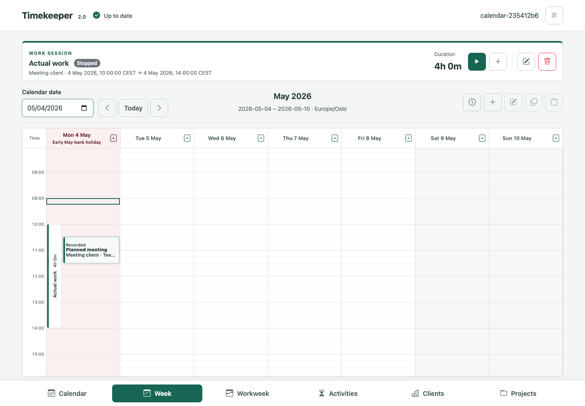

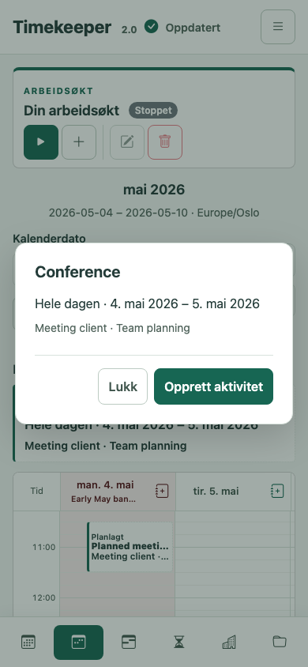

## Clients, projects and work sessions

The **Projects** view groups projects beneath their client, with its color and
project count. Client groups start collapsed. Use the client chevron to expand
or collapse its projects. Choices survive refreshes and tab changes within the
current session; reloading the page starts collapsed again. The session-report
button beside Edit opens all of the project's work sessions in a new browser
tab, newest first, with exact duration totals, running sessions, the account's
time zone, and Refresh and Print actions. Reports also work for read-only
sessions and follow the account language and selected theme.

Create or edit a project to
select an optional icon from the bundled picker, or choose **None** to remove it.
Icons also appear beside project names in Workweek and beside daily durations
in Calendar. They are retained in account downloads and JSON/CSV transfers.

The project icon picker offers 2,078 bundled Bootstrap Icons. Choose one of
Bootstrap's 29 categories, such as **Communications**, **Files & Folders** or
**Weather**, and filter by **Filled** or **Unfilled** style. Search by name,
keyword or category across the entire catalog, including icons not yet shown,
or choose **More icons** to browse. Category counts cover the full bundled set;
the results count reflects the combined filters. Filtering preserves the
current selection; **None** removes an icon. Icons work offline.

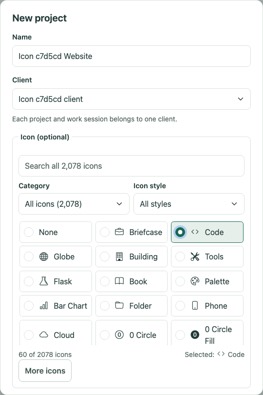

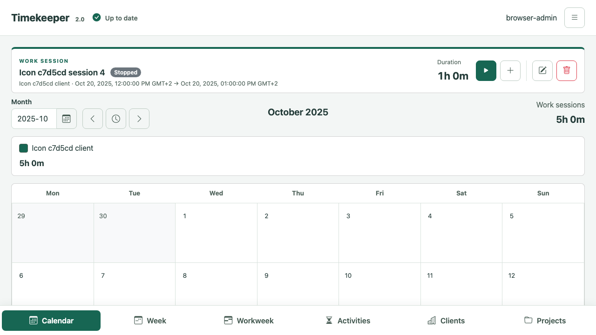

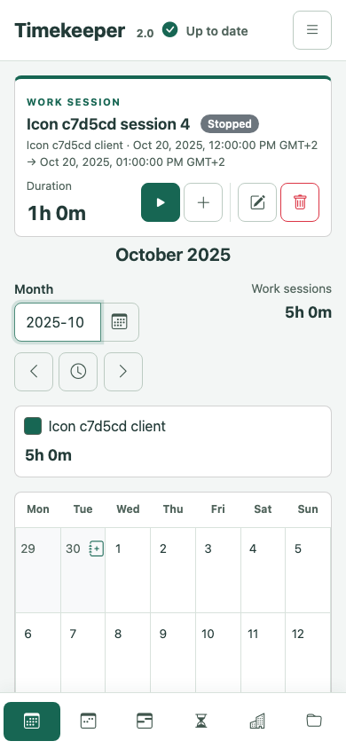

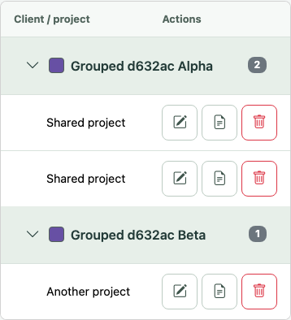

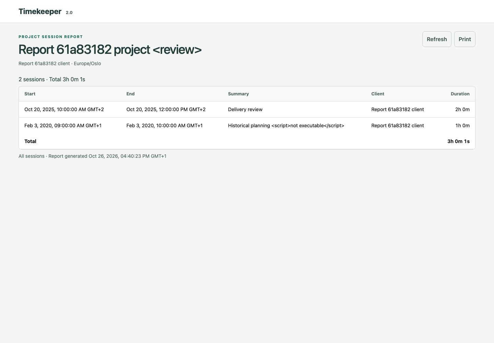

Use **Clients** to create, rename, recolor or delete a client. A client has a
required name and hex color. Each project belongs to exactly one client; choose
it in the project editor. A client may have many projects. Each work session also
belongs to exactly one client and has an optional summary, with no separate
title. Choose the client and optionally enter a summary when starting or recording
a session. Summaries support multiple lines and up to 4,000 characters. The
calendar uses the summary (or “Work session” when empty) and client color; light colors receive dark text and dark colors receive light
text. Changing a client’s color updates all its sessions without editing them.

Create a client before creating your first project or work session. Clients in
use by projects or sessions cannot be deleted; reassign or remove those records
first. A project’s client and a session’s client can be changed independently.
Existing activities and their times are retained when these associations change.

On server upgrade, projects and sessions without a client are assigned to
**General**. Existing session titles move into Summary. If a title contains text
not already at the start of the summary, it is placed before the existing notes,
separated by a blank line. Existing descriptions, exact times, clients, projects
and labels are retained; the migration is repeatable. General can be renamed and
recolored like any other client. Import/export v3 preserves clients, project
ownership, summaries and colors, and older archives with titles remain importable.
Older v1/v2 imports receive General automatically.

Client management is a server/web feature. Eclipse project
creation receives General on the server, and Eclipse project edits preserve its
client. No client selection fields are added to Eclipse.

## Toggl Track import

Prefer **Legacy (User/End) CSV** exports because they retain source client names
independently of projects. Detailed Report (Member/Stop) exports are also
supported and use the same review flow. A newer export without a Client column
uses project-based suggestions instead; review and correct each client mapping
before importing.

Each CSV row defaults to one continuous work session with a reviewed client and
optional description in Summary. Activity import is an explicit alternative. Both modes
share durable progress, duplicate review and whole-job Undo; sessions create no
companion task/activity records and contribute to Calendar’s client totals.
Source tags are retained in the import audit for work-session imports. Activity imports map tags to labels. Resuming an older import keeps
its original mappings, and repeat imports preserve existing session edits.

Open **My Account → Import** for the source preview, catalog mappings and duplicate
review. Import history supports resume, audit download and a single whole-job
Undo with explicit edited-record decisions. See the
[user guide](../operations/TOGGL-IMPORT.md) and
[verification report](../verification/TOGGL-IMPORT-ACCEPTANCE.md).

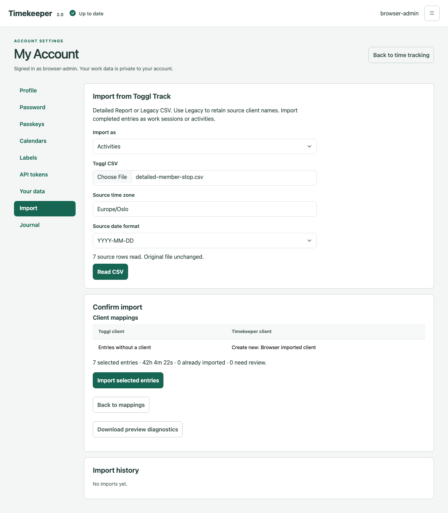

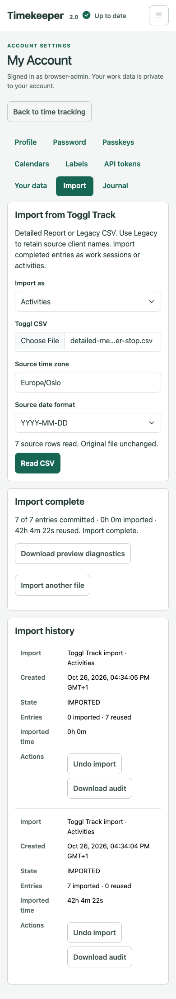

Work sessions support an optional project in start, record and edit dialogs.
Selecting a project selects its client; changing to a different client clears the
project. Week movement, resizing and copying retain the project. Toggl work-session imports review projects under their client without creating task activities.

Service administration uses `/admin/` and `/api/v1/admin/`. General settings show
saved versus effective configuration; versioned saves require a real account
session and the administrator password. SMTP passwords are never prefilled or
returned, and administrator proof and SMTP credentials use separate browser
autocomplete sections. Changes activate on a coordinated restart; a stale replica
leaves readiness and cannot continue using its old policy.


## Account data portability

**My Account → Your data** downloads the signed-in account as a private ZIP with
JSON and CSV. A reviewed restore shows record and link counts, then adds work with remapped
relationships and an optional time-zone change; it preserves the target account’s identity,
permissions and credentials. Interrupted uploads resume after file reselection,
and an uncertain restore can be reconciled without duplicating records.

See the [user guide](../operations/ACCOUNT-DATA.md) for scope and limits, and
the [acceptance report](../verification/ACCOUNT-DATA.md) for validation.

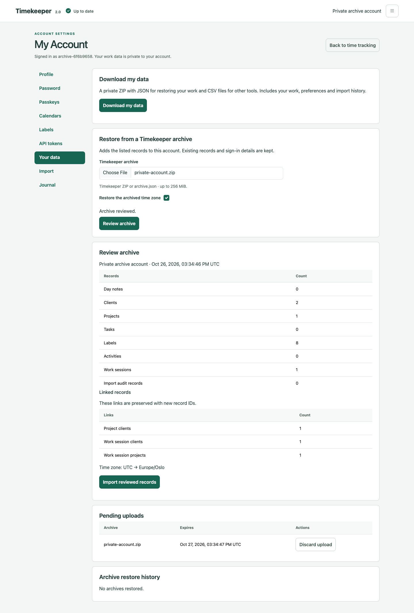

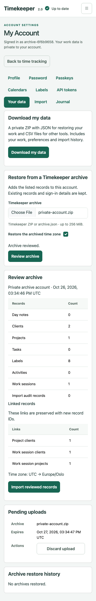


## Undo work-session changes

After editing or deleting a work session, choose **Undo** in the notification.
It fades after ten seconds; hovering over it or focusing its buttons keeps it
visible, up to the ten-minute Undo limit. Pending or unconfirmed Undo requests
stay visible until resolved. This includes calendar moves/resizes and Workweek time-cell
edits. Undo restores exact times, client, project, labels and summary; activities
remain independent. Only the latest acknowledged change is offered in the current
browser session. Creation, timer start/stop and other record types are outside
this first version.

If another edit or a removed destination makes restoration unsafe, Undo reports
that conflict without overwriting current records. A lost response offers
**Retry undo**, which checks the same command safely. Signing out clears the
notification. No work snapshots are stored in browser storage.
