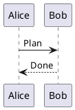

# Shared Markdown editor

Daily, weekly, calendar-event and vault notes use the same editor. A day label is
an independent resource: erasing a note body does not erase its day label.
Saving is explicit. Formatted and Markdown source are two views of the same draft.

## Source preservation and supported syntax

Opening, changing modes and saving without editing preserves the original file,
including UTF-8 BOM, opaque YAML frontmatter and line endings. Frontmatter is
displayed separately and is read-only; edit it with an external source editor.
Formatted edits preserve unchanged top-level blocks when the resulting Markdown
passes a semantic equivalence check. Editing inside a list, table or quotation
can normalize that whole block. Structural edits and ambiguous boundaries can
require canonical serialization of the body. Review source before saving if
exact spelling of edited markup matters.

The formatted dialect is CommonMark/GFM: paragraphs, H1–H6, emphasis, strong,
strikethrough, links, quotations, horizontal rules, nested/task lists, tables and
fenced code. Enter creates a paragraph; Shift+Enter creates a hard line break.
Tables use compact cells and theme-colored headers; wide tables scroll within
the editor instead of breaking words. Short rows display their
omitted trailing cells as empty without changing the saved source. As in GFM,
separate text following a table with a blank line to start a new paragraph.
An ordinary newline in Markdown is a soft break. Newly formatted rules use `---`.
Unknown extensions, HTML other than safe anchors, reference-style links and code
fences with extra metadata remain inert, editable source fragments. Their HTML is never executed.

Saved checklist items such as `- [ ] Follow up` are also ordinary
Dagsverk tasks. Checking or unchecking an item updates the task's completion;
completing or reopening the task updates the linked checkbox. Fenced/indented
code examples, escaped markers and empty items do not create tasks. Existing
notes are enrolled in the background, without needing to open or edit them.
Add `@Client_Name` or `@Project_Name` to assign a task; use underscores for spaces.
Names must identify one of your own clients or projects unambiguously. When a
client and project share a name, use `@client:Name` or `@project:Name`. Conflicting
or unknown names remain as text. Code, escaped annotations and link labels do not
assign tasks. The note retains its original text and annotation spelling.
Each document supports up to 1,000 nonempty checklist items. Task titles longer
than 1,024 characters are shortened with an ellipsis; the note keeps the full text.

Links use private metadata and add no IDs or comments to Markdown. Moving or
renaming the file retains its links. Distinct titles can be reordered; repeated
identical titles remain separate in their relative order. Unambiguous title edits
in the note update their tasks; editing a task title separately leaves the note's
wording intact. Replacing several unrelated items can create new tasks while
deleting unused previous tasks. Removing an item deletes its task unless recorded
work or subtasks require retaining it; in that case, only its note link is removed.
Trashing a note retains its tasks for restoration. Deleting
a task does not recreate it during unrelated note edits; editing that item's
title or checkbox can create a new task. Restoring a trashed note retains its
links and uses the tasks' current completion states.

Account archives retain checklist links and remap task IDs on restore. A notes-only
export contains Markdown, so importing those files elsewhere creates new tasks.
Task completion is a normal note change with a new content validator and history;
a concurrent unsaved note draft is retained for explicit review. An open Notes
editor reports a server change; use **Reload from server** to review the updated
checkbox state.

In **Tasks**, **Hide completed tasks** applies to every category and both native
and calendar tasks. Emoji shortcodes in titles are displayed as emoji. A native
task's details offer **Delete task** and an **Open source note** link with the
note's type icon. The shared note popup preserves normal draft and concurrency
guards. The task editor supports a client without a project, priority, and either
a date-only or timed deadline with its original time zone. Editing other fields
preserves the exact stored deadline, start, flags and urgency.

Canonical saves, including WebDAV and imports, reconcile immediately. The
background worker processes up to 25 sources of each kind every 30 seconds and
resumes scanning after restart. `TIMEKEEPER_NOTE_TASKS_AUTOMATIC=false` disables
only background enrollment; normal Markdown saves continue synchronizing tasks.

Vault extensions include:

| Syntax | Behavior |
| --- | --- |
| `[[2026-11-02]]` | Opens that day in Today |
| `[[Notes/Design]]` | Opens a vault note |
| `[[Notes/Design#Decisions\|design]]` | Uses an alias and jumps to a heading |
| `![[journal/assets/image.png]]` | Authenticated raster preview |
| `![[datasheet.pdf]]` | Opens the attachment in Notes, where it can be downloaded |
| `![[image.png\|320]]`, `![[image.png\|320x200]]` | Obsidian image sizing, up to 2000 pixels per dimension |
| `> [!NOTE] Title` followed by quoted content | Editable callout; `+`/`-` controls initial folding |
| `Text[^one]` and `[^one]: Footnote.` | Footnote reference and editable definition |

Type `[[` for note completion; `![[` suggests assets. Exact vault/relative paths
take priority over a unique filename. Missing and ambiguous references are
reported visibly; rename/move does not rewrite other files' links. Hover or focus
a wiki reference for its preview. Ordinary clicks follow web, local Markdown and
wiki links in formatted notes. Safe HTML anchors use the same link handling;
script attributes are not rendered. Web links open separately. A focused link
can also be followed with Enter.
Unsafe schemes and paths leaving the vault are rejected. Obsidian plugins,
transclusions of entire Markdown notes and executable HTML are not supported.

## Highlight, subscript and superscript

Use `==highlighted words==`, `H~2~O` and `X^2^`, or select text and use
**Highlight**, **Subscript** and **Superscript** in the formatting toolbar.
Highlighted text can contain other inline formatting. Subscript and superscript
use a single delimiter; strikethrough continues to use `~~two tildes~~`.
Code and escaped delimiters remain literal, and source mode retains the Markdown.

## Internal-link assistance

In Formatted mode and Markdown source, typing `[` inserts its matching `]` with
the caret between them. Typing a second `[` creates `[[…]]` and offers matching
documents. Continue typing to narrow by title or path, then click a choice or use
Arrow Down and Enter. Escape dismisses the choices. A wikilink keeps its `[[...]]`
syntax during autosave, even while the caret is inside the generated brackets.
Move past the closing brackets, leave the editor or switch modes to activate it.
Generated closing brackets
are consumed when completing a link or skipped when typed; Backspace removes an
empty generated pair. Code, escaped links and read-only documents stay literal.
Selections and edits remain in the current draft until the host saves it.

## Writing and source tools

PlantUML fences (`plantuml` or `puml`) render as local diagram previews in
Formatted mode, including read-only notes. For example:

````markdown

````

Switch to Markdown source to edit the diagram. Its authored fence, line endings
and frontmatter remain unchanged until an edit is saved. Sequence, class and
activity diagrams use the bundled official PlantUML engine and local Smetana
layout; no PlantUML service or Graphviz installation is required. Previews
follow the selected light/dark mode and fit narrow screens.

Previews accept up to 10 KB of source. Files, includes, images, external themes
and standard-library downloads are unavailable. Syntax errors, unsupported
features, large output or a rendering timeout leave the source available for
editing. Rendering runs in a bounded worker; replacing or clearing a document
cancels its work and releases the preview image. Canonical notes and backups
contain the source, without generated diagram files.

The heading menu selects plain text or H1–H6. Toolbar tooltips name each action
and available shortcut; active formatting is indicated. Use the main toolbar to
format a selection. Type `/` at the start of a paragraph for commands.
Formatting actions wrap on narrow screens and scroll horizontally on short
screens. **Note tools** opens a keyboard-accessible menu for existing attachments
and image properties. In Notes, **Main actions** contains revisions, client
association, delete, rename/move and reload, alongside the left/right sidebar
controls. Today also exposes revisions, client association and deletion in
**Main actions**. Dialog editors retain these actions in **Note tools**.
Returning to a note retains its
in-memory mode, cursor and scroll position while the session remains open.
Notes open in formatted mode by default.

Notes has separate **Folders and notes** and **Recent notes** cards on the left,
and a live **Table of contents** on the right. Selecting a heading moves the
caret without changing the document in either editor mode. Drag a desktop
sidebar separator to resize the panel, or focus it and use Left/Right, Home and
End. The same resize controls are available for both Today sidebars.

Use Command/Ctrl+B for bold, Command/Ctrl+I for italic, and Command/Ctrl+Z for undo.
Redo uses Command/Ctrl+Shift+Z. Undo and Redo have no toolbar buttons. Mode changes retain rich history;
source edits become history boundaries when returning to formatted mode.

Markdown source uses a plain text area. Tab indents by two spaces; Escape followed
by Tab leaves the text area. Source modes do not add a separate tools row.

Code blocks combine the language indicator and copy action in a compact badge
at the top right. Choose the language indicator to change the fence language.
Syntax coloring uses the locally bundled highlight.js grammars and the current
theme’s foreground colors; backgrounds remain unchanged. Unknown languages and
unusually large fences stay plain so editing remains responsive. About lists the
pinned highlight.js version and its complete BSD license.


In formatted mode, a Mermaid fence shows only its locally generated diagram.
Use **Markdown source** to edit the diagram text. The diagram is an atomic editor
node, so navigation cannot enter hidden code. Its complete original fenced source
is retained through mode changes and saves. External diagram resources are rejected.

Use the main toolbar for lists and tables. Tab in a table moves between cells.
Tab-separated clipboard data can create a table. To use advanced table operations
without extra controls, select a cell, press Escape to leave the text area, then
Tab to the existing **Table** toolbar button. Safari on macOS may use Option+Tab
or require Keyboard Navigation enabled, depending on browser/system settings
([Apple keyboard-navigation guide](https://support.apple.com/guide/safari/cpsh003/mac)).
Its tooltip and accessible description explain the keys below. They apply only
while that button is focused inside a
writable table, leaving normal text-selection and browser shortcuts unchanged.

| Key on the Table button | Action |
| --- | --- |
| Up / Down | Insert a row before / after |
| Left / Right | Insert a column before / after |
| Shift + arrow | Move the current row / column in that direction |
| Backspace | Delete the current row |
| Delete | Delete the current column |
| Shift + Delete | Delete the table |
| L / C / R | Align the current column left / center / right |

On macOS, forward Delete is Fn+Delete. Focus stays on the button for repeated
operations. Header rows cannot be moved
into the table body or deleted separately. Row insertion before the header is
ignored; select a body row to insert before it. Keyboard operations act on one
cell at a time, even after a row move selects the row. The Undo shortcut restores a
structural edit; saving remains
explicit. In lists, Tab/Shift+Tab indent/outdent and Enter continues the list.

## Paste and attachments

Formatted paste retains safe headings, lists, links and tables. Scripts, embedded
media and remote clipboard images are discarded. Command/Ctrl+Shift+V pastes
literal text. Pasting an HTTP(S) URL creates a link with the original URL spelling
in Markdown. Pasting it over selected text creates a link without replacing its
label. Code fields accept literal text.

Paste screenshots or drop files to upload them at a tracked insertion point.
The current upload shows its filename/count; **Retry** retains failed files and
does not duplicate completed uploads. Uploads are limited to 5 MB per file and
also obey account/server storage limits. Existing assets can be selected without
uploading another copy. PNG, JPEG, GIF and WebP use authenticated previews; other
attachments remain download links. References stay portable vault paths.
Select an image for alternative-text and sizing controls; sizing explicitly
converts an ordinary Markdown image into an Obsidian embed. Sized embeds use
the filename as their label. Journal uploads go in the configured journal assets
subfolder. No external image URL is fetched automatically.

## Saving, conflicts and history

Notes and daily, weekly and event-note documents save automatically after a
one-second pause, at least every five seconds while typing, and before switching
documents, dates, tabs or account pages, closing an editor, or signing out.
**Saved**, **Unsaved changes** and **Saving…** show the current state. There are
no document Save or Cancel buttons. Command/Ctrl+S can flush pending edits early.
Today's **Delete note** action is in **Main actions**. In journal dialogs,
**Delete note** is in **Note tools**, directly below **Note revisions**.

You can keep typing during a save. Navigation waits until the newest draft is
saved. Failed saves retain the draft and keep the document open; use **Retry
saving** for a rejected request, **Check saved result** after an uncertain reply,
or **Reload saved note** to review a conflicting server version. Reload asks
before replacing a dirty draft. An unknown result is read back before any further
write, and stale edits never overwrite another writer.

**Note revisions** compares the draft with a stored revision or current server
version. Restoring a revision puts it in the editor and autosaves through the
same concurrency guard as an ordinary edit.

Revisions begin with the first content change after this feature is installed;
they cannot recover previously lost content. The server retains at most 20
revisions per note and 1000 revisions/8 MB per account, evicting the oldest first.
History excludes binary assets and independent day labels. It is server-local:
portable account exports omit revisions; full instance backups include them.

Private drafts and remembered positions live in memory only, with no browser
storage copy. Browser close/reload attempts a final save; if a save is still
pending or failed, the browser warns before discarding it. A forced close or lost
connection cannot guarantee delivery, so check for **Saved** before leaving.
Read-only accounts can navigate, preview and compare but cannot edit or upload.

## Verification and limits

See the [presentation verification](../verification/MARKDOWN-EDITOR-548.md) and
[completion audit](../verification/MARKDOWN-EDITOR-515.md) for actual
browser/platform evidence, pending manual checks and representative-vault
results. Automated accessibility checks and emulated mobile viewports do not
certify a physical mobile keyboard, assistive technology or Obsidian rendering.
The audit distinguishes implementation completion from native/manual checks
that have not been performed.

## Emoji shortcodes

Type a standard shortcode such as `:smile:`, `:rocket:` or `:+1:` in formatted
Markdown to show its Unicode emoji. Typing a partial name opens local suggestions;
use Arrow Down and Enter or choose one with the pointer. Shortcodes remain intact
in Markdown source and downloads. Escaped colons, code, unknown names and link
destinations remain literal. Emoji also appear in note headings and navigation.
The bundled gemoji catalog works without an external emoji service; custom Slack
workspace emoji are not available.

In Formatted mode, typing or native text input preserves active `[[wikilinks]]`.
If a linked note is missing, an editable note offers to create it and open a
popup editor. Canceling leaves the collection unchanged. A bare name creates a
Markdown note beside the current document; a path containing `/` is relative to
the Notes collection root; required parent folders are created after confirmation.
Aliases and heading targets do not become part of the
filename. Ambiguous links require resolution, and read-only sessions cannot
create notes. Existing files are never overwritten by this action.
