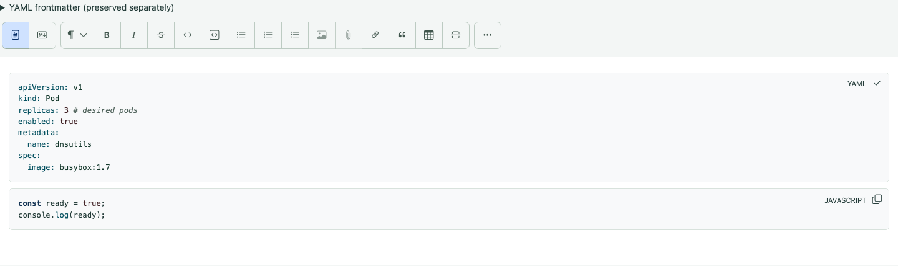

# Shared Markdown editor

Daily, weekly, calendar-event and vault notes use the same editor. A day label is
an independent resource: erasing a note body does not erase its day label.
Saving is explicit. Formatted and Markdown source are two views of the same draft.

## Source preservation and supported syntax

Opening, changing modes and saving without editing preserves the original file,
including UTF-8 BOM, opaque YAML frontmatter and line endings. Frontmatter is
displayed separately and is read-only; edit it with an external source editor.
Formatted edits preserve unchanged top-level blocks when the resulting Markdown
passes a semantic equivalence check. Editing inside a list, table or quotation
can normalize that whole block. Structural edits and ambiguous boundaries can
require canonical serialization of the body. Review source before saving if
exact spelling of edited markup matters.

The formatted dialect is CommonMark/GFM: paragraphs, H1–H6, emphasis, strong,
strikethrough, links, quotations, horizontal rules, nested/task lists, tables and
fenced code. Enter creates a paragraph; Shift+Enter creates a hard line break.
An ordinary newline in Markdown is a soft break. Newly formatted rules use `---`.
Unknown extensions, HTML other than safe anchors, reference-style links and code
fences with extra metadata remain inert, editable source fragments. Their HTML is never executed.

Vault extensions include:

| Syntax | Behavior |
| --- | --- |
| `[[2026-11-02]]` | Opens that day in Today |
| `[[Notes/Design]]` | Opens a vault note |
| `[[Notes/Design#Decisions\|design]]` | Uses an alias and jumps to a heading |
| `![[journal/assets/image.png]]` | Authenticated raster preview |
| `![[image.png\|320]]`, `![[image.png\|320x200]]` | Obsidian image sizing, up to 2000 pixels per dimension |
| `> [!NOTE] Title` followed by quoted content | Editable callout; `+`/`-` controls initial folding |
| `Text[^one]` and `[^one]: Footnote.` | Footnote reference and editable definition |

Type `[[` for note completion; `![[` suggests assets. Exact vault/relative paths
take priority over a unique filename. Missing and ambiguous references are
reported visibly; rename/move does not rewrite other files' links. Hover or focus
a wiki reference for its preview. Ordinary clicks follow web, local Markdown and
wiki links in formatted notes. Safe HTML anchors use the same link handling;
script attributes are not rendered. Web links open separately. A focused link
can also be followed with Enter.
Unsafe schemes and paths leaving the vault are rejected. Obsidian plugins,
transclusions of entire Markdown notes and executable HTML are not supported.

## Writing and source tools

The heading menu selects plain text or H1–H6. Toolbar tooltips name each action
and available shortcut; active formatting is indicated. Use the main toolbar to
format a selection. Type `/` at the start of a paragraph for commands.
Formatting actions wrap on narrow screens. **Note tools** opens a keyboard-
accessible menu for existing attachments, image properties, revisions and document
actions such as rename, delete and reload. Returning to a note retains its
in-memory mode, cursor and scroll position while the session remains open.
Notes open in formatted mode by default.

Use Command/Ctrl+B for bold, Command/Ctrl+I for italic, and Command/Ctrl+Z for undo.
Redo uses Command/Ctrl+Shift+Z. Undo and Redo have no toolbar buttons. Mode changes retain rich history;
source edits become history boundaries when returning to formatted mode.

Markdown source uses a plain text area. Tab indents by two spaces; Escape followed
by Tab leaves the text area. Source modes do not add a separate tools row.

Code blocks combine the language indicator and copy action in a compact badge
at the top right. Choose the language indicator to change the fence language.
Syntax coloring uses the locally bundled highlight.js grammars and the current
theme’s foreground colors; backgrounds remain unchanged. Unknown languages and
unusually large fences stay plain so editing remains responsive. About lists the
pinned highlight.js version and its complete BSD license.

In formatted mode, a Mermaid fence shows only its locally generated diagram.
Use **Markdown source** to edit the diagram text. The diagram is an atomic editor
node, so navigation cannot enter hidden code. Its complete original fenced source
is retained through mode changes and saves. External diagram resources are rejected.

Use the main toolbar for lists and tables. Tab in a table moves between cells.
Tab-separated clipboard data can create a table. To use advanced table operations
without extra controls, select a cell, press Escape to leave the text area, then
Tab to the existing **Table** toolbar button. Safari on macOS may use Option+Tab
or require Keyboard Navigation enabled, depending on browser/system settings
([Apple keyboard-navigation guide](https://support.apple.com/guide/safari/cpsh003/mac)).
Its tooltip and accessible description explain the keys below. They apply only
while that button is focused inside a
writable table, leaving normal text-selection and browser shortcuts unchanged.

| Key on the Table button | Action |
| --- | --- |
| Up / Down | Insert a row before / after |
| Left / Right | Insert a column before / after |
| Shift + arrow | Move the current row / column in that direction |
| Backspace | Delete the current row |
| Delete | Delete the current column |
| Shift + Delete | Delete the table |
| L / C / R | Align the current column left / center / right |

On macOS, forward Delete is Fn+Delete. Focus stays on the button for repeated
operations. Header rows cannot be moved
into the table body or deleted separately. Row insertion before the header is
ignored; select a body row to insert before it. Keyboard operations act on one
cell at a time, even after a row move selects the row. The Undo shortcut restores a
structural edit; saving remains
explicit. In lists, Tab/Shift+Tab indent/outdent and Enter continues the list.

## Paste and attachments

Formatted paste retains safe headings, lists, links and tables. Scripts, embedded
media and remote clipboard images are discarded. Command/Ctrl+Shift+V pastes
literal text. Pasting an HTTP(S) URL over selected text creates a link without
replacing its label. Code fields accept literal text.

Paste screenshots or drop files to upload them at a tracked insertion point.
The current upload shows its filename/count; **Retry** retains failed files and
does not duplicate completed uploads. Uploads are limited to 5 MB per file and
also obey account/server storage limits. Existing assets can be selected without
uploading another copy. PNG, JPEG, GIF and WebP use authenticated previews; other
attachments remain download links. References stay portable vault paths.
Select an image for alternative-text and sizing controls; sizing explicitly
converts an ordinary Markdown image into an Obsidian embed. Sized embeds use
the filename as their label. Journal uploads go in the configured journal assets
subfolder. No external image URL is fetched automatically.

## Saving, conflicts and history

Save status belongs to the host note. Failed uploads or save requests retain the
draft. A stale save is rejected rather than overwriting another writer. Use
**Revision history** to compare the current draft with a stored revision or the
latest server version. Restoring places the chosen content in the draft; review
and explicitly save it using the original write guard. Navigating away from an
unsaved draft requires confirmation.

Revisions begin with the first content change after this feature is installed;
they cannot recover previously lost content. The server retains at most 20
revisions per note and 1000 revisions/8 MB per account, evicting the oldest first.
History excludes binary assets and independent day labels. It is server-local:
portable account exports omit revisions; full instance backups include them.

Autosave remains off: background writes during synchronization/conflict review
would change the guarded manual-save contract. Drafts and remembered positions
live in memory only. Reloading, closing the tab or logging out can discard them;
there is no silent localStorage/sessionStorage copy of private note contents.
Read-only accounts can navigate, preview and compare but cannot edit or upload.

## Verification and limits

See the [presentation verification](../verification/MARKDOWN-EDITOR-548.md) and
[completion audit](../verification/MARKDOWN-EDITOR-515.md) for actual
browser/platform evidence, pending manual checks and representative-vault
results. Automated accessibility checks and emulated mobile viewports do not
certify a physical mobile keyboard, assistive technology or Obsidian rendering.
The audit distinguishes implementation completion from native/manual checks
that have not been performed.
