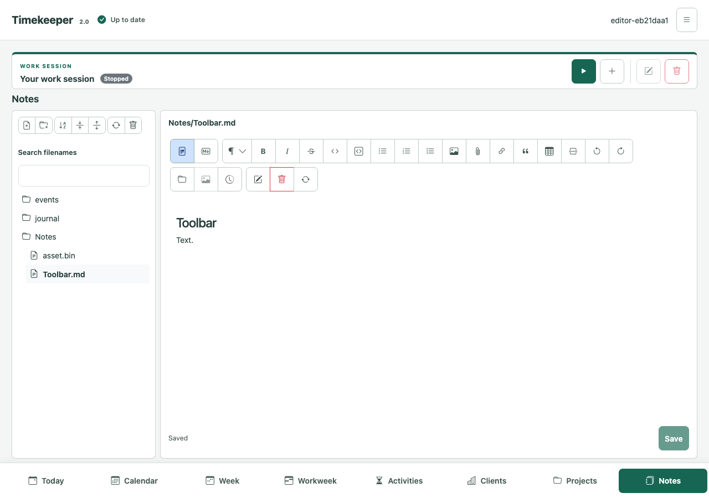
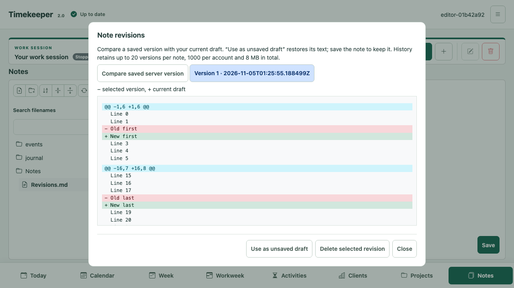

# Notes and manual vault synchronization

## Account settings and importing a folder

Open **My Account → Notes** to configure journal, event and attachment folders,
hide the journal from Notes navigation, or change configuration synchronization.
Save folder settings before importing a vault whose layout uses those folders.

The **Recent notes: number of days** preference controls the list below Planned
tasks in Today. The default is seven calendar days including today, using your
account time zone. Ordinary, event and daily/weekly journal notes have distinct
icons before their titles, with their type also announced to screen readers.
All open in Notes when selected. Selecting a historical date in Today does not change
this recent-edit window. Unsaved drafts still require confirmation before leaving.

Under **Import notes**, choose the local vault root with **Choose vault folder**.
Timekeeper reviews the relative paths before uploading. Hidden configuration
folders and nonportable paths are skipped; existing files are listed as conflicts.
The review lists each oversized file with its byte size and the applicable server
limit (by default 10,000,000 bytes for ordinary Markdown and 160,000,000 for other files).
Uncheck individual files or an entire folder to exclude them. Folder checkboxes
show a mixed state when only some descendants are selected. Choose **Import new
files** after reviewing the list. A Bootstrap progress bar counts the selected
items as they complete, including failed attempts; retry starts a fresh progress
count and does not upload files that already completed.
Markdown and attachment bytes are uploaded unchanged, and recognized journal
dates/weeks retain their associations. Day labels are independent and are kept.

Files import individually with create-only guards. Files created by another
client after review are also treated as conflicts. Interrupted imports retain
completed files; **Retry** attempts only failed files. Account navigation is
blocked while writes are running. Leaving a pending review requires confirming
that the unsent selection can be discarded. No local filesystem path or private
file selection is persisted in browser storage.

### Exporting notes and preserving dates

Under **My Account → Notes → Export notes**, choose **Prepare archive**, then
**Download archive**, just as under **Your data**. The private ZIP is one consistent
account snapshot with exact active Markdown, journal/event notes, assets and empty
folders at their configured relative paths. Hiding the journal in navigation does
not exclude it from export. Recently deleted items, credentials and other account
records are excluded. Match the journal/event/asset folder preferences before
importing into another account if it uses a different layout.

ZIP entries carry available creation and modification times. The auxiliary
`timekeeper-notes-metadata.json` file preserves their full precision; a UUID suffix avoids
colliding with an existing source filename. Its visible name also works with Safari's
folder picker, which omits dotfiles. Files recorded by metadata but absent from the
selection are listed as skipped; no missing bytes are fabricated. Extract the ZIP and choose its root
for folder import. Timekeeper recognizes the auxiliary metadata, excludes it from
uploads, and preserves dates and empty folders. A source file with the same name
is kept as a normal file. Invalid or ambiguous metadata blocks review. Original
creation dates follow relative paths; a checksum detects content edited after the
snapshot and uses that file's current modification time instead. Existing files are kept by default. Select **Overwrite existing files** to
include them as reviewed replacements. The review identifies each replacement;
a subsequent edit, move or deletion causes a conflict and preserves the current
server file. Replacements preserve file identity and path. Existing folder dates
remain unchanged. Without supplied original creation metadata, a replacement
keeps its existing creation date. Source modification dates are preserved.

Browsers expose `lastModified` but not filesystem creation dates. A folder import
without metadata therefore preserves the available modification time and records
when each new entry joined Dagsverk. The footer calls that date **Added**;
**Created** identifies a supplied original creation date. Older entries have no
recorded date provenance and show **Created / added**. Modification time may be
older than either value; it must not be substituted for an unknown creation date. To keep creation dates for an existing
local vault, download the manual sync client from the same account page and run:

```sh
python3 webdav_sync.py --folder "/path/to/vault" --prepare-import-metadata
```

This performs no synchronization and requires no URL or token. It reads the files
and writes only the private auxiliary metadata file, which can be removed after
import. It preserves nanosecond modification times and filesystem birth times
where the OS provides them (including macOS); POSIX `ctime` is never used as a
creation date. It refuses symlinks, checks for concurrent source changes, and
refuses to overwrite an unrelated file occupying the metadata filename. `--include-obsidian` includes configuration when
also enabled in the target account. Timekeeper exports already include metadata
and do not need this preparation step. To correct dates on files already
imported without metadata, prepare the metadata in the original local folder,
choose that folder again, enable overwrite and review the replacements. The helper defaults to at most 100,000 entries (adjust with `--max-entries`);
`--max-file-bytes` sets its bounded per-file limit. The browser review still
applies the target server's own limits.

The Notes editor and file tree use a bounded area above the workspace menu,
matching Today. Long source and formatted documents scroll within the editor.

The **Notes** tab presents an account-private folder tree and the shared Markdown
editor. Search matches names and paths; expand folders to load their children.
The navigator groups creation, sorting/expansion and browsing actions in a compact
toolbar. **Sort notes** offers name, creation date and modification date in both
directions. Folders stay before files; unknown dates follow known dates, with
alphabetical ties. Sorting covers every page of each loaded folder, search result
and Recently deleted list. **Expand all folders** loads every visible level;
**Collapse all folders** also cancels an unfinished expansion. These actions keep
an open editor's draft. Hidden journal folders are excluded from expansion.

New collection entries record their creation time (or the original source time
supplied by import), which survives editing,
renaming, recovery and account-archive round trips. Older entries without a
recorded creation time remain unknown rather than receiving an invented date.
Drag the divider, or focus it and use arrow keys, to resize navigation. On a
phone, use the folder button to open navigation. Rename/move preserves a
resource's identity. Recently deleted items retain their bytes and can be
restored if their destination is available. Trash counts against storage limits.

**Hide journal folder** under **My Account → Notes** is a saved account preference. It hides
the configured journal folder and its descendants from navigation, search and
trash, including after a journal-folder rename. Existing editor drafts remain
open. Today, Calendar, journal links, images and WebDAV synchronization continue
to use the same resources. The preference defaults to off and is retained in
account archives; older archives default to showing the folder.

Markdown source, frontmatter, unknown metadata, empty files, attachment bytes and
unsupported Obsidian syntax are stored without rewriting. An unchanged editor
save does not normalize the file. Formatted edits can normalize Markdown body
syntax in the edited block; unchanged top-level blocks retain their source when
the semantic preservation check succeeds. Frontmatter remains separate and
read-only in the editor. Use a local source editor to change frontmatter. Ordinary
wikilinks, aliases, heading targets and raster image embeds (including sizing)
render in formatted mode. Missing or ambiguous targets are reported instead of
selecting an arbitrary file. Unknown extensions remain editable source fragments.
Timekeeper does not execute Obsidian plugins. See the
[shared editor guide](MARKDOWN-EDITOR.md) for the supported dialect and controls.
Standard relative Markdown links navigate within the collection. Verified raster
images use authenticated previews, both inline in formatted Markdown and in the
content pane when selected in the navigation tree; other attachments can be downloaded.
Journal image references also resolve companions imported through vault synchronization,
including ordinary binary files in the configured assets folder. Renaming
a file does not rewrite links in other files. Review relative links after moves.

## Searching note contents

The title-bar **Search notes** field searches active ordinary Markdown, daily,
weekly and event notes. Results appear in a panel on the right with a search
field for refinements. Opening a note shows a popup and retains the results;
maximizing the popup opens its workspace and closes the search panel.

Use `file:name` for literal filename/path substring matches, including folders
and attachments. Quote names containing spaces, such as `file:"Meeting notes"`.
Use `event:words`, `journal:words` or `note:words` to limit content results to
events, daily/weekly journals or ordinary Markdown; a bare type qualifier such
as `event:` lists that type. Filters combine with words, phrases and tags.
Content results exclude attachments, folders, deleted notes, old revisions and
independent day labels. Hidden journals and disabled `.obsidian` paths remain
excluded. Search does not replace the folder navigator or the current draft.

Use words (all required) or double quotes for a phrase. Search is case-insensitive,
Unicode-aware and does not stem or fold accents. English and Norwegian text,
link labels and code are indexed; YAML frontmatter and markup are excluded.
Queries allow at most 512 UTF-16 code units and 32 analyzed terms. Punctuation
acts as text separators; arbitrary Lucene query syntax is not available.

Hashtags such as `#OpenShift` use the accent colour in Formatted mode. Click a
tag, or focus it and press Enter, to open matching notes in the search panel. The
search entry becomes `tag:#openshift`. Editing the
query can combine tags with ordinary words or quoted phrases. Tag matching is
exact and case-insensitive, so an untagged word or `#OpenShiftTools` does not
match `tag:#openshift`. The current Notes draft is retained.

Tags support Unicode letters and numbers, underscores, hyphens and nested
segments such as `#work/openshift`, up to 128 UTF-16 code units including `#`.
Code, link and image labels/destinations, wikilink targets and frontmatter do
not define tags. Markdown source retains ordinary editable text; no tag
metadata or rewritten source is required. Existing private search caches
rebuild automatically for the new tag format.

Matches are ordered by relevance, with title and path matches boosted. Each
result shows its title, path and a plain-text highlighted excerpt. **More results**
loads the next page without reordering earlier matches. Changing a query keeps
an open draft; opening another result uses the usual save/navigation guard.
Changes during pagination require a fresh search rather than mixing snapshots.

Content search is derived from the canonical SQL records using embedded Lucene.
Each server replica independently replays the committed, content-free change
log into its own private index. A search first captures the committed generation;
if that replica cannot catch up within a short wait, it reports that search is
being prepared or unavailable. File browsing and canonical saves remain usable.
The next successful search validates that its indexed source versions are current.
Do not treat an indexing response as a complete empty result.

### Search cache and recovery

`TIMEKEEPER_NOTES_SEARCH_CACHE_DIRECTORY` defaults to `AUTO`: a private
`timekeeper-notes-search-*` directory in the JVM temporary directory. A clean
shutdown removes an automatic cache; a restart rebuilds it from SQL. Abruptly
terminated processes can leave temporary directories for the operator or OS
temporary-file cleanup to remove. Only remove directories from stopped instances.
For persistent reuse, choose a dedicated local directory owned by the server
account. Each replica requires a different writable directory; a shared directory
is refused. Keep these derived files outside backup/export storage and include
only the canonical database in the backup plan. Restore works without any index.

The defaults are eight open account caches, two concurrent searches, a 16 GB soft
aggregate disk limit within the configured cache root and 1 GiB free-space
headroom. Configure them with `TIMEKEEPER_NOTES_SEARCH_OPEN_OWNERS` (1–32),
`TIMEKEEPER_NOTES_SEARCH_MAX_CACHE_BYTES` and
`TIMEKEEPER_NOTES_SEARCH_MIN_FREE_BYTES`. Disk usage is measured every two seconds;
bounded in-flight work and Lucene merges can exceed the soft limit. Inactive
account caches are reclaimed when the limit is reached. Idle handles close after
ten minutes. The worker processes at most 32 records or about 8 MB per replay
batch, stopping between records after its 100 ms work budget. A single supported
Markdown file and a commit/merge can extend a batch beyond those soft budgets.
Backfills checkpoint approximately once per second and publish readers only when
ready. A crash can repeat uncommitted backfill work; canonical data stays in SQL.
Incremental updates commit before being considered caught up. Canonical
transactions never wait for parsing or index commits.

`GET /api/v1/notes/search/status` reports this replica's ready/indexing/unavailable
state, applied and target generations and any safe failure category.
`POST /api/v1/notes/search/rebuild` requires write permission and schedules a
private rebuild for this account on this replica. The content-search UI offers
**Search again** and **Rebuild search** when unavailable. Missing, incompatible,
corrupt or expired caches rebuild automatically; collection and instance-restore
identities fence old contents. Removed SQL owners are purged during maintenance.
Cache failure, disk pressure or a busy writer produces an unavailable response
without changing canonical notes. The cache uses private directory/file permissions.

Search pages contain at most 50 results by default, capped at 200. Excerpts contain
at most 320 UTF-16 code units and 64 highlight ranges. Signed snapshot/cursor tokens
last ten minutes and bind the account, query, visibility, collection, restore
identity and content generation. A changed snapshot returns 412; retryable indexing
or cache failure returns 503. Continuation uses logical relevance/path/entry-ID
positions, allowing another caught-up replica to continue without local document IDs.

## Connection and folder choices

Create a dedicated read/write API token under **My Account**. Use any nonempty
username and the token as the WebDAV password over verified HTTPS. Use a
read-only token for browsing only. Revoke the token to disconnect; local files
remain. Never put the token in a URL or share it with a public vault repository.

The single WebDAV root is `https://HOST/dav/notes/`. All notes, journal entries,
event notes and attachments belong to that collection. A selected existing
subfolder, for example `/dav/notes/Research/`, is also a synchronization root.
Create that
folder in Notes before connecting. Folder listings expose stable resource IDs,
strong ETags and raw file sizes. Overwrites and deletes require current
preconditions; moves do not overwrite existing destinations. A stale request
fails with 412, an unguarded destructive request with 428.

### Ordinary Markdown folder: packaged manual client

Choose **Download manual sync client** under **My Account → Notes** to save
`webdav_sync.py` from this server. The same helper is included in the Java ZIP,
Compose archive and Synology SPK, beside this guide. On a NAS it is available at
`/var/packages/timekeeper/target/webdav_sync.py`; copy it to the Mac/Linux client
where the vault is stored. It is a Python 3 POSIX command-line client, version 1.0. It has no daemon, watcher or scheduled jobs. Back up
an existing local collection before its first synchronization. Choose a private
control directory **outside** the folder, on the same filesystem. It holds the
baseline, operation journal and retained copies of replaced/deleted local files,
never the token. The client rejects symlinks, nonportable collisions, replaced
roots, incomplete listings and redirects. It requires verified HTTPS; a private
CA can be supplied with `--ca-file`.

```sh
python3 webdav_sync.py --url https://HOST/dav/notes/Research/ \
  --folder "$PWD/Research" --state-dir "$PWD/.timekeeper-research"
```

Enter the token at the password prompt, or set `WEBDAV_TOKEN` privately in the
process environment. The first command is a preview: inspect `actions`,
`conflicts`, and the `review` hash. Run the same command with `--apply HASH` to
apply exactly that reviewed snapshot. Any changed input requires a new preview.
There is no implicit first-import winner. Resolve a listed collision explicitly
with `--prefer-local 'path.md'` or `--prefer-remote 'path.md'`, preview again, then
apply its hash. Replaced local bytes are retained in the private control folder.

Later runs compare both sides against the last complete common baseline. Deletes
require a preview with `--allow-deletes`, followed by applying that preview with
the same option. Without it, no deletion is applied. Do not reset the control
folder to resolve a conflict: preserve it and both versions. After an interrupted
operation, inspect the retained files and use `--resume` to review the interrupted
intention before applying it. An unavailable server or missing local root aborts
without treating it as an empty collection. A deleted/recreated remote root
requires a fresh reviewed profile. Distinct unchanged-content renames use a
conditional MOVE when unambiguous; ambiguous renames remain explicit changes.

The client uses a complete scan for each user-triggered invocation; it is not an
incremental/background indexing service. Only use one client profile for a given
local folder. Review large deletion sets rather than approving them mechanically.

### Obsidian

Use the packaged manual client described above with the vault root as the local
folder. Timekeeper synchronizes the Markdown and attachment files directly;
no Obsidian plugin or Nextcloud connection is required. Review the first preview
before applying changes, and resolve reported conflicts while retaining both
versions. See [reproducible acceptance](../verification/NOTES-VAULT.md).

`.obsidian` is excluded by default on both server and manual client. To transfer
it, explicitly enable **Synchronize Obsidian configuration** in Notes settings
and use `--include-obsidian` in the manual client. This synchronizes opaque bytes;
Timekeeper never loads the plugins or configuration. Disable local third-party
plugins before reviewing configuration imported from another device. Active
configuration files must be removed before the server opt-in can be disabled.

rclone, Cyberduck and Obsidian Remotely Save remain unsupported for complete
synchronization because their observed writes/deletes omit required guards.
The tested davfs2 1.6.1-1 conditional overwrite succeeds, but its delete omits
If-Match and receives 428. Listing or an initial upload is not proof of safe
synchronization; do not disable Timekeeper's guards to accommodate these clients.

## Journal and event folders

New collections use `journal`, `events` and `journal/assets`. Legacy collections
using the old default `assets` folder move it under `journal` on first
access, retaining resource IDs, bytes and content ETags. An existing destination
is never overwritten: if the destination is occupied or exceeds portable path
limits, the old layout remains until you resolve it using Notes settings. Other configured asset
folder paths are preserved; change **Assets folder** to `<journal folder>/assets` to
move them atomically. Review the client's sync preview after this folder move.
The Notes renderer also resolves old root-`assets/` references to the relocated
folder when their original path is absent, without rewriting Markdown. Review
those paths in external editors after synchronizing the folder move. Explicit
account-archive restores retain their reviewed folder layout. Only direct children
of the journal folder named `YYYY-MM-DD.md` or `YYYY-Www.md` bind to daily/ISO-week
notes. Date-looking files elsewhere remain ordinary Markdown. Event files in the
event folder use the existing `event-<subscription UUID>-<occurrence key>.md`
identity and required `timekeeper-event` metadata. Their source identity cannot
be changed by moving/renaming the file. Ordinary files cannot be moved into a
reserved association; use the journal/event interface to create that resource.

Changing folder settings moves the same indexed roots atomically; it neither
copies live notes nor changes content validators. Journal and event folders must
be disjoint. Assets may be nested under one of them; changing that parent also
moves nested assets unless an explicit assets destination is supplied. Conflicting
destinations are rejected. Day labels have independent storage and versions:
clearing, deleting or synchronizing Markdown never deletes a label.

Legacy `assets/name` links are resolved to the canonical asset by Timekeeper
when unambiguous, without rewriting stored bytes. Standard external Markdown
renderers use paths relative to the containing folder. With the default layout,
`assets/photo.png` refers to a journal image from a daily note;
`../journal/assets/photo.png` refers to it from an event note. Review relative
links when changing folders. An ordinary relative asset and a legacy asset with the same
link text is an ambiguity requiring review, not an implicit selection.

## Deployment, quotas and recovery

Schema **10** is a logical compatibility gate using the existing H2 2.4.240 or
PostgreSQL tables. Stop older replicas before authorizing a schema-9 upgrade;
older binaries must not write canonical notes without the new namespace hooks.
Use the documented offline/native/Compose upgrade and rollback procedures.
No Cassandra, CouchDB or extra service is introduced.

**Administration → Notes** lets an administrator change the four storage quotas.
Changes apply immediately to every account and server instance, without a restart.
Saving requires an account sign-in and current administrator password; API tokens
cannot change these limits. Concurrent saves are guarded by ETag.

Deployment properties supply defaults until the administrator saves an override:

| Property | Default |
| --- | ---: |
| `timekeeper.notes.max-file-bytes` | 160,000,000 |
| `timekeeper.notes.max-markdown-bytes` | 10,000,000 |
| `timekeeper.notes.max-total-bytes` | 5,000,000,000 |
| `timekeeper.notes.max-entries` | 100,000 |
| `timekeeper.notes.max-page-size` | 200 |

The four quotas are per account. Files and folders, including retained Trash,
count toward the entry limit; the virtual root does not. Pagination remains 200
and is a deployment setting. Saved overrides take precedence over environment
variables and are retained by encrypted instance backup/restore.

**My Account → Storage** shows total bytes, file/folder counts, and progress bars
for ordinary notes, daily notes, weekly notes, event notes, attachments/other files
and Trash. Category bars share the account allowance rather than having separate
quotas. The largest Markdown file and attachment are compared to their respective
file limits. Usage describes logical retained collection data, not database or
backup disk size. Opening the page does not initialize an unused collection.

The HTTP body default is `200M` (200 MiB), enough for the default 160 MB file
limit. The administrator form refuses increases above the configured upload
ceiling. To allow larger files, an operator must first increase
`quarkus.http.limits.max-body-size` (or `QUARKUS_HTTP_LIMITS_MAX_BODY_SIZE`) and any
reverse-proxy limit. The configurable file ceiling is 1,000,000,000 bytes; the
entry ceiling is 1,000,000. The manual helper defaults to 160 MB per file and
100,000 entries; use `--max-file-bytes` and `--max-entries` for a different server
policy. Changing Notes quotas does not enlarge portable archive limits.

Historical canonical notes are indexed without truncating over-limit content;
further growth fails with 507 until usage is reduced. Native journal/event limits
still apply. Metadata pagination uses a namespace snapshot; repeat from the first
page after 412. File bodies are fetched only when selected; tree and search reads
load metadata. Paths use NFC, portable case-collision checks, 255 UTF-8 bytes per
component, 1,024 per path, and at most 32 components.

Account archive v4 includes logical paths/IDs/settings/associations and separate
checksummed content/recovery files, plus existing canonical journal and label
records. It reads v1–v3 too. Restore requires a pristine general Notes collection
and enforces the target server’s current quotas; it refuses implicit collection merges.
ZIP uploads are bounded to 1 GiB, archive JSON to 256 MiB and extracted content to
3 GiB. A deployment with larger quotas must plan for those portable archive
limits. Encrypted full-instance backup retains every owner's canonical records,
derived indexes, history and resolved configuration, including these quota
properties. Continue to test restores and keep a pre-upgrade backup.

The **Editor cursor** setting in **My Account → Notes** chooses the default,
line, underscore or solid block cursor for all shared note editors. Changes
apply to the current account's editors without changing their text or drafts.
Browsers with native cursor shapes use them; others use a visual overlay outside
the editable document, with native text input and selection preserved.

The **Note revisions** toolbar button compares a selected retained version with
the current draft using coloured unified differences. **Use as unsaved draft**
keeps the normal guarded save step. **Delete selected revision** permanently
removes that historical snapshot after confirmation; the current saved note and
unsaved draft remain intact. Read-only accounts can compare versions. Large
comparisons show an explicit display limit, and exact BOM/line-ending-only
changes are shown as escaped source.




