# Dagsverk web client

Open `/web/` on your Dagsverk server. Use the same account as Eclipse to share
work records between clients. First installation, password recovery, passkeys
and API tokens are covered in [Accounts](ACCOUNTS.md).

## Track work

A **work session** records a work period for a client and optional project.
An **activity** records time on a task. Their timers are independent; starting or
stopping one does not start or stop the other. Work sessions do not require a
task or activity link.

The Work Session card shows the running or most recently completed session.
Its Edit and Delete actions apply to that displayed session. Use Workweek or
Week to find and edit older sessions. Activity timers and manual time entry are
available through tasks and Activities.

Workweek groups sessions by client and project. Edit a start/end pair and press
Enter or leave the pair to save; Escape cancels. Sessions crossing midnight appear
on each affected account day. Activities shows recorded task time and daily totals.
Labels classify activities and are managed under **My Account → Labels**.

Work-session screenshots

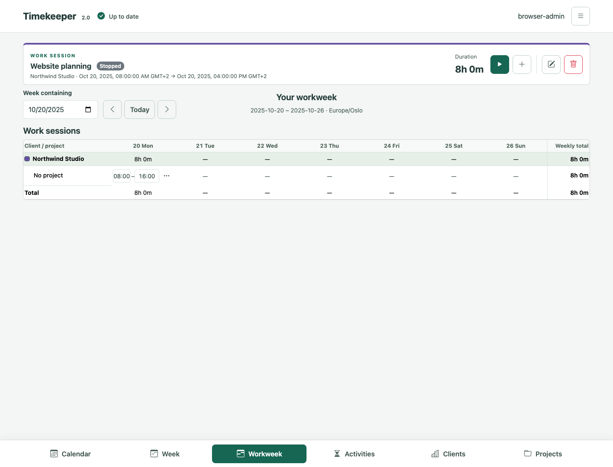

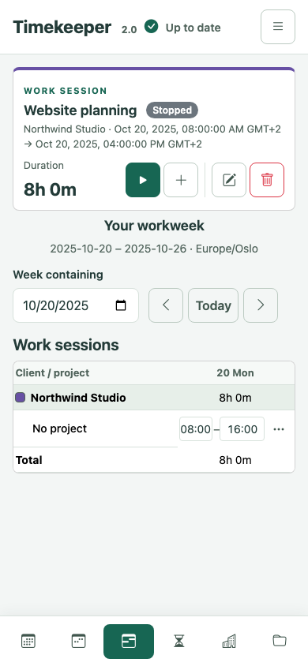

## Today, Week and Calendar

Today combines the daily journal, calendar events and recent notes. Week places
planned calendar time alongside recorded work. Calendar provides day/month
navigation and summaries; select a day or item for its details and available actions.

Dates and totals use the account's time zone. Change it under
**My Account → Profile → Time zone**. An explicitly chosen zone follows the account
across devices; changing browser language does not change it. Public holidays
use a separate country preference.

Calendar feeds can supply events and read-only to-dos without provider sign-in.
Google and Microsoft accounts can provide calendars and tasks through
[Internet accounts](TASK-PROVIDERS.md). Review a proposed import or conversion
before confirming it; a calendar event is not automatically recorded work time.

Calendar screenshots

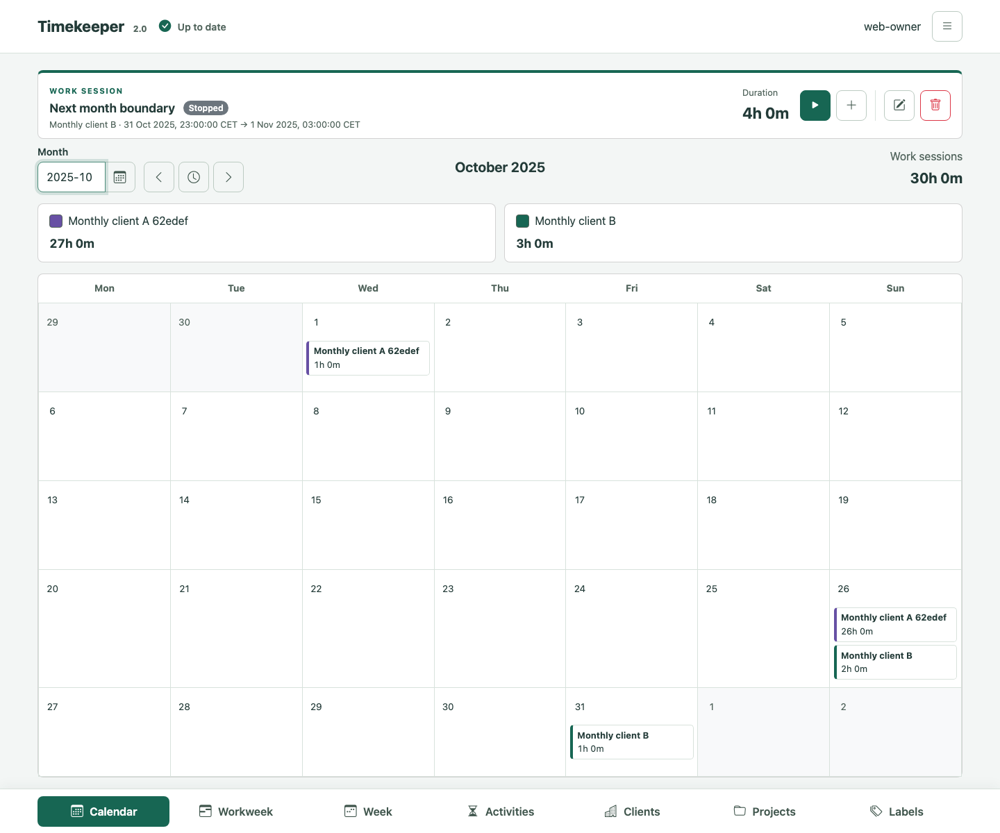

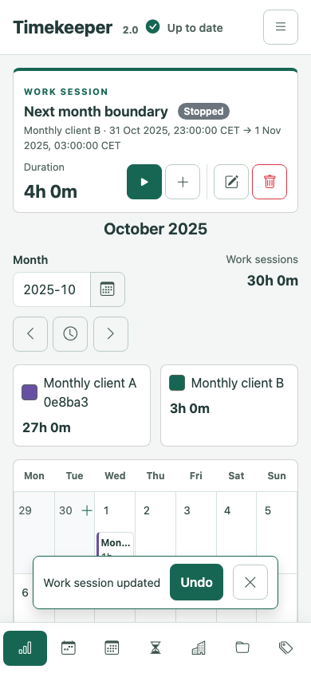

## Tasks and projects

Tasks combines native tasks with published calendar to-dos. Use Today, All,
Time critical, client and category filters to find work. **Hide completed tasks**
is initially enabled. Calendar to-dos remain read-only; native tasks support
editing, completion and activity tracking. Bulk completion reviews the visible
native-task count before writing.

Clients represent customers, not login accounts. Projects group work for a client;
tasks can also have a direct client assignment. A project report opens separately
and uses the account's reporting zone. Google Tasks defaults to import-only;
optional two-way access requires consent and review of outgoing changes.
See [task providers](TASK-PROVIDERS.md) for supported operations and reconnect steps.

## Notes and journals

Use Notes for folders, Markdown documents and attachments. Today edits the daily
journal; Week and calendar details can open related notes. These views share the
same stored document. Opening calendar details alone does not create a note.

The editor supports formatted and source views, links, lists, code and diagrams.
See the [Markdown editor guide](MARKDOWN-EDITOR.md) for shortcuts and supported
syntax. **Open in workspace** saves pending edits before opening the document in
Today or Notes. A failed or conflicting save keeps the draft available for review.

Search covers notes, journals and published event details. Prefix a query with
`note:`, `journal:` or `event:` to narrow it; `file:` searches the filename catalog,
including folders and attachments. Results can stay open while you edit.
[WebDAV](NOTES-WEBDAV.md) provides access from other clients; use a separate API
token for each client and review synchronization conflicts before overwriting files.

Notes screenshot

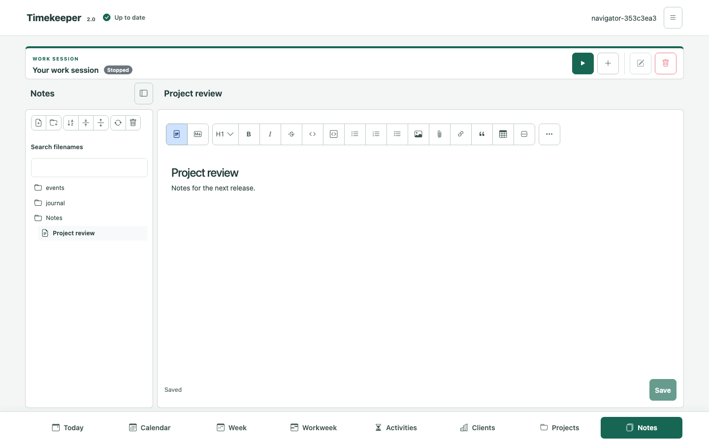

## Account and appearance

The account menu provides Profile, Labels, Internet accounts, Notes, API tokens
and appearance settings. English and Norwegian Bokmål are available. The browser
language is the default; an explicit account choice takes effect after reload.
Themes and typography settings change presentation, not stored Markdown or work data.

Passkeys can sign in and authorize supported account actions. Changing server
settings and running protected backup/restore actions still require the current
administrator password.
Administrators manage access through `/admin/`; their role does not reveal other
users' work records. See [accounts and recovery](ACCOUNTS.md).

Passkey management screenshots

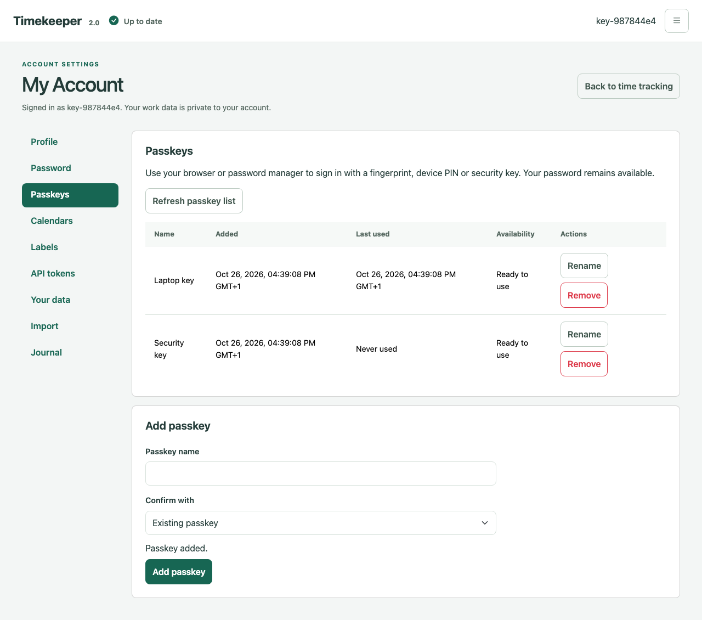

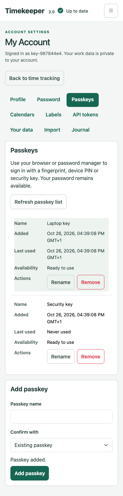

## Import, export and recovery

Use [Toggl Track import](TOGGL-IMPORT.md) to review time entries before applying
an import and to inspect its history or Undo actions. Use
[personal account archives](ACCOUNT-DATA.md) to review and transfer one account's
work. Imports allocate new identities; they do not overwrite a different account.

An account archive is not an installation backup. Administrators use
[full-instance backup and restore](INSTANCE-BACKUP.md) to preserve accounts,
credentials, Notes and installation security material together.

Import and archive screenshots

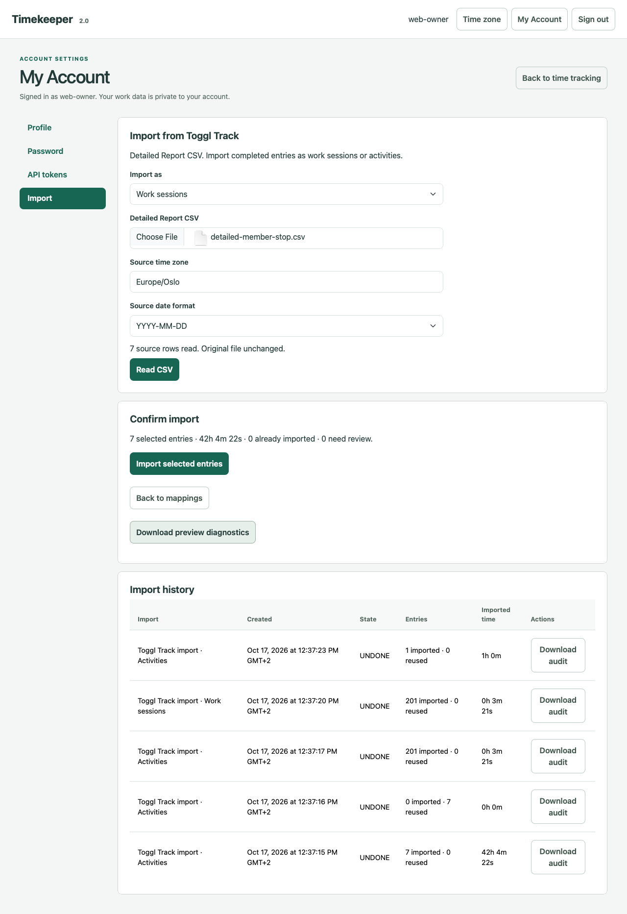

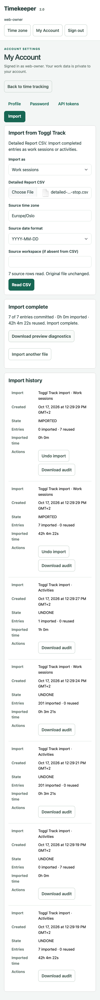

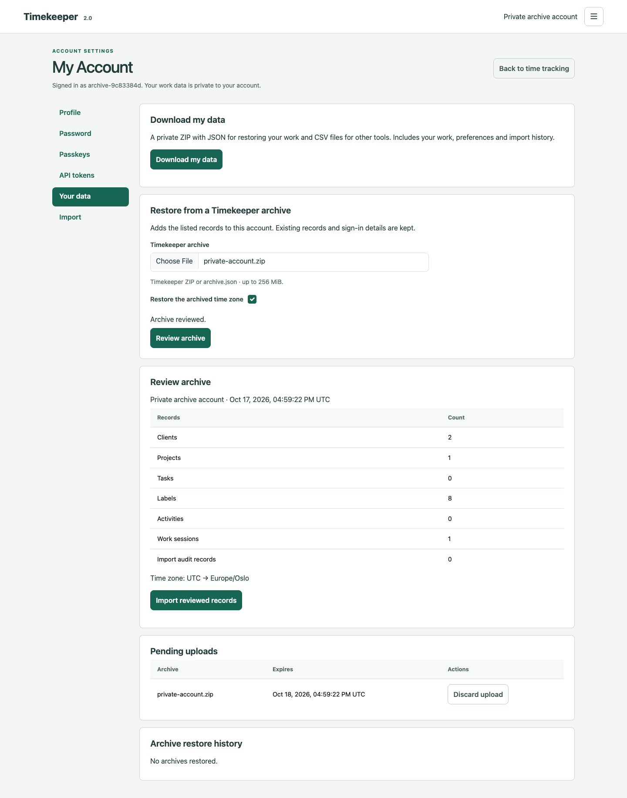

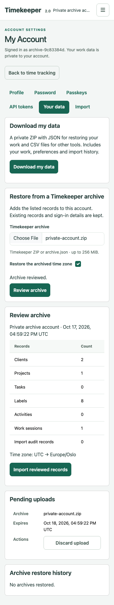

## Synchronization and problems

Clients signed into the same account refresh committed changes automatically.
Read-only access permits inspection but disables writes. If another client changes
an edited record, review the conflict and current values before saving again.
An uncertain response can mean a write committed: inspect the current record or
operation receipt instead of repeating it.

During a connection failure, recoverable drafts remain in the current tab;
Refresh retries synchronization. Sign-out and authorization failures clear local
account data and drafts. Do not use a draft as a backup.

**About** identifies the running server version, source commit, build time,
recorded deployment time and process start. Give that identity to the operator
when reporting a problem. See [API diagnostics](API-DIAGNOSTICS.md) for a read-only
investigation workflow. Browser implementation and test commands are in the
[development guide](../development/WEB-CLIENT.md).
