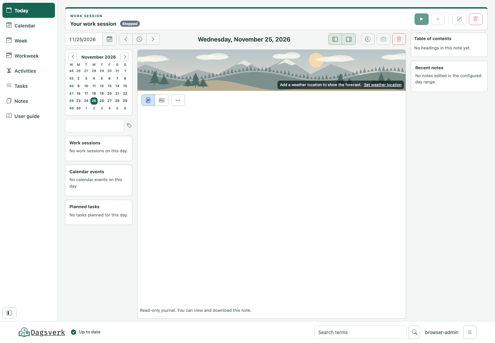

# Use Dagsverk in a desktop browser

Open your Dagsverk server's `/web/` address in a browser and sign in.

## Browser workspace

- **Today** opens your daily journal. Use the mini calendar to browse months,
  open a daily or weekly journal, or return to the current day with **Today**.
  The day overview lists work sessions, calendar events and scheduled tasks.
  Use the table of contents to jump between
  journal headings, or drag the sidebar separators to resize the panels.
- **Calendar** shows monthly work-session totals by client and day. Select a
  daily entry to open its sessions.
- **Week** lets you create, move, resize and copy work sessions. **Workweek**
  groups sessions by client and project and lets you edit times in daily cells.
- **Activities** shows time totals for tasks and projects. Start a timer or add
  time manually, including time without a task.
- **Notes** opens your notebook. Use the folder navigator to find notes and the
  [Markdown editor](MARKDOWN-EDITOR.md) to write them.

Open **My Account** to set your time zone and manage clients, projects and labels.
See the [account and data guides](README.md#account-and-data) for sign-in,
calendar connections, imports and account archives.

