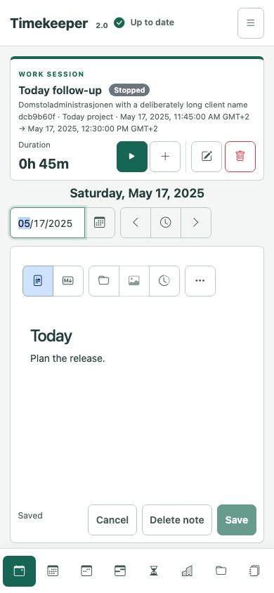

# Use Dagsverk on mobile

Open your Dagsverk server's `/web/` address in your phone browser. Sign in with
the same account you use in the desktop browser to access your work sessions,
tasks, calendar and notes.

- In **Today**, the mini calendar is in the day overview below the journal.
  Tap a date or week number to open its journal, or tap **Today** to return
  to the current day. Open **Main actions** above the journal to show the
  table of contents.
- In **Calendar**, swipe left for the next month or right for the previous
  month. In **Week**, **Workweek** and **Activities**, swipe on the heading
  or another non-scrolling area to change weeks. The date controls also work
  on touch screens.
- In **Calendar**, press and hold a day to add or edit its day note. Tap an
  existing note label to edit it.
- Use the account menu in the header to open **My Account** or sign out. In
  Safari, **Add to Home Screen** creates a shortcut to the web client.

See the [browser workspace overview](DESKTOP.md#browser-workspace) for what
each view does and the [account and data guides](README.md#account-and-data)
for settings, imports and account archives.

